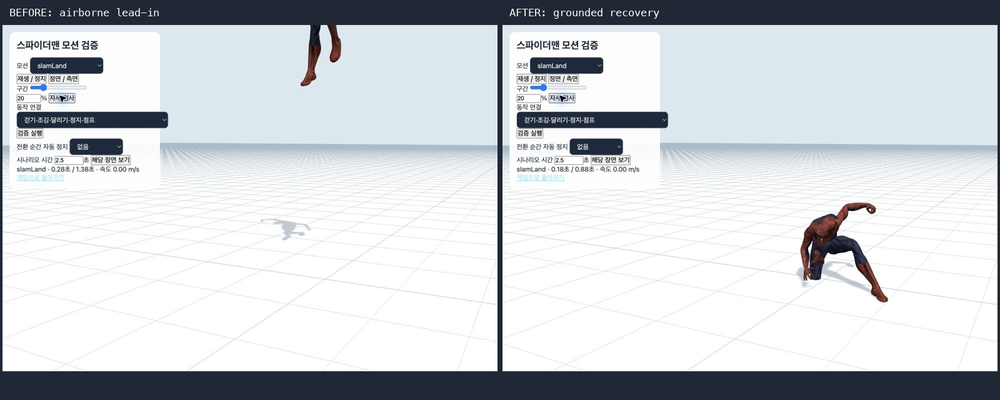

# 전체 모션 수정·검증 — 2026-10-15

실제 캐릭터 리그, 물리 연결, 1인칭 팔, 원격 캐릭터를 대상으로 검사했고 확인된 실행 결함 6종을 수정했습니다. 최신 전수 검사 **249개 그룹 통과 / 실패 0**, 전체 프로젝트 `npm test`와 프로덕션 빌드도 통과했습니다. 아래 수치는 명시한 조건에서 관측한 결과입니다.

## 수정한 실행 결함

| 문제 | 수정 전 재현 | 수정 후 동작·검증 |
|---|---|---|
| 전환 도중 이전 모션으로 돌아갈 때 자세가 튐 | A→B→A 전환에서 시간이 흐르지 않았는데 관절이 최대 약 695mm 이동 | 현재 혼합 자세를 하나의 재사용 스냅샷으로 보존한 뒤 전환. 모든 방향 조합 7,056건의 최대 순간 오차 0.001mm 미만 |
| 장시간 실행한 뒤 다음 전환 시작에서 미세하게 튐 | mixer 시간 65,536.011초에서 전환 시작만으로 12.1mm 이동 | 진행 중인 페이드가 끝난 시점에 mixer 기준 시각만 재설정. 클립 재생 시간은 보존. 동일 재현 오차 0 |
| 1인칭 팔·손목의 계층 오류 | 팔 두 개 사이에 독립 손목 노드가 끼어 오른손 펀치가 올바른 팔을 움직이지 않음 | 각 손목을 해당 팔에 부착. 잽·크로스·훅·헤비·스페셜의 공격 팔, 반대 팔, 장갑과 손목 일치, 복귀 검사 통과 |
| 1인칭 타격 시점 불일치 | 고정된 25% 지점에서만 최대 신전. 60%에서 명중하는 크로스는 이미 복귀한 상태 | 각 클립의 `impactPhase`에서 최대 신전하도록 보간. 5종 공격 모두 실제 타격 시점과 일치 |
| 슈퍼히어로 착지에서 몸이 다시 공중에 뜸 | 이미 땅에 닿은 상태에서 골반이 6.98m까지 올라가는 원본의 공중 진입 부분을 재생 | 접촉 이후 압축·회복 구간만 사용하고 목표 리그에 맞춰 접지 베이크. 회복 중 지지 발목 기준 높이 오차 최대 3.062mm |
| 가슴·머리 피격에서 발이 뜸 | `hit` 약 81.3mm, `hitHead` 약 62.8mm 부양 | 무릎과 몸통의 원본 굽힘을 보존하며 골반 위치를 접지 보정. 실제 업데이트 경로의 지지 발 오차 0.001mm 미만 |

근거: [수정 전 동일 검사](reproduced-before-fixes.log), [팔 계층 수정 후 남아 있던 타격 시점 문제](first-person-impact-before.log), [최종 검사 JSON](all-motion-results.json). 수정 전 소스는 [백업](source-before-review.tar.gz)에 보관했습니다. 독립 임시 작업 디렉터리에 백업 소스를 복원하고 모션을 다시 컴파일했을 때 최종 회귀 검사 44개가 모두 실패했고, 수정본에서는 같은 44개가 모두 통과했습니다.



## 빠짐없이 확인한 범위

| 범위 | 확인 결과 |
|---|---|
| 등록 클립 전체 39개 | 24 / 30 / 60 / 144fps 전 구간 PASS |
| GLB 내장 기본 대체 모션 1개 | 같은 4개 프레임률 전 구간 PASS |
| 보관된 컴파일 후보 2개 | `candidateFront`, `candidateStylish` 전 구간 PASS. 게임 선택 목록에는 추가하지 않음 |
| 총 42클립 × 4fps | 168개 타임라인, 18,943프레임. 유한 좌표, 정규화 회전, 고정된 사지 길이, 자세 범위, 말단 속도 검사 |
| 전체 방향 전환 | 42 × 42 × 4 = 7,056건. 전환 중 원래 동작으로 복귀할 때의 연속성과 완료 후 가중치 검사 |
| 공중 묘기 6종 | 전방·후방·좌·우·스핀·코크. 전체 재생, 중단, 반복, 복귀와 완료 이벤트 검사 |
| 원격 렌더러 | 15종 전투와 6종 공중 묘기를 실제 복제 리그에서 4개 프레임률, 5,387프레임 검사. 원본 리그 변형 없음 |
| 원본 파일 전체 | 28 FBX + 4 GLB = 32파일, 44개 유효 take, 5,476프레임. 빈 take 7개도 명시적 목록에 포함 |
| 벽·난간 | 실제 Rapier 캡슐 이동과 스파이더맨 리그의 벽 오르기→난간 넘기→옥상 접지 검사 통과 |
| 브라우저 시각 확인 | 42클립 각각 20%·70% 총 84장, 물리 연결 장면 45장, 1인칭 7장. 두 검토 화면의 콘솔 경고·오류 0 |

[모션·원본·장면별 전체 목록](INVENTORY.md)에 누락 여부를 확인할 수 있도록 개별 결과와 원본 PNG 링크를 남겼습니다. 자동 검사는 타임라인 전체를 샘플링하고, 시각 확인은 기록된 대표 장면을 대조했습니다.

원본 파일의 7개 `Take 001`은 트랙과 길이가 없는 컨테이너 항목입니다. 유효 모션을 생략한 것이 아니며 [원본 결과](source-coverage.json)에 구분해 기록했습니다. `candidateStylish`는 현재 저장소에 원본 FBX가 없어 보관된 컴파일 트랙을 검사했습니다.

## 검토 도구와 재발 방지

`?motionReview`에 내장 대체 모션과 보관 후보를 표시하고, 공중 묘기 6종의 물리 시나리오를 추가했습니다. 높이 이동이 큰 후보 모션에서도 전신이 잘리지 않도록 골반을 따라 검토 카메라가 이동합니다. `?combatReview`에는 1인칭/3인칭 전환과 헤비 자세 확인을 추가했고, 1인칭 검사가 실제 `Character.update` 경로를 사용하도록 했습니다.

`scripts/check-all-motions.mjs`, `scripts/check-motion-sources.mjs`, 실제 리그 도우미를 추가했습니다. 새 검사를 `npm test`에 연결하고 기존 벽·난간 리그 검사도 함께 실행하도록 했습니다.

컴파일 데이터는 `hit`, `hitHead`, `slamLand` 세 클립과 manifest만 변경했습니다. 다른 36개 등록 클립과 두 보관 후보는 기존 데이터를 유지했습니다. 원본 FBX/GLB는 수정하지 않았습니다. [트랙 변경 목록](compiled-track-changes.json).

## 실행 결과와 재현

```sh
npm test
npm run test:all-motions
npm run build
```

- `npm test`: 전체 46단계 종료 코드 0. [전체 로그](full-tests.log)
- 전수 모션 검사: 249 PASS / 0 FAIL. [결과](all-motion-results.json), [프레임별 커버리지](coverage.json)
- 원본 검사: 32파일 / 44개 유효 take / 5,476프레임 / 실패 0. [결과](source-coverage.json)
- 마지막 검토 카메라 변경 후 `node --check src/MotionReview.js`, `node scripts/check-qa.mjs`, `npm run build` 재확인. [검토 도구 검사](final-reviewer-check.log), [빌드 로그](build.log)
- 소스·모션 해시와 집계: [execution.json](execution.json)

빌드에 기존 대형 청크 안내가 남아 있습니다. 원본 FBX 읽기에는 기존 TGA 텍스처·4개 초과 스킨 가중치 경고가 나오지만, 캐릭터의 컴파일된 모션을 사용하는 두 브라우저 검토 화면에서는 경고·오류가 없었습니다.

## 화면 기록

클립 모음: [1](gallery/contact-sheet-1.jpg) · [2](gallery/contact-sheet-2.jpg) · [3](gallery/contact-sheet-3.jpg) · [4](gallery/contact-sheet-4.jpg) · [5](gallery/contact-sheet-5.jpg)

물리 연결 모음: [1](gallery/runtime-sheet-1.jpg) · [2](gallery/runtime-sheet-2.jpg) · [3](gallery/runtime-sheet-3.jpg). [1인칭 모음](gallery/first-person-sheet-1.jpg).

[클립 화면 목록](gallery/browser-coverage.json), [물리 장면 상태](gallery/runtime-coverage.json), [1인칭 상태](gallery/first-person-coverage.json), [브라우저 콘솔](gallery/browser-logs.json). 원본 화면을 유지하고 `generate-gallery.py`로 모음 이미지만 구성했습니다.

이번 결과는 로컬 최종 소스와 실제 캐릭터 리그에 대한 검증입니다. 원격 캐릭터는 로컬 재현 검사이며, 운영 서버의 새 2인 세션이나 모든 GPU·브라우저·실제 네트워크 조건까지 확인한 결과는 아닙니다. 운영 배포는 수행하지 않았습니다. 명시한 검증 범위에서 남은 실패는 없습니다.
