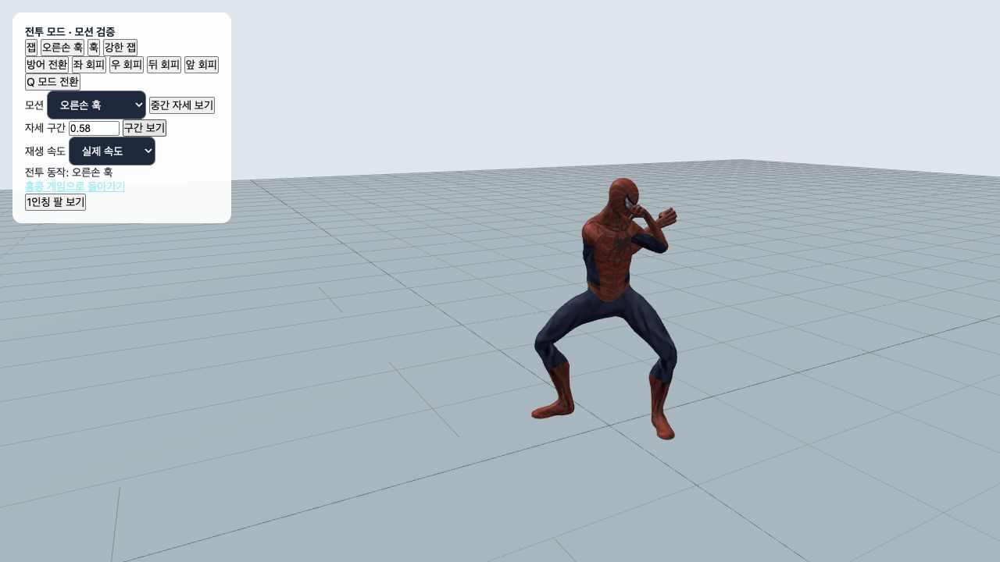
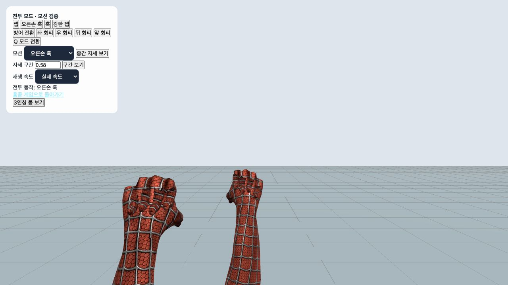
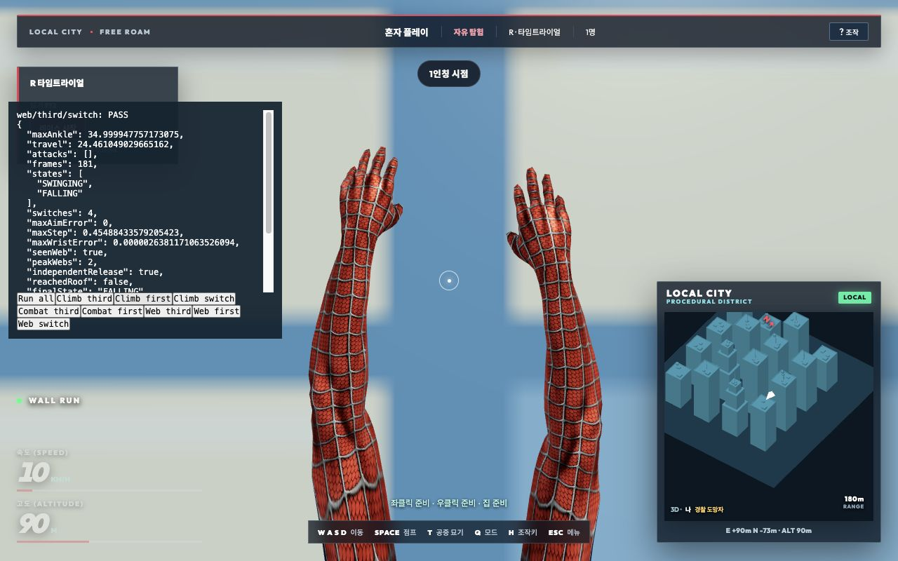

# 발목·1인칭·이동 전투·명중 피드백 수정

2026-10-18. 실제 게임 루프의 로컬 도시 재현과 원본 수트 리그 검사, 로컬 WebSocket 경기의 서버 명중 이벤트를 사용했다.

## 변경

- **벽·전투·옥상 발목**: 원본 모션과 실시간 보정 모두 발목 회전을 바인드 자세 대비 50→35도, 발가락을 30→15도로 제한했다. 공중/벽 자세의 발목 회전도 시간에 따라 제한한다. 벽에서는 발목을 꺾어 밑창 전체를 강제로 밀착시키는 대신 뒤꿈치가 들릴 수 있다. 접촉 위치·관절 정규화·35도 범위를 함께 검사한다.
- **난간 진입 후 발 틀어짐**: 착지 연결에서 발을 옮긴 뒤 발의 월드 회전만 복원하던 경로를 수정했다. `fitGroundAnkle`로 정강이·무릎 방향도 다시 풀고, 최종 접지 보정 뒤에도 관절 범위를 검사한다. 합성 난간 이탈 회귀에서 착지한 발의 월드 방향을 유지한다.
- **기본 이동**: 2.8→4.4m/s, 약 57% 증가. Shift 질주는 6.5m/s다. 이동 애니메이션의 재생 속도는 실제 속도와 연결된다.
- **이동 전투**: 일반 공격 중 이동 입력을 없애던 처리를 제거했다. 움직이는 동안 하체는 보행/달리기 동작을 유지하고 척추·어깨·팔에 공격을 얹는다. 회피의 별도 방향 이동은 유지한다.
- **좌 잽·우 오른손 훅**: 우클릭의 잽 재사용을 별도의 `rightHook` 동작으로 교체했다. 오른쪽 팔꿈치를 굽힌 짧은 궤적과 왼손 가드를 사용하고, 손가락도 주먹으로 만든다. 원격 동기화에는 기존 `cross` 식별자를 유지하고 실제 재생만 오른손 훅으로 연결한다. 서버/DB 스키마 변경은 없다.
- **1인칭**: 벽을 짚는 팔의 높이·각도·뻗기를 줄여 손이 화면 위로 크게 벗어나던 동작을 개선했다. 이동 시 실제 보폭 주기에 맞춘 작은 손 흔들림을 추가했다. 오른손 훅은 3인칭과 같은 타격 시점에 중앙 조준선을 지나며 왼손은 가드를 유지한다.
- **거미줄과 묘기**: 발사/빗나간 발사 때 진행 중 묘기를 취소하고, 발사 동작 또는 부착이 남아 있으면 새 묘기를 시작하지 않는다. 줄을 놓은 뒤 충분한 높이에서는 T 묘기를 계속 사용할 수 있다.

## 경찰과 도망자 명중 기준과 표시

서버의 기존 피해 규칙을 유지했다. 거미줄은 수평 22m, 높이 차 8m 미만, 정면 내적 0.84 이상(약 ±32.9도), 재사용 1.6초, 피해 15다. 주먹은 2.6m, 높이 차 2.2m 미만, 정면 내적 0.65 이상, 재사용 0.56초, 피해 25다. 시작 후 8초 보호와 지형 가림 검사도 계속 적용한다.

화면에 정면 대상 이름·거리·가림·재사용·시작 보호를 표시한다. 발사 예상은 '서버 판정 중'으로 구분하고, 서버가 보낸 실제 `hit` 이벤트에서만 중앙 명중 표식·효과음·타격 효과·피해량·남은 HP를 표시한다. 응답이 늦으면 '아직 명중 확인 없음'이라고 안내하며 이를 확정 실패로 표시하지 않는다. 조준선 가까이의 상대에게 발사할 때는 이동용 부착을 추가하지 않고 같은 손의 단발 거미줄을 표시한다.

## 검증

최종 실제 플레이 8종 모두 통과, 총 1,714프레임. 양 시점의 이동 잽→훅에서 각각 약 7.17m 이동했고, 벽·난간·전투의 최종 발목 각도는 35도 이내였다. 브라우저 경고·오류는 없었다.

- `npm test`: 전체 51단계 성공. [로그](full-tests.log).
- `npm run build`: 성공. [로그](build.log). 기존 대형 번들 경고는 남아 있다.
- 새 회귀: 24/60/144 FPS에서 이동 중 잽/오른손 훅, 관절 범위, 오른팔 사용 및 팔꿈치 굽힘, 1인칭 타격 시점/조준선, 발사 중 묘기 배제, 시작 보호/쿨다운, 서버 확인 전 명중음 금지. [결과](regression-results.json).
- 실제 WebSocket 경기: 거미줄 명중 패킷을 실제 클라이언트 메시지 처리기에 전달해 HP 85, 피해 15, 명중음 1회, 타격 효과 1회를 확인한다. 범위·방향·시작 보호·중복 타격·벽 가림의 기존 회귀도 포함한다.
- 실제 GameApp: `?city=procedural&traversalPlaytest`에서 Ready 후 Run all. 양 시점 벽→난간→옥상 3종, 이동 잽→오른손 훅 2종, 양손 거미줄/독립 해제/시점 교대 3종. [실제 플레이 결과](live-results.json), [브라우저 오류 기록](browser-logs.json).
- 밑창·발목·경사·질주·옥상 연결 검사 71건과 1인칭 손 검사 41건을 포함한다. 더 엄격한 발목 범위에서 생긴 접지 전환의 작은 차이를 위해 회전율 허용 오차를 0.08rad/s(30Hz에서 약 0.15도/프레임)로 두되 밑창 관통·뜸과 관절 범위 검사는 유지했다. 이동 속도가 올라 계단 끝을 지나가는 검사는 마지막 높이 대신 모든 단을 올라간 최대 높이를 검사한다.

브라우저 시각 검증은 로컬 도시와 실제 캐릭터를 대상으로 했다. 운영 Supabase 다중 접속이나 홍콩 지도 전체를 새로 전수 검수한 기록은 아니다. 온라인 피드백은 양쪽 전송 방식에서 공유하는 실제 메시지 처리 경로를 검증했다.

