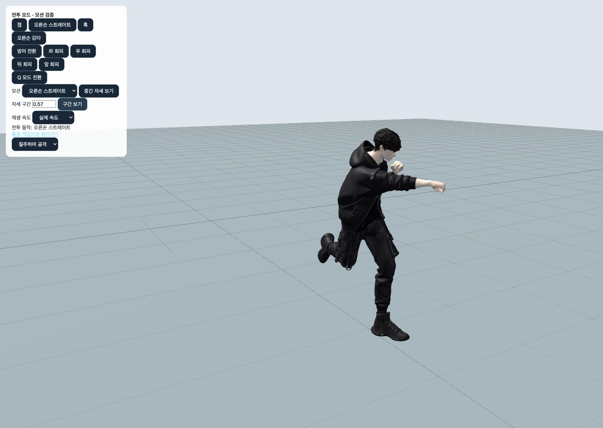
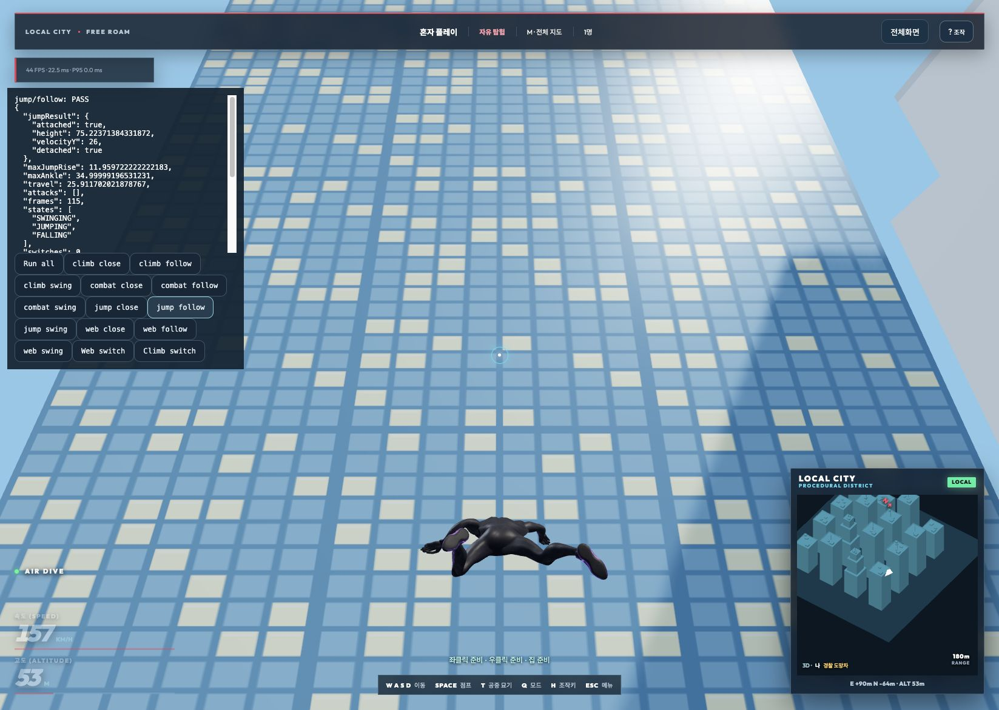

# 1인칭 제거 및 전체 모션 검증 — 2026-10-19

등록된 런타임 모션 33개를 빠짐없이 검사했다. 두 외형의 원본 모션 15%·45%·80% 구간을 실제 WebGL 렌더로 검토했고, 별도로 런타임 접지·관절 보정·전투 합성과 실게임 입력 경로를 검사했다. 이 문서는 과거 1인칭 검토 기록을 대신하는 현재 3인칭 기준 결과다.

## 변경 내용

- 1인칭 카메라·팔 리그·전용 포즈·전환 UI·검수 화면 분기를 제거했다. V 키는 close → follow → swing 세 시점만 순환한다.
- 매달린 상태의 Space가 양손 연결을 해제하고 상승 속도를 최소 26m/s로 보장한다. 수평 운동량은 유지한다.
- 이동 중 공격은 상체에 합성하고 골반 회전에 반대 보정을 적용해 하체 보행이 따라 비틀리지 않게 했다. 공격 사이 가드에서도 주먹을 유지한다.
- 펀치 손목을 전완 방향에 맞추고, 외형의 팔·몸통 경계 가중치와 소매/손가락 바인딩을 수정했다. 소매가 뾰족하게 늘어나거나 손가락이 갈고리처럼 꺾이던 변형을 줄였다.
- 지지면보다 높아진 발의 잘못된 접지를 해제한다. 발바닥 보정과 관절 제한을 모두 적용한 최종 발목 회전을 다음 프레임의 출발점으로 저장해 경사면 질주에서 회전이 튀는 현상을 수정했다.

## 결과 및 재현

- 자동 검사: 40/40 묶음 통과, 40개 완료. 개별 결과: [suite-results.json](suite-results.json).
- 최신 전체 검사에서는 소스 해시 고정을 확인했다. [추가 수정·확장 검사와 최신 실게임 결과](../expanded-motion-2026-10-19/README.md)를 함께 참고한다.
- 실제 GameApp: 14/14 조건 통과. [game-results.json](game-results.json). 세 시점에서 매달리기 점프, 이동 공격, 벽→옥상, 양손 연결/독립 해제, 등반·스윙 중 시점 전환을 실행했다.
- 전체 모션 타임라인: 등록 모션 16,946 리그 프레임(24/30/60/144fps). 별도 보관 후보 2개를 포함하면 17,938프레임. [전체 타임라인 결과](../all-motions-2026-10-15/all-motion-results.json).
- 두 외형 전체 스킨: 66 조합 × 13 구간 = 858 자세. 유한 좌표·크기·삼각형 늘어남 검사. 실패 0개. [appearance-motion-results.json](appearance-motion-results.json).
- 모션 전환: 1,089쌍, 3,267케이스, 77,319프레임. 일부는 게임에서 도달하지 않는 조합도 포함한다. [전환 기록](../motion-quality-2026-10-13/transitions.json).
- 달리기/질주 × 잽/크로스/강타: 6조합. 최대 손목 꺾임 12.000°, 최대 메시 엣지 증가 10.76cm. [측정 기록](../moving-combat-2026-10-19/skin-results.json).
- 보행·와이어 회귀: 71개 중 71개 통과. 접지한 부츠 최대 틈 6.71mm. [보행 기록](../silk-gait-2026-10-15/results.json).
- `npm run build` 성공. 번들 크기 안내가 있으며 빌드 오류는 없다.

```sh
node scripts/run-motion-audit.mjs
npm run build
npm run dev
```

개발 서버에서 `?city=procedural&traversalPlaytest`의 Run all로 실게임 14조건을 실행한다. `?motionAuditReview`는 전체 모션/두 외형/세 구간의 렌더를 보여준다. `?combatReview`의 이동 속도로 달리기·질주 공격을 확인한다. 검수 화면은 개발 전용이다.

## 실게임 결과

| 조건 | 통과 | 핵심 측정 |
|---|---|---|
| climb/close | PASS | 옥상 도달 |
| climb/follow | PASS | 옥상 도달 |
| climb/swing | PASS | 옥상 도달 |
| combat/close | PASS | 공격 jab, cross, 이동 7.17m |
| combat/follow | PASS | 공격 jab, cross, 이동 7.17m |
| combat/swing | PASS | 공격 jab, cross, 이동 7.21m |
| jump/close | PASS | 상승 11.962m, 위 속도 26m/s, 양손 해제 |
| jump/follow | PASS | 상승 11.962m, 위 속도 26m/s, 양손 해제 |
| jump/swing | PASS | 상승 11.962m, 위 속도 26m/s, 양손 해제 |
| web/close | PASS | 최대 연결 2, 독립 해제 True |
| web/follow | PASS | 최대 연결 2, 독립 해제 True |
| web/swing | PASS | 최대 연결 2, 독립 해제 True |
| web/follow/switch | PASS | 최대 연결 2, 독립 해제 True, 시점 전환 4회 / 조준 오차 0 |
| climb/follow/switch | PASS | 옥상 도달, 시점 전환 6회 / 조준 오차 0 |

## 모션별 누락 점검

모든 행은 4개 프레임률의 전체 타임라인, 두 외형 각각 13개 전체 스킨 구간, 두 외형 각각 3개 렌더 구간을 포함한다. 표의 엣지 증가값은 바인드 자세 대비 삼각형 변 길이 최대 증가로, 충돌/미끄러짐 수치와는 별개다.

| 모션 | 루프 | 타임라인 프레임 | 사람 외형 엣지 증가 | 변신 외형 엣지 증가 | 시각 검토 |
|---|---|---:|---:|---:|---|
| idle | 예 | 1036 | 4.82cm | 2.14cm | [사람](gallery/combat-front-1.jpg) · [변신](gallery/web-front-1.jpg) |
| walk | 예 | 255 | 5.55cm | 2.47cm | [사람](gallery/combat-front-1.jpg) · [변신](gallery/web-front-1.jpg) |
| regularRun | 예 | 185 | 6.58cm | 3.36cm | [사람](gallery/combat-front-1.jpg) · [변신](gallery/web-front-1.jpg) |
| run | 예 | 144 | 11.15cm | 4.88cm | [사람](gallery/combat-front-2.jpg) · [변신](gallery/web-front-2.jpg) |
| stop | 아니오 | 65 | 4.80cm | 2.13cm | [사람](gallery/combat-front-2.jpg) · [변신](gallery/web-front-2.jpg) |
| runStop | 아니오 | 237 | 6.56cm | 2.93cm | [사람](gallery/combat-front-2.jpg) · [변신](gallery/web-front-2.jpg) |
| zip | 예 | 262 | 6.64cm | 4.77cm | [사람](gallery/combat-front-3.jpg) · [변신](gallery/web-front-3.jpg) |
| turnLeft | 아니오 | 248 | 6.24cm | 3.06cm | [사람](gallery/combat-front-3.jpg) · [변신](gallery/web-front-3.jpg) |
| turnRight | 아니오 | 248 | 6.03cm | 2.92cm | [사람](gallery/combat-front-3.jpg) · [변신](gallery/web-front-3.jpg) |
| jump | 아니오 | 160 | 4.90cm | 3.07cm | [사람](gallery/combat-front-4.jpg) · [변신](gallery/web-front-4.jpg) |
| land | 아니오 | 230 | 6.57cm | 3.04cm | [사람](gallery/combat-front-4.jpg) · [변신](gallery/web-front-4.jpg) |
| jumpDown | 아니오 | 599 | 10.47cm | 7.75cm | [사람](gallery/combat-front-4.jpg) · [변신](gallery/web-front-4.jpg) |
| drop | 아니오 | 142 | 10.82cm | 7.95cm | [사람](gallery/combat-front-5.jpg) · [변신](gallery/web-front-5.jpg) |
| jumpDownVariant | 아니오 | 687 | 10.21cm | 6.96cm | [사람](gallery/combat-front-5.jpg) · [변신](gallery/web-front-5.jpg) |
| swing | 예 | 510 | 8.37cm | 7.14cm | [사람](gallery/combat-front-5.jpg) · [변신](gallery/web-front-5.jpg) |
| fall | 예 | 1165 | 12.18cm | 5.57cm | [사람](gallery/combat-front-6.jpg) · [변신](gallery/web-front-6.jpg) |
| fallVariant | 예 | 1165 | 12.18cm | 5.57cm | [사람](gallery/combat-front-6.jpg) · [변신](gallery/web-front-6.jpg) |
| fallIdle | 예 | 1165 | 12.18cm | 5.57cm | [사람](gallery/combat-front-6.jpg) · [변신](gallery/web-front-6.jpg) |
| roll | 아니오 | 405 | 9.16cm | 5.23cm | [사람](gallery/combat-front-7.jpg) · [변신](gallery/web-front-7.jpg) |
| injuredIdle | 예 | 2412 | 3.10cm | 1.67cm | [사람](gallery/combat-front-7.jpg) · [변신](gallery/web-front-7.jpg) |
| wall | 예 | 520 | 12.32cm | 8.93cm | [사람](gallery/combat-front-7.jpg) · [변신](gallery/web-front-7.jpg) |
| combatIdle | 예 | 1142 | 6.57cm | 4.43cm | [사람](gallery/combat-front-8.jpg) · [변신](gallery/web-front-8.jpg) |
| jab | 아니오 | 352 | 8.71cm | 3.99cm | [사람](gallery/combat-front-8.jpg) · [변신](gallery/web-front-8.jpg) |
| guard | 예 | 520 | 5.08cm | 4.06cm | [사람](gallery/combat-front-8.jpg) · [변신](gallery/web-front-8.jpg) |
| slam | 아니오 | 704 | 12.02cm | 5.57cm | [사람](gallery/combat-front-9.jpg) · [변신](gallery/web-front-9.jpg) |
| slamLand | 아니오 | 235 | 12.64cm | 5.72cm | [사람](gallery/combat-front-9.jpg) · [변신](gallery/web-front-9.jpg) |
| hook | 아니오 | 366 | 9.00cm | 4.19cm | [사람](gallery/combat-front-9.jpg) · [변신](gallery/web-front-9.jpg) |
| heavy | 아니오 | 366 | 9.00cm | 4.19cm | [사람](gallery/combat-front-10.jpg) · [변신](gallery/web-front-10.jpg) |
| hitHead | 아니오 | 147 | 5.35cm | 2.34cm | [사람](gallery/combat-front-10.jpg) · [변신](gallery/web-front-10.jpg) |
| rightHook | 아니오 | 181 | 8.04cm | 7.62cm | [사람](gallery/combat-front-10.jpg) · [변신](gallery/web-front-10.jpg) |
| cross | 아니오 | 377 | 7.90cm | 6.87cm | [사람](gallery/combat-front-11.jpg) · [변신](gallery/web-front-11.jpg) |
| airTrick | 아니오 | 246 | 8.89cm | 6.38cm | [사람](gallery/combat-front-11.jpg) · [변신](gallery/web-front-11.jpg) |
| special | 아니오 | 470 | 7.71cm | 7.01cm | [사람](gallery/combat-front-11.jpg) · [변신](gallery/web-front-11.jpg) |

## 분야별 판정 기준

| 분야 | 검사와 판단 범위 |
|---|---|
| 관절·해부학 | 손목/발목/발가락 제한, 뼈 길이 보존, 무릎 잠김, 쿼터니언 정규화·유한값 |
| 접지·이동 | 평지·5종 경사 조합·계단·옥상 전환에서 실제 부츠 정점 관통, 발끝 높이, 접지 오차와 미끄러짐, 발목 각속도 |
| 전투 | 제자리/달리기/질주, 가드·회피·피격·착지, 타격 시점, 이동 방향·조준, 공격 중단·연속 입력, 상하체 합성 |
| 공중·와이어 | 점프·낙하·묘기·양손 스윙·집, 전환/해제, 줄 시작점과 손의 일치, 수직 통과 시 줄 뒤집힘 |
| 벽·지형 | 벽 손발 접촉·교대, 등반→맨틀→지면, 실제 충돌 캡슐·경사·계단 연결 |
| 시간·연속성 | 24/30/60/144fps, 반복 경계, 모든 등록 모션 쌍 전환, 인터럽트, 부드러운 보정 해제 |
| 입력·카메라·원격 | 세 3인칭 모드와 전환, 키보드/마우스/게임패드 이벤트 경로, 포커스·메뉴 수명, 원격 포즈와 줄 소유권 |
| 메시 | 두 업로드 외형 전체 정점 검사, 팔·몸통 경계·소매·주먹·부츠의 시각적 변형 |
| 준비·타이밍·호·후속 동작 | 원본 모션 세 구간과 런타임 공격을 시각 검토. 힘의 물리량/인간 평가 점수를 정량 인증한 것은 아님 |
| 실루엣·균형·무게감·보조 동작 | 렌더와 동작 전환을 시각 검토. 질량 중심/근육/의복을 물리 시뮬레이션하지 않으므로 실제 인체와 완전히 같다는 의미는 아님 |
| 과장·압축/신장·형태 일관성 | 뼈 길이를 보존하는 게임 리그의 특성에 맞춰 검토. 애니메이션 원칙의 모든 예술적 항목을 자동 합격 수치로 바꾸지 않음 |

## 캡처와 검증 한계





현재 검사 행렬에서 확인된 오류를 수정하고 재검증했다. 유한한 테스트로 모든 입력 순서·모든 지형·모든 기기·무한한 조합과 주관적 자연스러움의 100% 완벽함을 증명할 수는 없다. 44년 경력 전문가가 직접 인증했다는 뜻도 아니다. 원본 모션 연락표는 IK 없는 렌더이므로 그 화면만으로 접지를 판정하지 않았고, 접지·관절·실게임은 별도 런타임 검사 결과를 근거로 한다.
