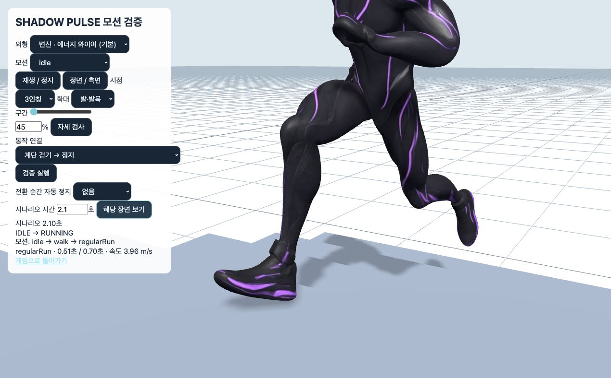
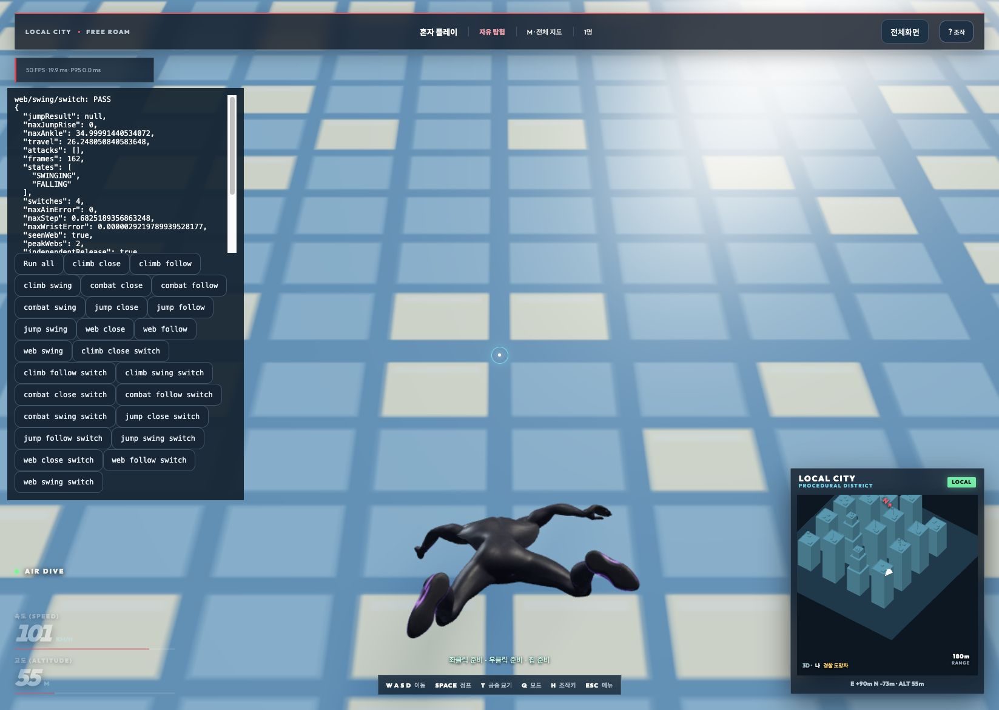

# 입력·지형·카메라·전체 모션 확장 검증

최종 검증: 2026-10-20 (Asia/Seoul). 10월 19일 시작한 검증을 이어서 수행했으므로 증거 폴더명은 시작 날짜를 유지한다.

계단 발끝 관통, 접지 해제 시 발 자세 튐, 계단 충돌로 인한 걷기/달리기 반복 전환을 수정했다. 실제 GameApp 복합 동작과 별도의 실제 충돌 캡슐+캐릭터 리그 검사, 두 외형 전체 모션의 WebGL 재생을 구분해 검증했다.

## 발견과 수정

- 계단의 측면에서 발목은 단 밖에 있고 발끝만 높은 단 안에 있는 경우, 발목 지지면이 없다는 이유로 부츠 전체 검사를 건너뛰었다. 발끝과 부츠 윤곽의 지지면도 확인하도록 변경했다. 초기 기록에는 발끝이 단 위 표면보다 17.3cm 낮아지는 재현 사례가 있다.
- 지지면 탐색 높이와 범위를 맞추고, 이동 방향의 다음 단을 미리 확인해 발이 모서리를 넘기 전에 들어 올리도록 했다. 접지가 사라져도 보정 자세를 즉시 버리지 않고 해제한다.
- 지면에서 점프/낙하로 바뀔 때 발 자세를 몸 기준으로 0.14초 동안 부드럽게 풀어 준다. 물리 속도와 점프 입력에는 지연을 추가하지 않는다.
- 계단 충돌로 속도가 3.1m/s 주변을 왕복하면 걷기/달리기 클립이 매 프레임 바뀌었다. 진입/이탈 속도를 분리하고 0.12초 유지 조건을 추가했다. 실제 감속·가속은 정상 전환하며 한 프레임의 충돌 감속으로는 바뀌지 않는다.
- 발목 보정은 관절 제한과 발바닥 보정을 끝낸 최종 자세를 다음 프레임의 시작점으로 사용한다.
- 검수 화면에 등록된 33개 모션을 처음부터 끝까지 순차 재생하고 프레임 수·유한값·15/45/80% 캡처를 기록하는 개발 전용 기능을 추가했다.

초기 검사에는 점프의 정상적인 루트 이동과 낙하 후 의도된 리스폰까지 발의 순간 이동으로 세는 오류도 있었다. 해당 검사는 몸 기준 발 이동을 측정하고 명시적 리스폰 프레임을 따로 기록하도록 고쳤다. 초기 실패 전체를 게임 버그 개수로 계산하지 않았다. [초기 지형 기록](terrain-before.json).

## 최종 결과

| 검사 | 결과 | 범위 |
|---|---|---|
| 입력·카메라 | 526/526 PASS | 세 장치 동시 소유·6가지 해제 순서, 양손 줄/점프/재발사, 반대 방향 16조합, 모든 시점 쌍·프레임률·피치·장애물 조합 |
| 실제 지형+리그 | 64/64 PASS | 8종 지형 × 24/30/60/144fps × 급반전/질주·타격·점프, 총 10,752프레임 |
| 보행 전환 회귀 | 4/4 PASS | 임계 속도 반복, 지속 감속·가속, 한 프레임 충돌 감속 |
| 실제 GameApp | 24/24 PASS | 등반·옥상, 이동 공격·점프, 매달리기 점프, 양손 독립 해제, 각 동작 중 3개 시점 순환 |
| 기존 모션 검사 | 40/40 묶음 PASS | 전체 타임라인·전환·스킨·접지·손목·양손 줄·입력 수명·원격 모션 등 기존 검사 재실행 |
| 전체 WebGL 재생 | 33개 × 두 외형 PASS | 7,643 렌더 프레임, 모든 take의 전체 길이를 재생하고 198개 구간 캡처 직접 검토 |
| 프로덕션 빌드 | PASS | npm run build, 번들 크기 안내 외 빌드 오류 없음 |

지형 검사 전체에서 발끝의 최소 지지면 여유는 3.000mm였다. 4회의 의도된 낙하 리스폰을 별도로 기록했다. 보행 임계 속도 반복 검사에서는 수정 전 2초 동안 48/60/120/288회 전환되던 것이 수정 후 모두 0회가 되었다. [수정 전](gait-before.log).

검사 결과: [입력·카메라](input-camera-results.json), [지형·리그](terrain-motion-results.json), [보행 전환](gait-stability-results.json), [실게임](game-results.json), [기존 40묶음](../complete-motion-2026-10-19/suite-results.json), [검사 중 소스 고정 확인](../complete-motion-2026-10-19/source-integrity.json), [빌드](build.log).

커밋 대상 코드만 모은 별도 복사본에서도 입력·카메라 526조건, 보행 전환 4조건, 프로덕션 빌드가 통과했다. 지형 검사의 로컬 의존 파일 21개도 검증한 작업트리와 일치한다. [복사본 검증 기록](commit-snapshot-validation.json).

## 모션별 직접 확인

두 외형 모두 각 모션의 전체 길이를 실제 WebGL에서 재생했다. 다음 표는 각 모션의 재생 프레임 수와 직접 확인한 측면 캡처다. 원본 클립 재생 화면의 접지와 주먹 자세는 게임의 IK/전투 합성이 적용된 결과와 다를 수 있으므로, 접지·공격·전환은 별도의 런타임 검사와 실게임에서 판정했다.

| 모션 | 사람 재생 프레임 | 변신 재생 프레임 | 측면 직접 검토 |
|---|---:|---:|---|
| idle | 238 | 230 | [사람](gallery/combat-side-1.jpg) · [변신](gallery/web-side-1.jpg) |
| walk | 55 | 60 | [사람](gallery/combat-side-1.jpg) · [변신](gallery/web-side-1.jpg) |
| regularRun | 42 | 41 | [사람](gallery/combat-side-1.jpg) · [변신](gallery/web-side-1.jpg) |
| run | 33 | 33 | [사람](gallery/combat-side-2.jpg) · [변신](gallery/web-side-2.jpg) |
| stop | 15 | 16 | [사람](gallery/combat-side-2.jpg) · [변신](gallery/web-side-2.jpg) |
| runStop | 55 | 54 | [사람](gallery/combat-side-2.jpg) · [변신](gallery/web-side-2.jpg) |
| zip | 61 | 58 | [사람](gallery/combat-side-3.jpg) · [변신](gallery/web-side-3.jpg) |
| turnLeft | 57 | 57 | [사람](gallery/combat-side-3.jpg) · [변신](gallery/web-side-3.jpg) |
| turnRight | 54 | 57 | [사람](gallery/combat-side-3.jpg) · [변신](gallery/web-side-3.jpg) |
| jump | 35 | 37 | [사람](gallery/combat-side-4.jpg) · [변신](gallery/web-side-4.jpg) |
| land | 51 | 53 | [사람](gallery/combat-side-4.jpg) · [변신](gallery/web-side-4.jpg) |
| jumpDown | 139 | 140 | [사람](gallery/combat-side-4.jpg) · [변신](gallery/web-side-4.jpg) |
| drop | 34 | 33 | [사람](gallery/combat-side-5.jpg) · [변신](gallery/web-side-5.jpg) |
| jumpDownVariant | 159 | 158 | [사람](gallery/combat-side-5.jpg) · [변신](gallery/web-side-5.jpg) |
| swing | 114 | 119 | [사람](gallery/combat-side-5.jpg) · [변신](gallery/web-side-5.jpg) |
| fall | 271 | 271 | [사람](gallery/combat-side-6.jpg) · [변신](gallery/web-side-6.jpg) |
| fallVariant | 271 | 252 | [사람](gallery/combat-side-6.jpg) · [변신](gallery/web-side-6.jpg) |
| fallIdle | 271 | 261 | [사람](gallery/combat-side-6.jpg) · [변신](gallery/web-side-6.jpg) |
| roll | 94 | 94 | [사람](gallery/combat-side-7.jpg) · [변신](gallery/web-side-7.jpg) |
| injuredIdle | 561 | 559 | [사람](gallery/combat-side-7.jpg) · [변신](gallery/web-side-7.jpg) |
| wall | 121 | 121 | [사람](gallery/combat-side-7.jpg) · [변신](gallery/web-side-7.jpg) |
| combatIdle | 249 | 265 | [사람](gallery/combat-side-8.jpg) · [변신](gallery/web-side-8.jpg) |
| jab | 75 | 81 | [사람](gallery/combat-side-8.jpg) · [변신](gallery/web-side-8.jpg) |
| guard | 120 | 117 | [사람](gallery/combat-side-8.jpg) · [변신](gallery/web-side-8.jpg) |
| slam | 156 | 164 | [사람](gallery/combat-side-9.jpg) · [변신](gallery/web-side-9.jpg) |
| slamLand | 48 | 54 | [사람](gallery/combat-side-9.jpg) · [변신](gallery/web-side-9.jpg) |
| hook | 45 | 85 | [사람](gallery/combat-side-9.jpg) · [변신](gallery/web-side-9.jpg) |
| heavy | 65 | 85 | [사람](gallery/combat-side-10.jpg) · [변신](gallery/web-side-10.jpg) |
| hitHead | 30 | 34 | [사람](gallery/combat-side-10.jpg) · [변신](gallery/web-side-10.jpg) |
| rightHook | 39 | 42 | [사람](gallery/combat-side-10.jpg) · [변신](gallery/web-side-10.jpg) |
| cross | 84 | 81 | [사람](gallery/combat-side-11.jpg) · [변신](gallery/web-side-11.jpg) |
| airTrick | 45 | 48 | [사람](gallery/combat-side-11.jpg) · [변신](gallery/web-side-11.jpg) |
| special | 106 | 90 | [사람](gallery/combat-side-11.jpg) · [변신](gallery/web-side-11.jpg) |

전체 재생 기록: [사람 외형](playback-combat.json), [변신 외형](playback-web.json).

## 지형 및 재현

지형: 평지, 대각 경사면, 경사면 가장자리, 계단 오르기, 계단 내려가기, 낮은 천장, 좁은 모서리, 바닥이 없는 옥상 가장자리. 각 지형에서 대각 이동 후 반전하거나 질주 중 잽·스트레이트 후 점프하면서 카메라를 주기적으로 전환한다. 실제 Rapier 삼각형 충돌과 런타임 캐릭터 리그를 사용한다.

```sh
npm run test:expanded-motion
npm run test:complete-motion
npm run build
npm run dev
```

실게임: `?city=procedural&traversalPlaytest` → Run all. 전체 모션: `?motionAuditReview` → 외형·시점 선택 → 전체 구간 재생 검증. 지형 확대 검토: `?motionReview` → 계단/경사면 → 해당 장면 보기 → 발·발목 확대.

## 증거 화면





이 결과는 위에 명시한 재현 가능한 검사 범위에 대한 통과다. 모든 가능한 장치·입력 순서·외부 도시 데이터·지형·사용자 취향을 무한히 열거했다는 의미는 아니다.
