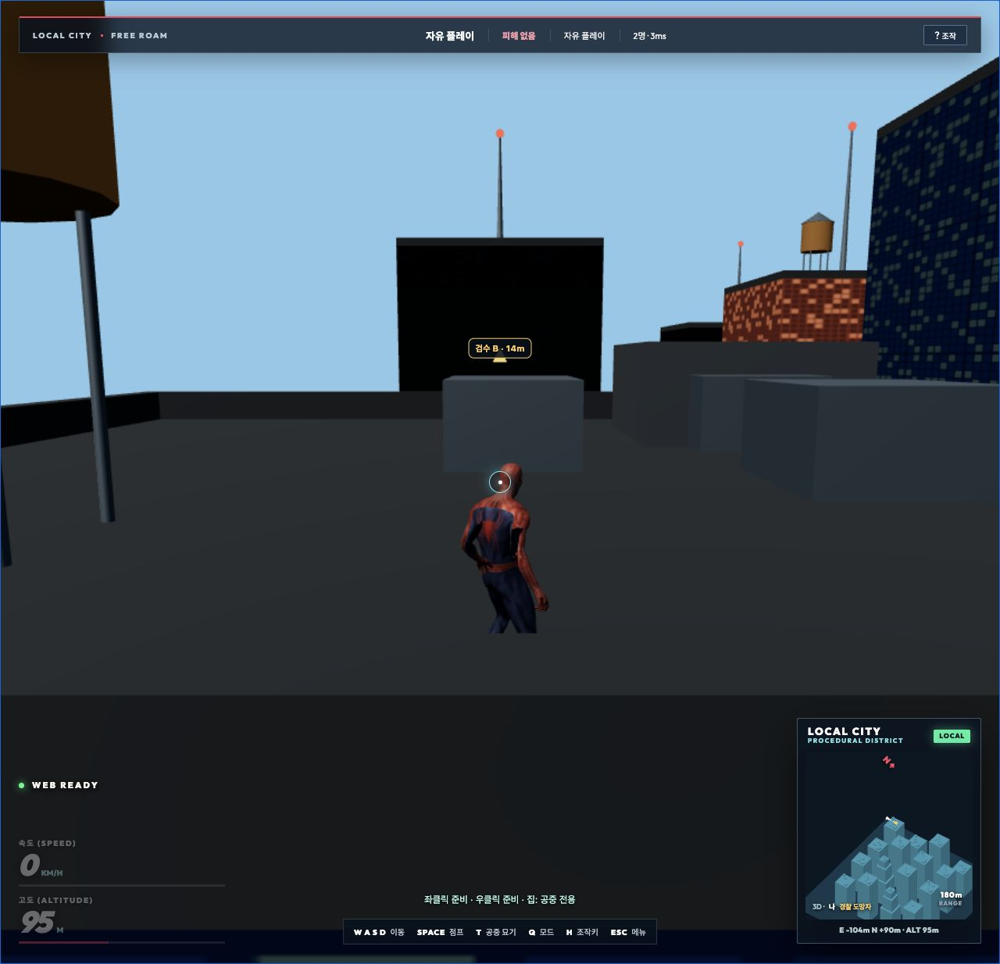

# 전체 게임 분야별 점검·검증·수정 — 2026-10-14

숙련 게임 개발·QA 관점으로 현재 실행되는 게임의 주요 요소를 33개 분야로 나누어 점검했다. 이번 작업 전부터 남아 있던 소스 수정은 보존했다. 결과는 아래 실행·재현·코드 검토 범위에 대한 판정이며, 모든 장치·지형·네트워크 상황에서 결함이 없다는 의미는 아니다.

## 이번에 확인하고 수정한 문제

| 문제 | 원인과 영향 | 수정·검증 |
|---|---|---|
| 로컬 지도와 DB 충돌 데이터 불일치 | 현재 렌더/Node 도시는 건물 16개·충돌체 184개인데 SQL 마이그레이션은 이전 충돌체 744개였다. 벽·피격 판정이 실제 지도와 달라질 수 있었다. | 현재 생성기의 184개 좌표로 새 마이그레이션 작성. 실제 PostgreSQL의 모든 좌표를 렌더/Node와 비교해 일치 확인. |
| 지도 밖 시작점·이동 목표 | 로컬 도시가 ±160m인데 추격전의 시작점·목표 검증은 홍콩 크기까지 허용했다. | JS/SQL에서 지도별 범위 검사. SQL은 잘못된 목표를 제외한 뒤 유효 목표를 선택. |
| 서버의 지도 밖 이동 허용 | 서버는 첫 이동부터 로컬 도시 밖 좌표도 허용할 수 있었다. | Node/SQL 모두 범위 밖 좌표를 기존 위치로 보정하며 이동 예산을 소비하지 않음. 실제 WebSocket/SQL 검사. |
| 혼자 플레이를 덮는 늦은 방 응답 | 연결 복구·늦은 입장 응답이 명시적으로 선택한 혼자 플레이를 다시 온라인 방으로 바꿀 수 있었다. | 혼자 플레이 중 늦은 방/신원 응답 차단, 복귀 토큰 정리, 연결 완료 시 이전 방 퇴장. 오래된 소켓 콜백도 무시. |
| 1인칭 관전에 남는 내 팔 | 캐릭터 몸만 숨겨 카메라 자식인 1인칭 팔은 계속 표시됐다. | 관전 시작 시 3인칭과 팔 숨김, 구조 시 기존 시점 복원. 피격/구조 메시지 재현 검사. |
| 종료된 경기의 목표·구조 표시 잔류 | 캐릭터만 제거하고 목표 표식과 구조 타이머는 남겼다. | 경기 종료·연결 해제·아바타 정리 시 함께 초기화하고 플레이어 표시 복구. |
| 수동 품질과 자동 해상도 상태 불일치 | 수동으로 높은 품질을 골라도 자동 제어기는 이전 낮은 해상도·지연 표본을 기준으로 계속 조정했다. | 품질/자동 옵션 변경 시 해상도, 제어 단계, 지연 표본과 연속 판정 횟수를 함께 초기화. |
| 메달 저장의 실행 중 무제한 누적 | 불러올 때만 64개로 제한했고 플레이 중에는 계속 늘어났다. | 기록을 작성할 때도 64개 제한. 최고 메달·고스트 갱신 유지 검사. |
| 잘못된 고스트 구간 시간 | 저장 파일의 역순 구간 시간이 그대로 비교에 사용될 수 있었다. | 유한·범위·엄격한 시간 순서를 검사하고 잘못된 구간 시간은 폐기. |
| 리셋 거리를 탐험 이동으로 집계 | 시작점 복귀/레이스 시작 전 위치 표본이 남아 순간 이동도 누적 거리로 계산됐다. | 물리 리셋·복구·레이스 시작 시 거리 표본 초기화. |
| 시작 직후 경계 경고 | 작은 지도에도 고정 65m 경고 거리를 써 안전한 시작점에서 경고가 나타났다. | 지도/경기 크기에 비례한 경고 거리로 변경. 시작점에서는 숨김, 경계 10m에서는 표시 확인. |
| WebGL 복구 안내 접근 불가 | 이미 숨겨진 로딩 화면에 오류 문구만 넣었다. 그래픽 복구 전 계속하기도 가능했다. | 오류 화면·재시도 버튼을 다시 표시하고 복구 전 재개 차단. 로딩 완료 타이머가 복구 안내를 숨기지 않도록 보호. |
| 안내 표식의 불필요한 고밀도 지형 검색 | 부착점 안내는 초당 10회 갱신되는데 지형 후보를 모든 렌더 프레임과 클릭 처리에서 반복 검색했다. | 안내 검색을 10Hz로 제한하고 중복 클릭 검색 제거. 실제 발사/집은 즉시 최신 시점으로 검색. 30/60/144FPS 검사. |
| 홍콩 검색의 큰 CPU 지연 | 주기 제한 뒤에도 시각 메시를 직접 검색해 실제 홍콩 표본의 물리 구간 평균 22.8ms·P95 72.6ms가 남았다. | 스윙·집·당기기의 표면 검색을 구축된 Rapier 지형으로 전환. 실제 지형·월드 법선·물리 지지 검사 유지, 고밀도 시각 메시 검색을 금지한 재현 검사 추가. 로컬 시각 메시의 비균일 스케일 법선도 기존 검사로 검증. |
| 안내 문서의 이전 값 | README의 로컬 지도 ±440m·충돌체 744개·레이스 v4 표기가 현재 소스와 달랐다. | ±160m·184개·실제 링 통과 시각을 쓰는 v5로 정정. DB 운영 적용 여부도 명시. |

새 재현 검사 12개는 수정 전 소스 백업에서 모두 실패했고, 최종 소스에서는 모두 통과했다. DB 충돌체 불일치는 별도 실제 PostgreSQL 검사로 수정 전 744개와 수정 후 184개를 확인했다.

## 33개 분야의 점검 근거

표의 ‘통과’는 기재한 검사 사례에 대한 결과다. 전체 자동 검사 로그는 [full-tests.log](full-tests.log)이며, 원래 검사 스크립트도 재실행했다.

| 번호 | 분야·세부 요소 | 주요 소스/검사 | 판정 |
|---|---|---|---|
| 1 | 시작·모델/모션 로딩·실패 대체·재시도 | AssetLoader, Character, main; QA/전문가 검사 | 통과. WebGL 안내 수정 |
| 2 | 렌더 루프·고정 물리 시간·일시정지·도움말 | main, SwingPhysics; QA/교차 기능 검사 | 통과 |
| 3 | 키 변경·좌우 수식 키·중복 입력·토글·해제 | PlayerSettings, SettingsPanel; 전문가/업그레이드 검사 | 통과 |
| 4 | 패드 연결·해제·마우스 병행·같은 프레임 입력 | GamepadInput; 전문가/업그레이드 검사 | 자동 검사 통과. 실물 패드 미검증 |
| 5 | 걷기·달리기·질주·점프·코요테·짧은 입력 | SwingPhysics; controller/gameplay/QA 검사 | 통과; 브라우저 점프 확인 |
| 6 | 단일 거미줄·고정 길이·진자·관성 해제 | SwingPhysics, WebConstraints; pendulum 검사 | 통과 |
| 7 | 양손 거미줄·버튼 소유·반대 손·부분 해제 | SwingPhysics, Character; dual-web 검사 | 통과 |
| 8 | 거미줄 장애물·실패 발사·LOD 유예·재연결 | SwingPhysics, StreamedCollision; continuity 검사 | 실제 Rapier 지형 포함 통과 |
| 9 | 공중 집·거리·재사용·장애물·도착 연결 | SwingPhysics; mechanics/player/dual-web 검사 | 통과 |
| 10 | 벽 이동·벽 점프·옥상 진입·안전한 중단 | LedgeTraversal, SwingPhysics; traversal 검사 | 통과 |
| 11 | 지면 법선·경사·계단·발·골반 보정 | CharacterPose, StreamedCollision; review/traversal 검사 | 통과 |
| 12 | 공중 묘기·높이·완료·착지 취소·종류 선택 | AirTricks, Character; air-tricks/전문가 검사 | 통과 |
| 13 | 원본 모션·리타게팅·직렬화·39개 클립 | MotionCatalog, MotionRetarget; motions/pose 검사 | 통과 |
| 14 | 모션 블렌딩·빠른 전환·리셋·동일 클립 재시작 | Character; timeline/transitions/camera-motion-web 검사 | 통과 |
| 15 | 잽·스트레이트·훅·강공격·슬램·접촉 시각 | Combat, CombatChoreography; combat/rig 검사 | 통과 |
| 16 | 방어·기력·회피·무적 시간·피격 복구 | Combat; combat/전문가 검사 | 통과 |
| 17 | 연습 시작·안전 배치·근접·방패·원거리·종료 | CombatPractice; release/upgrade 검사 | 통과 |
| 18 | 투사체 이동·벽 차단·중복 피격·사망 후 잔류 | CombatPractice; 전문가 검사 | 통과 |
| 19 | 카메라 네 모드·회전·줌·정렬·충돌·흔들림 | Camera; controller/camera-motion-web 검사 | 통과 |
| 20 | 1인칭 손·줄 끝점·관전·구조 후 시점 복원 | Character, Multiplayer; 신규/카메라 검사 | 통과; 관전 팔 잔류 수정 |
| 21 | 줄·충격·착지·먼지·입자·수명·풀링 | WebStrand, VFX; web-vfx/landing-vfx 검사 | 통과 |
| 22 | 오디오 초기화·음소거·세 음량 버스·노드 정리 | Audio; QA/업그레이드 및 코드 검토 | 관련 검사 통과. 청감·장치별 품질 미평가 |
| 23 | 레이스 코스 공간·링 순서·고속 통과·활성 시간 | TimeTrial; gameplay/review/compact-map 검사 | 통과; 실제 시작 HUD 확인 |
| 24 | 고스트·샘플·최종 통과점·구간 차이·메달 | RaceGhost, Progression; online-edge/new 검사 | 통과; 기록 검증·개수 제한 수정 |
| 25 | 연결 점수·반복 감점·배수·착지 확정·실패 | StuntSystem, PlayerExperience; upgrade 검사 | 통과 |
| 26 | 진행 저장·보상·안전 위치·오류 저장·이동 거리 | Progression, PlayerExperience; upgrade/new 검사 | 통과; 리셋 거리 중복 집계 수정 |
| 27 | HUD·도움말·변경한 키 표시·경계·좁은 창 | index/style/settings/main; 전문가 검사·Chrome | 관련 검사 통과; 경계 안내 수정 |
| 28 | 3D/2D 미니맵·좌표·상대 거리·화면 밖 표시 | Minimap, PlayerPositionMarkers; minimap/compact 검사 | 통과; 실제 2인 상대 위치 확인 |
| 29 | 홍콩 타일·텍스처·지형 준비·콜라이더 교체 | UrbanGroundCity, TileTextures, StreamedCollision | 자동 검사·공식 지형 판정·Chrome LIVE 확인 |
| 30 | 지연 표본·P95·품질·해상도·검색 비용 | PerformanceBudget, PlayerExperience, SwingPhysics | 상태 동기화·검색 주기·Rapier 표면 검색 수정 및 검사 통과 |
| 31 | 로비·2~8명·준비·팀·목표·구조·재접속·퇴장 | Multiplayer, SupabaseRooms; multiplayer/upgrade-online/reconnect | 실제 8인 서버·Chrome 2인·재현 검사 통과 |
| 32 | 서버 이동·피격·지형·권한·경기/생명 구분 | rooms, SQL, terrain worker; PostgreSQL/authority 검사 | 로컬 실제 DB/서버 통과; 운영 적용 대기 |
| 33 | 빌드·정적 제공·HTTP·프록시·의존성·문서 | vite/serve/package/README; build/server/npm audit | 빌드·HTTP 10개 검사 통과, 운영 의존성 공지 취약점 0개 |

`spiderman-game/`은 Vite 기본 시작 예제이고 루트 게임의 실행/빌드 경로에 연결되어 있지 않았다. `WebSwinger.js` 등 현재 실행 경로에서 쓰지 않는 이전 구현은 삭제하거나 새 게임으로 바꾸지 않았다.

## 최종 검증 결과

- `npm test`: 최종 소스에서 종료 코드 0. 모션 생성 확인 포함 38단계. 신규 12개 재현 검사도 포함.
- 실제 모델의 39개 모션 × 30/60/144FPS = 117개 사례, 16,183프레임 검사 통과. 1,521개 클립 쌍 × 세 FPS = 4,563개 전환, 107,991프레임 검사 통과.
- `node scripts/check-city-authority.mjs`: 실제 PostgreSQL 184개 충돌체 일치, 잘못된 시작점/목표/첫 이동, 보정 후 정상 이동, 기존 권한·홍콩 경계, 실제 WebSocket 검사 통과. [city-authority.log](city-authority.log).
- `node scripts/check-postgres-rules.mjs`: 실제 연결·역할·트랜잭션·동시 이동·예산·구조·잠금·2~8명 경기 검사 통과. [postgres.log](postgres.log).
- `node scripts/check-hong-kong-db-authority.mjs`: 피해 중복·시간 지연·생명/라운드 구분·동시 판정·서비스 역할 검사 통과. [hong-kong-db.log](hong-kong-db.log).
- `node scripts/check-hong-kong-terrain.mjs`: 공식 실제 지형의 막힌 경로/열린 경로/캐시 검사 통과. [hong-kong-terrain.log](hong-kong-terrain.log).
- `node scripts/check-room-server.mjs`: 실제 8인 연결·역할·공식 지형 피격·위조 응답 차단·Origin·종료 검사 통과. [eight-player-server.log](eight-player-server.log).
- `npm run build`: 최종 소스 빌드 종료 코드 0. [build.log](build.log).
- 로컬 생산용 실행 서버의 HTTP 10개 검사: 엔트리·HEAD·불변 캐시·쓰기 거부·숨김 경로·경로 탈출·잘못된 URL·프록시 제한·404·공식 홍콩 타일 제공 통과. [production-server.log](production-server.log).
- `npm audit --omit=dev --json`: 설치된 운영 의존성의 공지 취약점 0개. 모든 잠재적 보안 결함의 부재를 의미하지 않는다. [dependencies.json](dependencies.json).
- `git diff --check`: 통과.

수정 전 재현: [reproduced-before-fixes.log](reproduced-before-fixes.log), [authority-before.json](authority-before.json). 최종 신규 검사: [added-regressions.log](added-regressions.log). 이번 작업 전 소스: [source-before-this-audit.tar.gz](source-before-this-audit.tar.gz).

## 실제 브라우저 확인

Chrome과 로컬 개발 서버에서 확인했다.

1. 로컬 혼자 플레이·레이스 시작·현재 키/링 HUD를 확인했다. 시작점의 불필요한 경계 경고가 사라졌다.
2. 두 독립 탭에서 자유 플레이 방 생성→코드 입장→두 명 준비→방장 시작을 실행했다. 두 화면에 2명, 상대 이름/거리, 지도 표식이 나타났다. 실제 점프 입력에 속도·고도·JUMPING 상태가 반응했다.
3. 소스 갱신 뒤 두 참가자가 기존 경기로 복귀했다. 한 참가자는 명시적으로 퇴장 후 혼자 플레이로 전환했고, 남은 참가자는 1명으로 표시됐다. 마지막 참가자도 퇴장하여 열린 방 목록이 비었음을 확인했다.
4. 홍콩 공식 지도는 LIVE 상태로 준비됐고, 지형·텍스처·캐릭터·미니맵을 화면으로 확인했다. 실제 V 입력으로 1인칭을 선택하고 좌클릭을 유지했다가 놓자 고도가 20→32m로 바뀌고 스윙 연결 점수와 자유 낙하 상태가 나타났다. 이 관찰만으로 모든 중간 프레임이나 전체 지형의 무결함을 주장하지 않는다.
5. 로컬 2인 탭의 관찰한 error/warn 표본은 빈 배열이었다. 홍콩에서는 3D Tiles 1.1 일부 기능 지원에 관한 라이브러리 경고가 관찰됐다. 오류를 숨기지 않았다.
6. 콜라이더 검색 적용 뒤 같은 저장 위치에서 수집한 약 70초의 정지 표본은 평균 59.95FPS, 프레임 P95 18.3ms, 물리 구간 평균 0.749ms·P95 0.9ms였다. 적용 전 정지 표본의 물리 구간 평균은 22.803ms·P95 72.6ms였다. 두 실행의 프레임 창·시스템 부하는 동일하게 통제하지 않았으므로 모든 지형의 성능 보장이나 엄격한 A/B 벤치마크로 해석하지 않는다. [적용 전](hong-kong-runtime-before-indexed-targeting.json), [적용 후](hong-kong-runtime-after-indexed-targeting.json).
7. 최종 콜라이더 검색으로 실제 좌클릭을 유지한 뒤 놓았다. 진단 기록에서 SWINGING/jump→SWINGING/swing→FALLING→LANDING→IDLE 연결과 마지막 거미줄 0개를 확인했다. [실제 입력 기록](hong-kong-traversal.json).

## 적용 범위와 남는 한계

이번 변경은 로컬 작업 파일에 반영했다. 프런트·Node 방 서버의 운영 배포와 새 Supabase 마이그레이션의 운영 적용은 수행하지 않았다. 특히 Supabase의 지도 일치는 새 마이그레이션을 적용한 격리 PostgreSQL 결과이며, 현재 운영 DB가 이미 일치한다는 주장으로 읽으면 안 된다.

빌드의 메인 JS는 약 5.64MB(압축 약 2.02MB)로 대형 번들 경고가 남는다. 부착점 검색의 주기와 방식은 개선했지만 전체 다운로드 크기나 모든 장치의 60FPS를 해결한 것은 아니다. 브라우저 FPS 표본은 여러 게임 탭·자동 검사·렌더러가 함께 실행된 환경이라 전용 성능 벤치마크로 사용하지 않는다. 실물 패드, 터치 전용 조작, 모든 해상도·운영 인터넷 지연·홍콩 전체 구간은 별도 범위다.

Supabase 변경에서는 [공식 RLS 안내](https://supabase.com/docs/guides/database/postgres/row-level-security), [채널 제거 API](https://supabase.com/docs/reference/javascript/removechannel), [최신 변경 안내](https://supabase.com/changelog)를 확인했다. 기존 인증 확인·빈 search_path·방 우선 잠금 순서·직접 테이블 접근 제한·서버 전용 피해 확정 권한을 유지했고 실제 DB 역할/동시성 검사로 확인했다.
