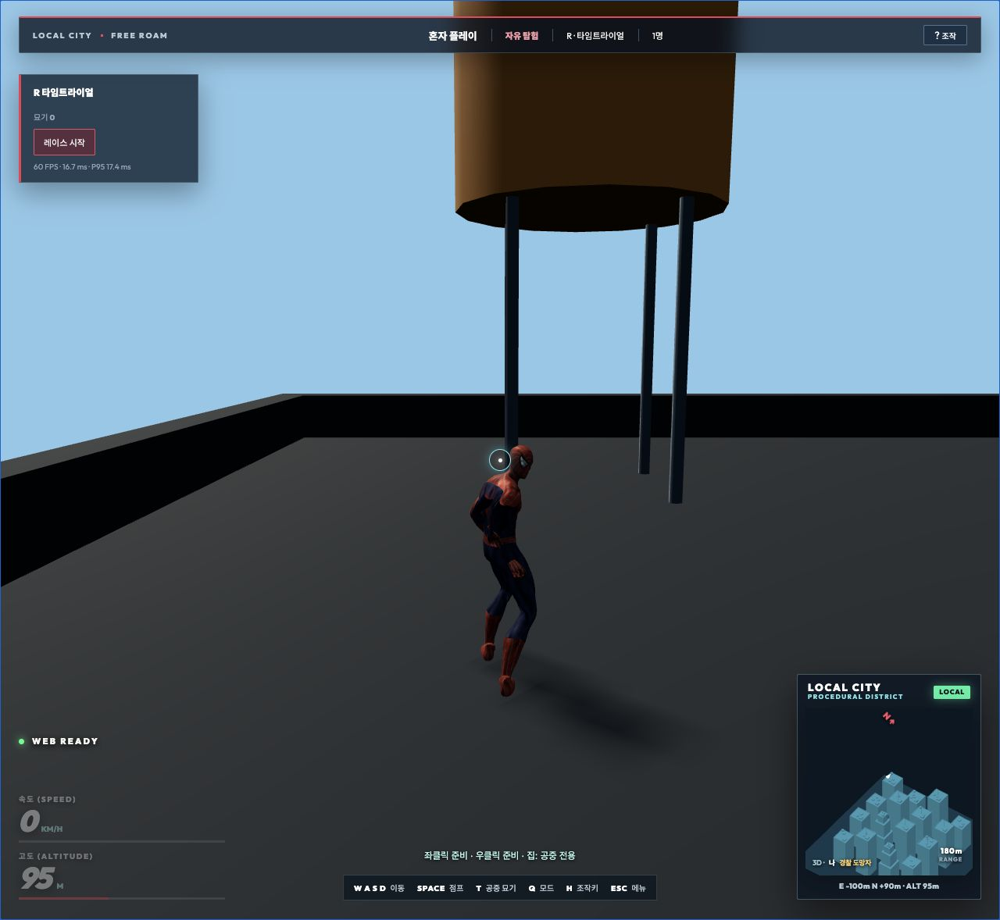

# 입력·일시정지·재개 개선 검증 — 2026-10-14

현재 루트 게임과 기존 검증 기록을 숙련 게임 개발·QA 관점으로 검토했다. 플레이에 직접 영향을 주는 입력 중복, 취소 요청, 레이스 시간, 설정 대기, 자동 화질의 상태 전환을 우선 수정했다. 작업 시작 전에 있던 변경은 보존했으며 이번 수정은 로컬 프로젝트에 반영했다.

## 확인하고 수정한 문제

| 문제 | 실제 영향 | 수정 |
|---|---|---|
| 키보드·패드 또는 좌우 수식 키의 중복 입력 | Q가 두 번 실행되어 원래 모드로 돌아가고, R이 시작한 레이스를 바로 종료할 수 있었다. 묘기 등도 중복 호출됐다. | 모든 입력원의 누름/해제를 추적하며, 단발 동작은 첫 누름에서만 실행한다. 마지막 입력원을 해제하면 다시 실행할 수 있다. |
| 마우스와 패드의 거미줄 토글 충돌 | 마우스를 누른 상태에서 같은 손의 패드 트리거를 누르면 연결이 해제됐다. | 버튼 입력도 두 장치의 합산 상태로 처리한다. 두 손은 계속 독립적으로 동작한다. |
| 빠른 거미줄 켜기·끄기의 잔여 발사 | 물리 프레임 사이에서 토글을 꺼도 webTap 요청이 남아 양손 발사가 실행됐다. | 토글을 끌 때 연결·유지 상태와 미처리 발사 요청을 함께 취소한다. |
| 정지한 시간이 레이스에 포함됨 | 백그라운드 등에서 프레임이 멈춘 뒤 재개하면 수십 초의 정지 시간이 추가됐다. 패드 Start로 프레임 안에서 재개할 때도 발생했다. | 재개 및 혼자 플레이 도움말 닫기에서 정지 시간을 버린다. 프레임 내부 재개는 다음 프레임부터 시간을 센다. 플레이 중 지연과 온라인 도움말 시간은 계속 포함한다. |
| 메뉴를 닫은 뒤 숨은 키 변경 대기 | 키 변경을 시작하고 계속하기를 누르면 다음 게임 키가 보이지 않는 설정에 잡혔다. Escape도 메뉴를 열지 못하고 대기만 취소했다. | 정상 재개 시 키 변경 대기를 취소한다. WebGL 복구 전 재개를 거부할 때는 설정 상태를 유지한다. |
| 일시정지 중 자동 화질과 실제 해상도 불일치 | 화면은 낮은 해상도인데 제어기는 수동 품질 상한으로 돌아가, 재개 후 느린 프레임에서 해상도가 오를 수 있었다. 비활성 프레임도 표본에 섞였다. | 정지·로비·관전은 화질 판단 표본에서 제외한다. 활성 전환 시 표본·연속 판정을 초기화하고 현재 해상도 단계는 유지한다. |

변경 파일: `src/main.js`, `src/PlayerExperience.js`. 새 검사 `scripts/check-input-lifecycle.mjs`를 전체 `npm test`에 연결하고 `npm run test:input-lifecycle` 명령을 추가했다.

기존 `check-qa.mjs`의 한 사례는 버튼과 키를 해제하지 않고 별도의 누름을 여러 번 보내고 있었다. 실제 장치의 누름→해제→새 누름 순서로 정정했으며 기존 게임 동작 검증의 모든 단언은 유지했다. [수정 전 검사](check-qa-before.txt), [36개 QA 사례](qa-input-check.log).

## 검증 근거

- 수정 전 소스를 별도 임시 디렉터리에 복원하여 동일한 새 검사 10개를 실행했다. **0개 통과, 10개 실패**로 문제를 재현했다. [수정 전 로그](reproduced-before-fixes.log), [소스 백업](source-before-review.tar.gz).
- 최종 소스의 신규 검사: **10개 통과, 0개 실패**. 입력원별 해제와 재입력, 양손 토글, 프레임 사이 취소, 90초 정지 후 재개, 패드 프레임 내부 재개, 온라인 도움말 시간 유지, 숨은 설정 대기, 화질 해상도와 표본을 검사했다. [신규 회귀 로그](regressions.log).
- `npm test`: 모션 생성 확인을 포함한 **39단계 전체 회귀 검사 통과**, 종료 코드 0. [전체 검사](full-tests.log).
- `npm run build`: **프로덕션 빌드 통과**, 종료 코드 0. [빌드 로그](build.log).
- `git diff --check`: 통과, 공백 오류 없음. 결과·소스 해시는 [execution.json](execution.json), 이번 변경만 비교한 패치는 [changes-this-review.patch](changes-this-review.patch)에 보존했다.

## 실제 Chrome 검증

로컬 개발 서버의 절차 도시에서 최종 코드로 실행했다. [검증 기록](browser-evidence.json).

1. 모델·지도 로딩과 혼자 플레이 시작, HUD를 확인했다.
2. R로 레이스를 시작하고 H로 도움말을 열었다. 별도 작업 후에도 `링 1/8 · 0.02초`를 유지했다.
3. 도움말 닫기와 Escape 메뉴 전환을 확인했다.
4. 앞으로 키 변경을 눌러 `새 키 입력 · Esc 취소` 상태를 만든 뒤 마우스 잠금 없이 계속하기를 눌렀다. 바로 Escape로 메뉴가 다시 열렸고 키 버튼은 `W`로 돌아왔다. 레이스 시간도 `0.02초 → 0.03초`였으며 메뉴 체류 시간이 추가되지 않았다.
5. 레이스 종료, Q 모드 전환과 복귀, Space 점프를 실행했다. 점프 시 고도가 `95m → 103m`, 상태가 `JUMPING`으로 바뀌었다.
6. 해당 브라우저에서 수집한 error/warn 표본은 빈 배열이었다.

## 검증 범위

게임패드와 키보드 동시 입력 및 장시간 프레임 중단은 실제 입력 핸들러·물리 코드의 자동 재현으로 검사했다. 실물 게임패드를 사용한 검사는 수행하지 않았다. 이번 브라우저 검증은 로컬 도시이며 홍콩 전체 지형, 운영 인터넷 환경, 모든 기기와 해상도의 검증으로 확대 해석하지 않는다. 서버·DB·운영 배포는 이번 변경 범위에 포함하지 않았다.

기존 대형 번들 경고는 남는다. 최종 빌드의 메인 JS는 약 5.64MB, gzip 약 2.02MB다. 이번 개선은 입력과 상태 전환의 결함을 해결하며 초기 다운로드 크기를 줄이는 변경은 포함하지 않는다.
