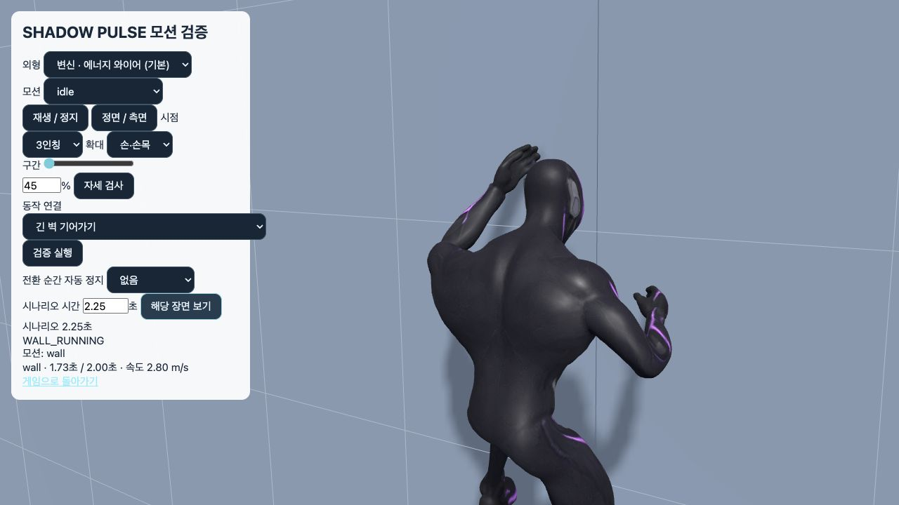

# 손·발 꺾임 재수정과 전체 사용 모션 검증

> 후속: [전체 모션 품질 재검수](../motion-quality-2026-10-20/README.md)에서 전완·종아리 비틀림을 추가 수정하고 43개 검사군을 확인했다. 아래 내용은 이전 검증 기록이다.

이전 검수에서 사용한 손목 기본 자세 대비 70° 제한은 충분하지 않았다. 기본 뼈대 자체의 손목이 13–18° 기울어져 있었고, 벽 동작의 실제 전완–손등 각도는 최대 **86.9°**였다. [수정 전 측정](before.json).

이번 수정의 기준은 실제 전완과 손등의 방향, 관절의 최종 출력, 프레임 사이 회전량이다. 33개 사용 모션의 원본 준비 데이터와 게임 실행 중 자세에 같은 제한을 적용했다.

## 수정

- 손목의 중립 자세를 실제 전완–가운데 손가락 관절 방향으로 다시 계산했다. 손등이 전완과 이루는 각도를 12° 이내로 제한한다.
- 발목은 바인드 자세에서 18°, 발가락 뼈는 5° 이내로 제한했다. 초당 관절 회전은 손목 180°, 발목 240°, 발가락 90°로 제한한다.
- 접촉·와이어·전투·착지 보정이 끝난 **최종 출력**에 제한을 적용한다. 마지막 발바닥 관통 보정도 발목의 로컬 회전을 바꾸지 않는다.
- 관절에서 남는 회전을 전완·종아리에 무제한으로 더하던 처리를 제거했다. 지지면 보정에는 정해진 무릎 방향과 결정적인 종아리 정렬을 사용한다.
- 벽에서는 손바닥을 강제로 벽과 평행하게 만들지 않는다. 손목을 편 상태로 가운데 손끝을 실제 IK 접촉점으로 사용하고, 필요한 손바닥 방향은 전완 회전으로 맞춘다.
- 와이어 발사는 손목을 꺾는 대신 팔 전체를 들어 손가락과 와이어 출구 사이를 확보한다.
- 부츠의 높이는 고정된 발목 높이로 판단하지 않는다. 실제 메시와 바닥의 거리를 계산해 발목 지지 높이를 조절한다.
- 보정된 발 회전을 다음 IK 목표로 다시 사용하던 피드백을 제거했다. 고정된 원본 자세·루트·바닥이 같으면 이미 계산한 하체 자세를 재사용한다. 이동, 자세 변화, 지지면 변화, 외형 변경 시 이 캐시를 해제한다.
- 손목·발목 제한을 반영해 33개 배포 모션을 다시 컴파일했다.

## 검사 범위

[최종 출력 검사](results.json)는 두 외형 × 33개 사용 모션 × 24/30/60/144 FPS의 전체 타임라인과 실제 동작 전환을 검사한다. 이 검사는 클립에 저장된 회전값만 보는 것이 아니라 `Character.update()`의 최종 결과를 측정한다.

| 요소 | 검사 |
|---|---|
| 손목 | 매 프레임 실제 전완–손등 각도, 중립축 기준 회전 |
| 발목·발가락 | 최종 로컬 회전량, 프레임 사이 각속도 |
| 전환 | 걷기·달리기·질주·점프·낙하·착지·정지·벽·스윙·와이어 당기기·공격 전환 |
| 고정 자세 | 잽 이후 자세 교체, 고정 프레임, 반복 보정 시 발 미끄러짐 |
| 접촉 | 발앞부분·손끝 접촉점, 실제 부츠 지지면 거리, 실제 손 메시의 벽 관통 |
| 지형 | 평지·오르막·내리막·복합 경사·계단·옥상·난간 |
| 메시 | 두 외형의 실제 모든 정점을 샘플링, 유한값·전체 크기·삼각형 엣지 증가 |
| 뼈대 | 모든 뼈의 길이 보존, 정규화된 회전, 유한값 |
| 원격·입력 | 원격 캐릭터, 양손 와이어, 독립 발사·해제, 입력 중단과 반복 전환 |

발목 관절의 꺾임은 정강이에 대한 로컬 회전으로 측정한다. 발 전체의 월드 회전에는 달릴 때의 다리 움직임과 몸의 회전도 포함되므로 두 값을 혼동하지 않는다. 지지면에서는 자연스러운 뒤꿈치 들기를 허용하면서 실제 부츠의 관통과 뜨는 거리를 별도로 검사한다.

메시 엣지 길이는 실제 바인드 자세로 스키닝한 월드 좌표와 비교한다. 서로 다른 좌표계의 정점 길이를 직접 비교하지 않는다.

## 최종 실행 기록

전체 회귀 검사: **42개 검사군 확인 완료**. [최종 취합](verified-audit/completion-results.json), [모션 목록](verified-audit/manifest.json), [소스 일치 기록](verified-audit/source-integrity.json), [빌드 로그](build.log).

- 최종 관절 검사: **272/272 통과**, 41,632프레임. 33개 모션 × 두 외형 × 네 프레임율의 264개 전체 타임라인과 8개 실제 전환 시나리오다.
- 실제 메시 검사: 60 FPS의 198개 자세에서 두 외형의 모든 정점을 계산했다. 손·발 부위 외에도 전체 메시 크기, 삼각형 엣지의 증가, 유한값을 확인했다.
- 전투 발 검사: 이동·공격 45개, 고정 자세 75개 **총 120개 통과**. 고정 자세의 정착 후 발 위치 변화는 최대 **0mm**였다.
- 벽 손끝 접촉, 무릎 방향, 발바닥 지지, 경사·계단·난간 전환, 와이어·원격 캐릭터를 포함한 나머지 회귀 검사도 통과했다. [이번 실행의 상세 결과 사본](regression-results/sources.json).
- 프로덕션 빌드와 `git diff --check` 통과. 검사 시작·종료 및 전투 발 재검사 사이의 실행 코드·배포 모션·외형 파일 해시는 같다.

| 최종 출력 측정 | 최대 / 최소 |
|---|---:|
| 실제 전완–손등 각도 | 최대 12.0001° 미만 |
| 발목의 중립 자세 대비 회전 | 최대 18° |
| 발가락 뼈의 중립 자세 대비 회전 | 최대 5° |
| 손목 / 발목 / 발가락 각속도 | 최대 180 / 240 / 90°/초 |
| 전체 모션 메시 샘플의 바닥 여유 | 최소 +0.95mm |
| 벽 모션의 실제 손 메시 여유 | 최소 +14.89mm |
| 전투 지지 발의 실제 부츠 바닥 여유 | +2.57mm ~ +26.15mm |

각도·각속도의 소수점 말단에는 부동소수점 오차가 있다. 각속도는 각 관절의 부모 뼈에 대한 회전량이다. 손발 전체의 월드 회전 속도나 팔다리 전체 움직임을 고정하는 제한은 아니다.

일괄 실행은 처음에 [41/42](verified-audit/suite-results.json)였다. 남은 `combat-feet`는 달리며 가드로 복귀하는 발끝 지지에서 부츠 전체가 37.67° 기울어진 것을 35° 기준으로 거부했다. 해당 프레임의 발목 자체는 18° 제한 안에 있었고 실제 부츠는 바닥에서 약 3mm였다. 평평한 지지의 35° 기준은 유지하고, 뒤꿈치를 드는 지지는 옆 기울기 25°·앞뒤 기울기 35°·합성 기울기 45° 이내인지 따로 검사한다. 실제 부츠의 관통 -5mm, 공중 뜸 35mm 제한도 추가했다. **런타임을 바꾸지 않고 판정을 구분한 뒤 120개 사례를 다시 통과**했다. [원래 실패 기록](verified-audit/combat-feet.log), [재검사 기록](verified-audit/combat-feet-contact-recheck.log). 최종 취합은 이 재검사와 같은 실행 소스의 41개 통과 기록을 합친 결과다.

## 화면 검수

두 외형에서 벽 손목을 확대하고, 벽 등반·질주의 발목과 난간 전환을 확인했다. 스크린샷은 최종 실행 코드에서 채취했다.



[전투 외형 손목](combat-hands.jpg) · [벽 등반 발목](wall-feet.jpg) · [질주 발목](sprint-feet.jpg) · [벽 등반 전신](wall-body.jpg) · [난간 전환](mantle-hands.jpg)

## 재현

```sh
npm run test:end-joints
MOTION_AUDIT_DIR=docs/qa/joint-stability-2026-10-20/verified-audit MOTION_AUDIT_DATE=2026-10-20 npm run test:complete-motion
npm run build
```

검증 화면 `http://127.0.0.1:5173/?motionReview`에서 실제 동작 연결 시나리오를 실행하고 `손·손목`, `발·발목`, `정면 / 측면`으로 확인한다. 원본 후보와 클립 단독 재생은 게임에서의 접촉·전환 보정까지 적용한 결과와 구별한다.

검사 범위는 위에 명시한 입력·지형·외형·프레임율이다. 모든 지형과 입력 조합, 표현의 미적 완성도를 무제한으로 보증하는 의미는 아니다.
