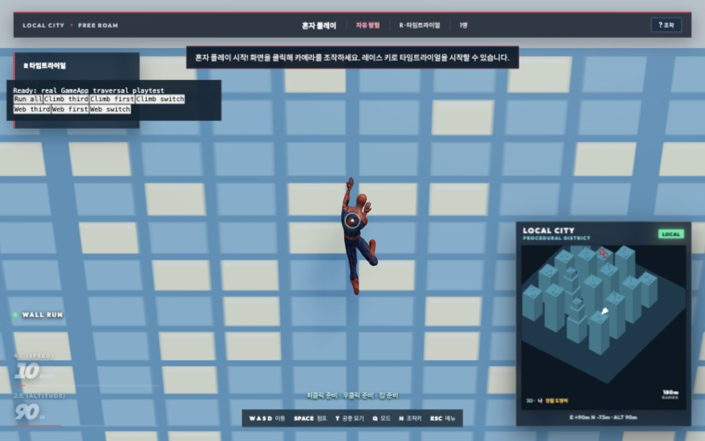
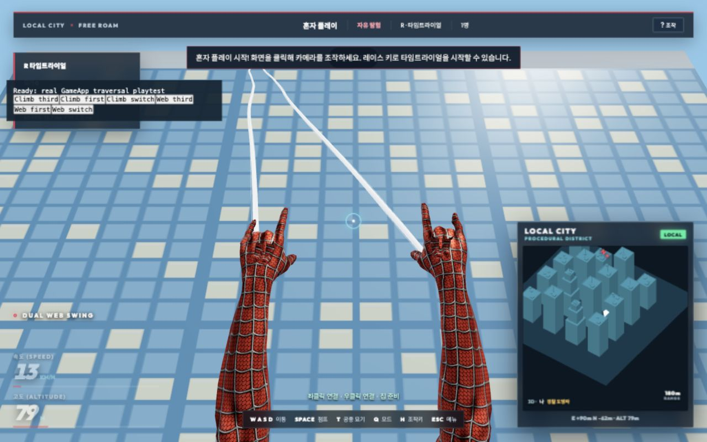
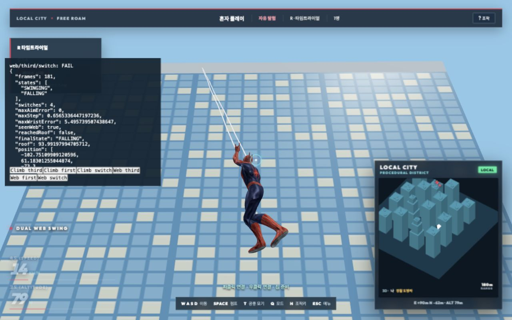

# 실제 게임의 시점 전환·거미줄·벽·난간 재검증

2026-10-15, 로컬 절차 도시의 실제 GameApp에서 검증했다. 모션 검수 전용 화면 대신 실제 도시, 캐릭터, 충돌체, 고정 물리 스텝, 카메라 및 렌더 루프를 사용했다. 반복 가능한 시작 위치를 지정하고 기존 게임패드 입력 어댑터를 통해 W/F/V 및 좌우 마우스 이벤트를 전달했다.

## 발견하고 수정한 문제

1. **옥상 직전 매달림 고착.** 실제 생성된 건물의 몸체와 1.2m 난간 경계에는 약 0.0000016m의 좌표 차이가 있었다. 수평 광선이 경계에 닿으면 좌표 검사 순서 때문에 벽 대신 바닥 법선을 반환했다. 지붕 높이 93.991979947m인 벽을 5m 아래에서 오르면 93.191979947m에서 멈췄다. 광선이 실제로 가로지르는 축을 기준으로 표면 법선을 선택하도록 수정했다. 같은 건물에서 난간을 넘고 94.091979947m의 옥상에 착지한다.
2. **V 전환 시 조준 초기화와 복귀 회전.** 1인칭에 들어갈 때 몸의 방향과 수평 시선으로 덮어쓰고, 나올 때 자동으로 몸 뒤로 회전하던 처리를 제거했다. 시점 전환은 바라보던 방향을 유지하고, C는 명시적인 재정렬로 유지한다. 3인칭 복귀 첫 프레임의 카메라 위치와 주시점도 함께 배치해 머리 위치에서 잘못된 방향으로 보간하는 현상을 방지했다. 충돌 검사는 계속 적용한다.
3. 전체 검사 도중 발견한 별도 테스트의 시간 의존성도 정리했다. 원격 타격 검사에서 실행이 5초를 넘으면 ping이 공격 기록에 섞였으므로, 해당 fixture에서는 다른 주기 전송과 함께 ping을 비활성화했다. 게임의 네트워크 동작은 변경하지 않았다.

## 실제 브라우저 검증

개발 서버에서 `/?city=procedural&traversalPlaytest`를 열고 Ready 후 **Run all**을 누르면 재현된다. 이 경로는 개발 빌드에서만 활성화한다.

- 벽→난간→옥상: 3인칭, 1인칭, 도중 시점 교대의 3개 시나리오. `WALL_RUNNING → MANTLING → RUNNING → IDLE`을 확인한다.
- 양손 거미줄: 3인칭, 1인칭, 도중 시점 교대의 3개 시나리오. 실제 두 부착점, 한 손만 해제한 뒤 남은 줄 유지, 양손 해제, 잔상 제거 및 1인칭 손목 연결을 확인한다.
- 시점 교대 중 yaw/pitch 유지와 프레임 이동량을 기록한다. 손목 오차는 GameApp이 렌더한 프레임에서 측정한다. 다음 프레임에 반영될 시점 선택 직후의 이전 메시와 비교하지 않는다.

최종 **6개 시나리오 모두 통과**, 1,347프레임을 확인했다. 벽·난간 도중 6회, 거미줄 도중 4회 시점을 교대했고 조준 각도 변경은 0이었다. 1인칭 줄 시작점과 손목의 최대 오차는 0.0033mm였다.

최종 수치와 각 시나리오 판정은 [results.json](results.json), 브라우저 경고·오류는 [browser-logs.json](browser-logs.json)에 있다.

## 자동 회귀 검사

- `npm test`: 전체 50단계 성공. 전체 검사 로그 [full-tests.log](full-tests.log).
- `npm run build`: 성공. 빌드 로그 [build.log](build.log). 기존 500kB 초과 번들 경고는 남아 있다.
- 새 카메라 회귀: 24/60/144 FPS, 서로 다른 3개 방위, 몸과 시선이 다른 상태에서 왕복 전환 및 C 재정렬.
- 새 난간 회귀: 실제 생성 건물의 부동소수점 경계를 24/30/60/144 FPS에서 재현하고 옥상 도착을 필수로 검사한다.
- 기존 벽·양 시점 검사: 101건. 실제 리그의 접촉 고정·손발 법선·손가락·줄 해제 검사를 포함한다.

이번 브라우저 검증 지도는 로컬 절차 도시다. 홍콩 지형은 전체 검사에 포함된 실제 Rapier 지형의 벽·난간 회귀 검사 범위이며, 실운영 홍콩 지도나 원격 다중 접속을 브라우저에서 새로 전수 검수한 기록은 아니다.
