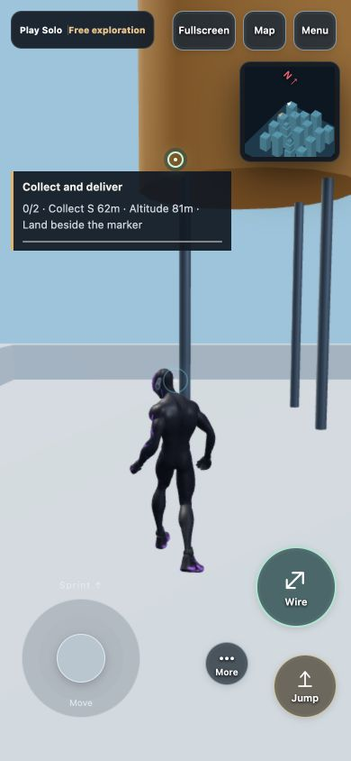
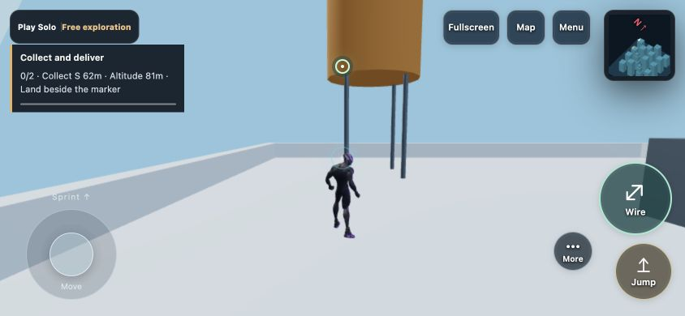

# 탐험 임무 확장과 로딩 복구 — 2026-10-25

## 반영 내용

- 구역 탐방은 출발 구역을 제외하고 각 임무 안에서 서로 다른 100m 격자 세 곳을 방문한다. 기존 탐험 기록을 삭제하지 않으며, 방문 이력 때문에 임무가 소진되지 않는다. 제자리 이동과 동일 격자 반복은 추가로 세지 않는다.
- 물품 회수·배달: 안전한 옥상 두 곳을 고르고 순서대로 0.6초 동안 서 있어야 회수/배달한다. 기존 옥상 임무와 월드·미니맵 목표를 공유한다. 회수 상태는 임무 진행 중에 유지하며 재시작하면 초기화한다.
- 이동 기술 훈련: 줄이 실제로 연결된 3초 연속 스윙, 1초 연속 벽 이동/턱 오르기, 안전한 바닥 착지를 순서대로 수행한다. 메뉴·연습·비정상 시간 표본은 연속 동작을 끊는다.
- 완료 안내에 실제 이동 거리와 활성 임무 시간을 표시한다. 완료 횟수와 최근 결과를 저장하고 메뉴에서 최근 임무를 다시 시작한다. 완료 안내는 활성 플레이 기준 10초간 표시한다. 저장 공간이 막히면 안내하고 실행 중 결과는 유지한다.
- 목표 생성 실패 시 기존 임무를 보존하고 목표 재준비 버튼을 제공한다. 도착 지형이 바뀌어 안전 착지가 어려워진 경우에도 메뉴에서 목표를 다시 준비할 수 있다. 500m 순찰은 지형 목표 생성 없이 시작할 수 있다.
- 로딩 대기 시간과 오프라인 안내를 추가했다. 외부 엔진 import 전부터 재시도 버튼을 연결하고, 30초 지연/오프라인 시 기존 복구 영역을 표시한다. 준비 완료 시 타이머·네트워크 이벤트를 해제한다. 기존 로컬 지도 전환과 그래픽 연결 복구는 유지한다.
- 임무 판정은 `src/MissionRules.js`, 초기 로딩 안내는 `src/LoadingStatus.js`로 분리했다. 화면·일시정지·설정과 물리 엔진의 기존 동작을 유지했다. 영문 속도 표기의 번역 누락도 보완했다.

## 자동 검사

`validation.json`과 각 로그에 현재 소스로 실행한 9개 검사 스크립트의 성공 결과와 소스 SHA-256을 보관했다. 임무 확장 5개, 플레이 여정 14개, 세션 8개, 입력 생명주기 16개, 전체 게임 감사 9개 케이스 외에 미니맵·다섯 로컬 지도/언어·로딩/충돌·터치 검사를 통과했다. 여정 검사에는 실제 다섯 로컬 도시의 안전한 옥상 목표 생성과 도착이 포함된다.

새 검사에는 이미 탐험한 구역의 두 차례 반복, 출발/중복 구역 제외, 배달 순서와 안전 지지, 거리로 다른 임무가 조기 완료되지 않음, 목표 생성 실패 시 기존 임무 유지, 지도 목표 전환, 결과 저장/복원/손상/할당량 실패, 정지/연습/비정상 시간/위험 착지로 기술 임무를 완료할 수 없음, 앱 초기화 이전 재시도 버튼 및 로딩 이벤트 해제를 포함한다.

`network-conditions.json`은 이번 작업 중 로컬 지연 프록시와 실제 WebSocket 8개로 실행한 결과다. 입장/준비/시작, 이동 업데이트 일부 누락, 8번째 플레이어의 자리 복구, 방장 이탈 후 위임 4개 시나리오가 통과했다. TCP 패킷 손실이나 서로 다른 인터넷 회선의 결과로 해석하지 않는다.

`build-validation.json`과 빌드/압축/HTTP 로그에 성공 결과를 보관했다. 기존 아티스트의 모션 출력을 재생성하지 않도록 Vite 빌드를 직접 실행한 뒤 압축 스크립트를 실행했다. HTTP의 Brotli/gzip/identity 복호화 결과 일치, HEAD 길이, 406/404/숨김 파일 차단을 확인했다. 기본 전체 `npm test`를 이번 최종 소스에서 단일 실행한 것은 아니다. 기존 대형 JS 청크 경고는 남는다.

## 실제 브라우저 검사

- 한국어 PC에서 혼자 플레이, 메뉴의 새 임무 목록, 회수/배달 시작, 거리·고도·목표 안내 표시를 확인했다.
- 영어 390×844에서 이동 기술 임무와 회수/배달을 시작했다. 터치 검수 모드에서도 목표와 조작 버튼 배치를 확인했다. 844×390 가로에서도 목표·조이스틱·버튼 겹침과 가로 넘침이 없었다. 해당 로컬 화면에서 오류/경고 로그가 없었다.
- 홍콩 실제 외부 지형 요청 중 대기 문구를 확인한 뒤 솔로에 진입했다. 준비 후 로딩 화면이 숨고 대기 문구가 비워지는 것을 확인했다. 기존 3D Tiles 1.1 제한 지원 경고는 남는다. 오프라인/긴 엔진 로딩 분기는 자동 검사로 확인했다.
- 위 화면 크기 검사는 실제 휴대폰의 터치 하드웨어·발열을 검증한 결과가 아니다. 전체 신규 임무를 실제 입력으로 끝까지 플레이한 검증과 자동 상태 전환 검사는 구분한다.

## 남은 검증과 범위

실제 iPhone Safari/Android Chrome의 20분 발열·프레임·세 손가락 터치와 통신망 전환, 외부 인터넷 회선 8인 전체 경기는 별도 실측이 필요하다. 도시 아트·NPC·환경음의 전면 제작, 메인 입력/세션·물리 엔진의 대규모 분리는 이번 변경에 포함하지 않았다. 임무는 브라우저 로컬 저장을 사용하며 진행 중 임무 자체는 새로고침 후 복원하지 않는다.

재현: `npm run test:mission-expansion`, 관련 로그의 개별 검사 명령. 배포 빌드: `npm run build`, HTTP 검증: `npm run verify:asset-http`.
