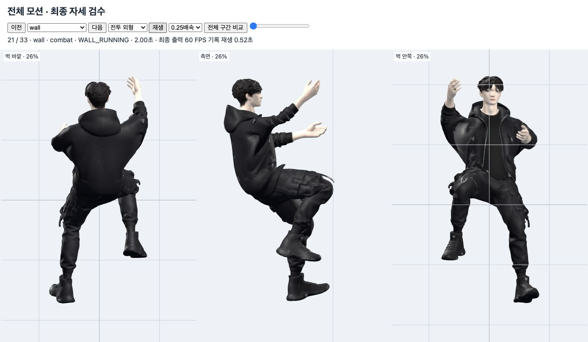

# 전체 모션 품질 재검수 · 2026-10-20

손목·발목 제한만으로는 남아 있던 전완·종아리의 급격한 비틀림을 추가로 수정했다. 등록되어 로드되는 **33개 모션, 두 외형**의 최종 자세를 다시 확인했다.

## 새로 발견하고 수정한 문제

1. **벽 등반 중 전완이 순간적으로 반 바퀴 회전.** 팔이 벽을 향해 곧게 뻗을 때 벽 법선을 전완에 수직인 평면으로 투영하면 방향이 거의 사라진다. 이 값을 먼저 정규화한 뒤 길이를 검사하던 처리 때문에 작은 오차가 큰 방향 변화가 됐다. 정규화 전에 퇴화 구간을 판별하고, 직전 손바닥 방향을 유지하면서 벽 방향 정렬을 부드럽게 회복하도록 바꿨다. 손목을 꺾어 보상하지 않는다. 벽 변경·리셋·동작 종료 시 이전 방향을 해제한다.
2. **급정지·강한 착지·훅에서 종아리가 순간적으로 비틀림.** 발 지지를 다시 확보할 때 원본 부츠 회전과 바닥 회전을 섞으면서 종아리 회전 기준도 급변했다. 하나의 지지 회전 기준을 유지하고 시간 보정은 최종 발목 관절 단계에서 처리한다. 발목 제한·실제 부츠 관통 보정은 유지했다.

비틀림은 뼈의 굽힘·이동을 평행 운반으로 제거한 뒤 남는 축방향 회전으로 측정했다. 빠른 펀치나 점프의 팔다리 이동 속도 전체를 비틀림으로 취급하지 않는다.

| 상황 | 수정 전 최대 축방향 회전 속도 | 수정 후 최대 |
|---|---:|---:|
| 벽 등반·대각선·속도 변경·정지·역방향 | 4,551.6°/초 | 477.1°/초 |
| 급정지 `runStop` | 6,246.0°/초 | 94.6°/초 |
| 강한 착지 `slamLand` | 7,485.6°/초 | 337.2°/초 |
| 훅 `hook` | 3,562.2°/초 | 107.7°/초 |

두 외형·24/30/60/144 FPS의 32개 사례 중 수정 전 **28개 실패 → 수정 후 32개 모두 통과**. 이전 화면 캡처와 정확히 같은 소스 해시를 가진 코드를 임시 격리 복사본에 복원해 동일 검사를 실행했다. [수정 전 결과](before-limb-continuity.json), [수정 후 결과](limb-continuity.json).

## 검수 범위와 결과

- [전체 회귀 검사](final-audit/suite-results.json): **43/43 통과**, 한 번의 일괄 실행. [실행 로그](final-audit/run.log), [검사 중 소스 안정성](final-audit/source-integrity.json).
- [최종 관절 검사](end-joints.json): **272/272 통과, 41,632프레임**. 손목 실제 전완–손등 각도 12° 이내, 발목 중립 대비 18°, 발가락 5° 이내. 손목/발목/발가락 로컬 각속도 180/240/90°/초 제한을 확인했다. 소수점 말단에는 부동소수점 오차가 있다.
- 메시: 두 외형의 모든 정점을 198개 최종 자세에서 계산해 유한값·전체 크기·삼각형 엣지 증가·손발 관통을 확인했다. 벽 접촉과 지형별 검사도 함께 통과했다. [벽 상세 결과](natural-wall.json).
- 전투 발: 이동·공격 45개와 고정 자세 75개 통과. 정착한 고정 자세의 발 위치 변화 최대 0mm. [이번 실행 결과](regression-results/combat-feet-2026-10-19/results.json).
- [다각도 화면 검수](gallery.md): **462개 최종 자세 × 3방향 = 1,386개 시점**, 66장에 기록했다. 골반·등·목·어깨·팔꿈치·무릎·손발, 지지와 실루엣, 공격과 회복을 확인했다.
- [재생 확인](playback-checks.json): 정상 속도 **66개 전체 타임라인**, 0.25배속 **주요 8개 동작 × 두 외형 = 16개**, 총 82개 재생을 끝까지 확인했다.
- [검수 자료 무결성](artifact-verification.json): 7,886개 60 FPS 기록 프레임, 512,590개 뼈 샘플의 유한값·회전 정규화, 66개 자료·화면의 대응과 게임 소스 해시를 확인했다.
- 프로덕션 [빌드](build.log)와 `git diff --check` 통과.

이번 버전의 판단은 명시한 외형·입력·지형·프레임율에서 관절 꺾임, 급격한 축 비틀림, 손발 접촉과 연결 동작의 검수가 끝났다는 뜻이다. 무게 이동은 골반과 지지 다리·상체 연결을 화면으로 판단했다. 인체의 질량 분포까지 계산한 생체역학 시뮬레이션이나 모든 가능한 입력 조합·미적 취향의 무제한 보증은 아니다.

## 검수 화면



개발 서버 실행 중 [전체 모션 검수 화면](http://127.0.0.1:5173/docs/qa/motion-quality-2026-10-20/review.html)을 열면 모션·외형을 바꾸고 정상/0.25배속 재생, 세 방향 동시 비교, 구간별 정지가 가능하다.

이 화면은 지정 상태·속도에서 클립을 고정 선택한 뒤 **`Character.update()`의 모든 보정이 끝난 결과**를 기록해 보여준다. 위치 이동은 비교를 위해 제자리로 옮겼다. 입력으로 동작을 선택하는 실제 컨트롤러·전환·물리·경사·계단·난간·원격 캐릭터는 위 회귀 검사와 기존 `?motionReview` 시나리오에서 별도로 확인한다. `candidateFront`·`candidateStylish`는 게임에 선택되지 않는 보관 후보라 33개 등록 모션 범위에 포함하지 않는다.

일괄 검사 종료 뒤 검수 도구의 압축 기록 로딩과 로딩 중 버튼 처리만 수정했다. 게임 실행 코드·컴파일 모션·외형은 43개 검사군 실행 당시와 동일하다. 도구는 수정 후 위 82개 브라우저 재생으로 확인했다. [최종 게임 코드 일치 기록](runtime-integrity.json).

## 재현

```sh
npm run test:limb-continuity
MOTION_AUDIT_DIR=docs/qa/motion-quality-2026-10-20/final-audit MOTION_AUDIT_DATE=2026-10-20 npm run test:complete-motion
npm run qa:motion-quality
npm run build
npm run dev
```

`qa:motion-quality`는 수치 기록과 최종 자세·연속 재생 자료를 생성한다. 스크린샷은 위 화면에서 해당 자료를 렌더링한 결과다. 이전 검증의 역사적 보고서가 새 실행 결과로 바뀌지 않도록 이번 결과 사본을 `regression-results/`에 보관했다.
