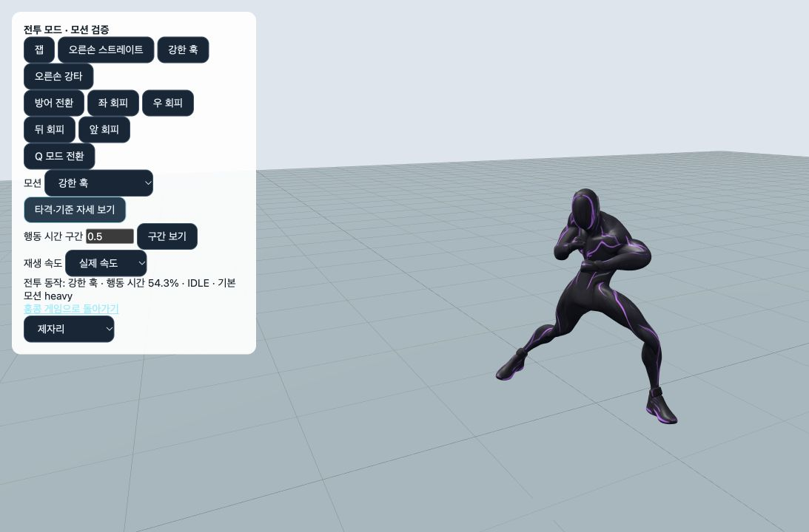

# 모션 선택 적합성 검수 — 2026-10-25

## 판정

보유한 원본, 현재 입력 체계, 캡슐 기반 이동과 타격 판정을 기준으로 기본 게임플레이의 모션 연결은 유지한다. 이번 검사에서 기본 이동·전투 모션을 다른 원본으로 교체해야 하는 근거는 발견하지 못했다. 모든 원본이 모든 상황에 최적이라는 뜻은 아니다. 원본 전체가 아니라 잘라낸 구간, 재생 속도, 발 접지, 상체 레이어와 함께 적합성을 판정했다.

비교용 원본과 예비 동작도 카탈로그에 포함된다. 등록된 33개 전부가 일반 조작으로 호출되는 동작은 아니다. 특히 `jumpDown` 전체를 짧은 낙하에, `runStop` 전체를 걷기 정지에, `rightHook`을 스트레이트 입력에 일괄 적용하면 현재 의도와 맞지 않는다.

## 33개 모션별 선택 근거

| 키 | 현재 역할과 판정 |
|---|---|
| idle | 일반 대기. 유지. 전투 대기는 별도 복싱 자세를 사용한다. |
| walk | 저속 지상 이동. 유지. 속도에 따라 재생률을 조절한다. |
| regularRun | 보통 달리기. 유지. 걷기 전환에는 속도 히스테리시스와 0.12초 지속 조건이 있다. |
| run | 질주. 유지. 보통 달리기와 구분한다. |
| stop | 걷기·보통 달리기에서 정지. 원본 마지막 짧은 정착 구간을 사용하므로 긴 제동 스텝을 재현하지 않는다. 유지. |
| runStop | 질주에서 정지. 긴 제동 원본을 사용한다. 유지. |
| turnLeft | 왼쪽 제자리 전환. 원본 골반 회전의 중복 적용을 제거한다. 유지. |
| turnRight | 오른쪽 제자리 전환. 위와 같은 방향 소유권을 적용한다. 유지. |
| jump | Standing Jump의 공중 구간. 이미 물리가 이륙한 뒤 원본 준비 동작을 다시 재생하지 않는다. 유지. |
| land | 같은 점프 원본의 착지 회복 구간. 공중 구간과 분리한다. 유지. |
| jumpDown | 준비부터 착지까지 있는 비교용 전체 원본. 일반 FALLING 선택으로 교체하지 않는다. |
| drop | Jumping Down (1)의 공중 16~29프레임. 짧거나 초기 낙하에 사용. 유지. |
| jumpDownVariant | 다른 하강 원본. 현재 일반 상태의 기본 선택은 아니며 비교용으로 유지. |
| swing | Rope Swinging의 매달린 구간. 와이어 방향과 손 부착은 런타임 보정이 담당한다. 유지. |
| zip | 같은 매달린 원본의 고정 기준 자세 위에 당김·다리 접기를 적용한다. 스윙 시간축 전체로 바꾸지 않는다. |
| fall | 충분히 빠른 하강의 자세. 초기 낙하에는 drop을 사용한다. 유지. |
| fallVariant | 다른 낙하 원본. 현재 일반 FALLING 기본 선택은 아니며 비교용으로 유지. |
| fallIdle | 공중 묘기 대체 자세. 현재 허용한 앞돌기는 airTrick을 우선한다. 유지. |
| roll | Falling To Roll의 접촉 이후 구간. 낙하 준비를 다시 재생하지 않는다. 유지. |
| injuredIdle | 부상 대기 원본. 현재 체력별 대기 선택에 연결되지 않은 예비 동작. 일반 대기로 대체하지 않는다. |
| wall | Climbing Up Wall. 벽 이동·난간 진입의 기준이며 벽 손발 접촉과 난간 넘기는 런타임에서 보정한다. 유지. |
| combatIdle | Boxing Stance. 전투 대기와 회피의 기준 자세. 유지. |
| jab | Lead Jab. 잽 입력과 타격 판정에 맞는 리드 손 공격. 유지. |
| cross | Cross Punch의 잘라낸 구간. 스트레이트 입력. 오른손 훅으로 대체하지 않는다. |
| hook | Boxing Hook의 원본 비교용 구간. ATTACKS/외부 동작 키는 남아 있으나 현재 강공격 입력은 heavy를 호출한다. |
| heavy | 같은 훅 원본에 지연된 준비·추진 시간축과 몸통 보정을 적용한다. 강한 훅으로 구분하여 유지. |
| special | Cross Punch의 더 긴 구간. 긴 준비 시간과 강한 후방 손 공격을 사용한다. 다른 기술로 보이도록 근거 없이 어퍼컷으로 바꾸지 않는다. |
| rightHook | 복싱 기준 자세에서 생성한 이전 오른손 훅. 비교용으로 유지. 검수 화면에서 cross로 바뀌던 오류를 수정했다. |
| guard | 방패용 Defend 원본의 하체를 그대로 쓰지 않고 복싱 기준 자세로 다시 구성한 가드. 유지. |
| slam | Attack_Ground_Pound. 공중 강하 공격. 실제 접촉 전에는 행동 시간을 고정한다. 유지. |
| slamLand | Land_Three_Point의 접촉 이후 구간. 강하 착지 회복. 일반 land와 구분하며 LANDING에서 검사한다. |
| hitHead | Hit_Head에 접지와 몸통 반응 보정. 피격 반응. 유지. |
| airTrick | Front Flip의 잘라낸 회전 구간. 현재 허용한 앞돌기에 사용한다. 유지. |

## 실제로 수정한 결함

1. `CombatReview.showPose`는 rightHook 선택을 cross로 바꿔 `Character.update`에 넘겼다. 선택과 표시가 다르던 별칭을 제거했다.
2. heavy의 원본 타격 구간은 43%지만 게임 행동 시간은 `heavyClipPhase`로 비선형 변환된다. 이전 기본 검사에서는 행동 43%를 다시 변환하여 원본 약 19.5%를 보여줬다. 이제 역변환하여 행동 약 54.3%에서 원본 43%를 보여준다. 직접 입력한 구간은 화면에 명시한 행동 시간을 뜻한다.
3. slamLand의 자세 검사는 IDLE에서 실행되었다. 실제 LANDING으로 바꾸고 공중 강하·강하 착지 검사에 이동 속도 선택이 섞이지 않도록 했다.

브라우저와 자동 검사가 같은 `sampleCombatReviewPose`를 사용한다. 검수 도구만 수정했으며, 위의 게임플레이 모션 선택과 타격 규칙은 유지했다.

## 검증 결과

- 실제 상태·정지·전투·검수 선택 검사 **153건 통과**. 상태 선택 행렬은 24·30·60·144 FPS이며, 별도의 검수 자세 검사는 제자리·달리기·질주를 포함한다.
- 전체 실행의 기능 검사 **64/64개 통과**. 4,205개 동작 중단 시나리오와 42,050프레임을 검사한 적대적 조합 검사도 포함한다.
- 전체 실행기는 검사 중 수정한 `src/CombatReview.js`, `package.json`, `scripts/run-motion-audit.mjs` 때문에 소스 일관성 단계에서 **종료 코드 1**을 반환했다. 전체 실행 성공이나 동일 소스에서 65개 검사를 한 번에 통과한 것으로 기록하지 않는다.
- 위 수정 후 최종 선택 검사 153건과 프로덕션 빌드는 성공했다. 최종 추가 검사·빌드 전후 소스 해시 비교는 **변경 없음**. 새 `CombatReviewPose.js`와 선택 검사 스크립트도 최종 비교에 포함했다.
- `git diff --check` 통과. 빌드는 기존 대형 번들 경고를 출력했다.

## 검증 기록

최종 자동 검사 결과와 소스 일관성 판정은 아래 결과 파일에 기록한다. 33개 원본 클립의 기존 측면 접촉 시트 4장을 직접 확인했고, 새 브라우저 검사에서는 이전 오른손 훅, 강한 훅의 타격 자세, 강하 착지의 상태와 질주 중 강공격의 하체·상체 분리를 확인했다. 기존 접촉 시트는 원본 재생의 대표 15·45·80%이며, 모든 최종 보정 자세의 전 프레임 육안 검사로 해석하지 않는다.

- `selection-inventory.json`: 33개 소스·재생 구간·루프·파생 동작·타격 구간 목록.
- `selection-results.json`: 실제 Character.update 경로의 상태·정지·전투·검수 선택 결과.
- `suite-results.json`: 이번에 실행한 전체 회귀 검사 결과.
- `source-integrity.json`: 전체 검사 시작/종료 시 소스 비교. 검사 도중 수정했다면 별도 해석이 필요하다.
- `final-source-validation.json`: 최종 소스에서 추가 검사·빌드 전후의 해시 비교.
- `build.log`: 프로덕션 빌드 결과.
- `preview-right-hook.png`, `preview-heavy.png`, `preview-slam-land.png`: 수정 후 브라우저 화면.

```sh
npm run test:motion-selection
MOTION_AUDIT_DIR=docs/qa/motion-selection-2026-10-25 MOTION_AUDIT_DATE=2026-10-25 node scripts/run-motion-audit.mjs
npm run build
```

판정은 보유 소스와 명시한 상태·입력·지형 검사에 한정한다. 주관적 연출의 절대적 최적성이나 모든 가능한 입력·네트워크·지형 조합의 완벽함을 증명한 것은 아니다.


