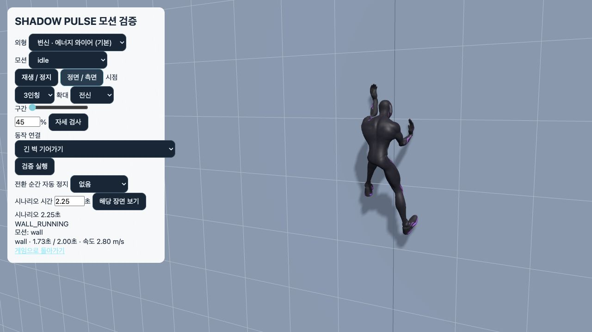
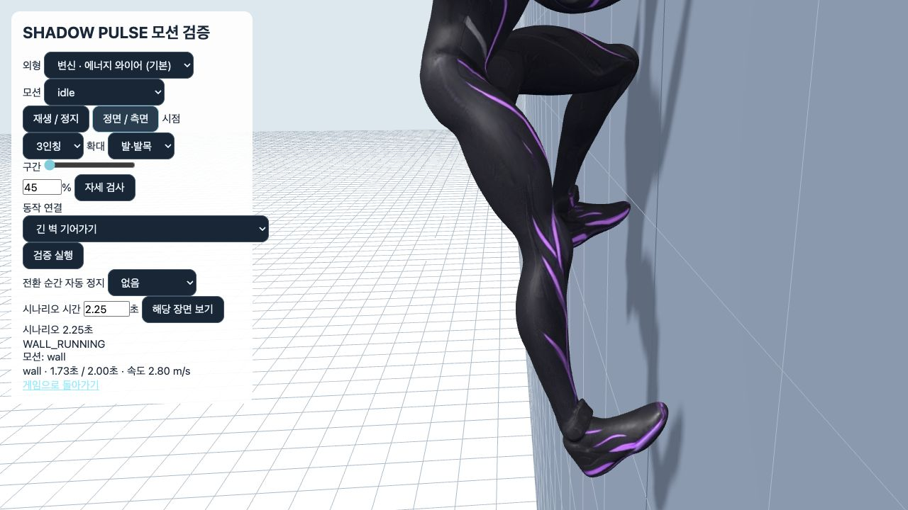
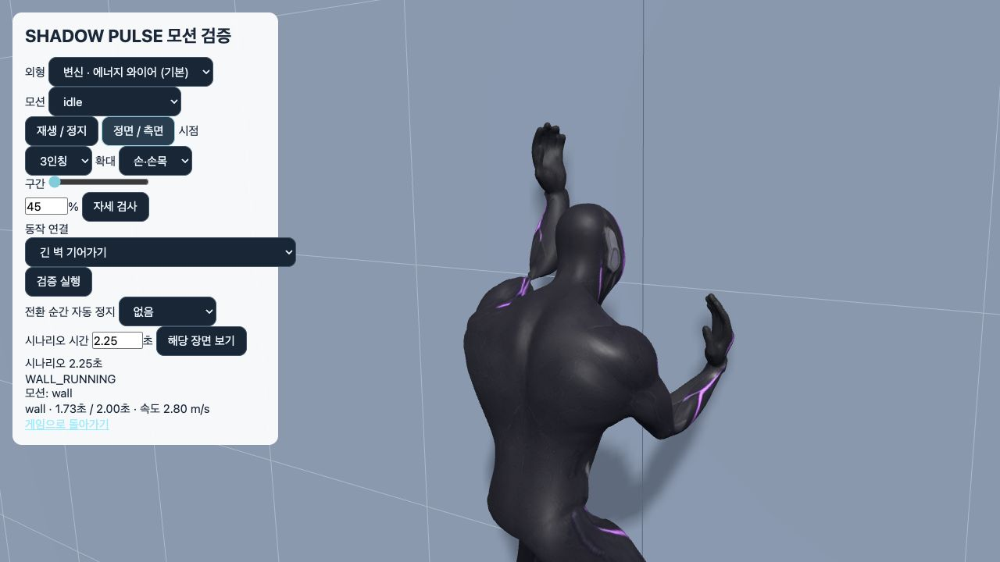
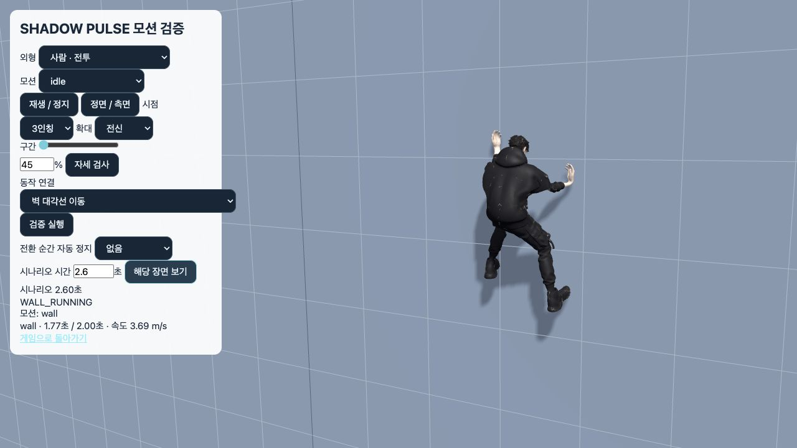

# 벽 기어가기 교체 및 모션 검수 — 2026-10-20

> 후속: [전체 모션 품질 재검수](../motion-quality-2026-10-20/README.md)에서 전완·종아리 비틀림을 추가 수정하고 43개 검사군을 확인했다. 아래 내용은 이전 검증 기록이다.

> 후속 수정: 이 기록의 손목 70° 제한은 실제 손등 꺾임을 막지 못했다. 현재 결과와 엄격한 12°/18° 제한은 [손·발 꺾임 재수정 및 전체 검증](../joint-stability-2026-10-20/README.md)을 기준으로 한다.

기존 FBX의 팔다리를 벽 평면에 강제로 투영하던 등반을, 실제 이동 거리로 진행하는 교차 지지 등반으로 교체했다. 무릎을 벽 쪽으로 굽히고 발앞부분으로 벽을 짚으며 뒤꿈치를 든다. 손발 동작, 몸통 균형, 접촉, 관절, 외형 메시, 동작 전환을 함께 검증했다.

## 발견한 원인과 수정

| 분야 | 확인한 문제 | 수정 |
|---|---|---|
| 무릎·다리 | 발바닥을 벽에 평평하게 맞추는 재계산이 무릎 방향을 뒤집음 | 무릎 방향을 벽 쪽으로 고정하고 발 방향 때문에 다리를 다시 풀지 않음 |
| 발·발목 | 수직 발바닥과 발목 제한이 충돌해 종아리 회전과 다리 벌어짐 발생 | 발앞부분 접촉과 뒤꿈치 들기로 교체, 발 높이와 지지 시간을 조정 |
| 골반·척추 | 원본의 큰 무릎 들기와 골반 동작을 그대로 벽에 투영 | 골반을 벽에서 띄우고 상체를 앞으로 기울임. 작은 좌우 무게 이동과 반대 방향 몸통 회전 추가 |
| 손·손목 | 어깨에서 손으로 향하는 벡터를 손가락 방향으로 사용해 낮은 손이 아래로 뒤집힘 | 손가락은 벽 위쪽을 향하게 하고 전완으로 회전을 분배 |
| 접촉·타이밍 | 원본 재생 속도와 실제 이동 거리가 달라 손발이 끌림 | 이동 거리 1.05m를 한 주기로 사용, 지지점은 월드 좌표 유지 |
| 동작 곡선 | 새 접촉점과 방향 전환에서 목표 위치가 급변 | 접촉 해제부터 다음 지점까지 부드러운 곡선과 벽에서 떨어지는 궤적 사용 |
| 부츠·외형 | 공통 발 뼈 위치만으로는 두 외형의 서로 다른 부츠 두께를 처리하지 못함 | 실제 부츠 정점과 바인드 행렬로 접촉 거리를 외형별 측정 |
| 정지·재시작 | 정지 중 원본 시계는 계속 진행할 수 있음 | 실제 이동이 없으면 주기 정지, 들린 손발의 벽 이격은 부드럽게 정리 |
| 상태 초기화 | 순간 이동·벽 변경·낙하에서 이전 지지점과 진행 방향이 남음 | 접촉, 주기, 방향, 보정 가중치 초기화 |
| 옥상 진입 | 정지한 애니메이션에 자세 보정이 누적되고 대기 전환 때 손이 튐 | 원본 샘플을 매번 복원하고, 실제 등반 진입 자세를 저장해 옥상 동작에 연결 |
| 최종 출력 | 관절 제한 전 자세를 다음 프레임에 사용 | 관절 보정 후 실제 출력 자세를 연결 기준으로 저장 |

## 검증 범위와 수치

[전용 결과](results.json)는 두 외형 × 24/30/60/144 FPS × 벽 네 방향의 32개 연속 입력 사례와 실제 외형 메시 4개 사례, 총 **36개 / 8,736프레임**을 검사한다. 각 연속 사례에 상승, 빠른 상승, 양방향 대각선, 방향 반전, 정지, 재시작, 순간 이동, 낙하 해제가 포함된다.

| 항목 | 측정 결과 |
|---|---:|
| 전용 검사 | 36/36 통과 |
| 무릎이 고관절–발목 선에서 벽 반대쪽으로 굽혀진 거리 | 최대 0mm |
| 무릎 좌우 벌어짐: 몸 중심에서 거리 | 최대 326mm |
| 부츠 실제 정점의 최소 벽 이격 | 10.7mm, 관통 없음 |
| 지지점 최대 오차: 방향 변경 포함 | 23.36mm |
| 지지 중 최대 프레임 이동 | 23.36mm |
| 정지 후 손발 잔여 이동 | 최대 0.13mm |
| 손목 / 발목 / 발가락 뼈 회전 | 최대 70° / 35° / 2.56° |
| 실제 메시 삼각형 엣지 길이 증가 | 최대 98.1mm, 회귀 한계 160mm 이내 |
| 메시 검사 | 외형별 29,133 / 67,491개 정점, 샘플링한 모든 정점 유한값 |

회전 각도는 뼈대 기본 자세에 대한 엔진 회전량이다. 지지 오차와 이동 값은 두 외형·모든 프레임율·방향 전환을 포함한 최악값이다. 메시 변형 검사는 60 FPS에서 일반/빠른 상승을 각각 2초 진행하고 15프레임씩 모든 정점을 계산한다.

기존 벽 검사도 발바닥 전체를 수직으로 고정하는 조건에서, **발앞부분이 벽을 향하고 발바닥이 뒤집히지 않는 조건**으로 변경했다. 벽 접촉 검사에서 발목이 벽에 가까워야 한다는 이전 조건도 실제 지지점 오차와 발끝 관통 검사로 대체했다. 새 검사에는 별도로 무릎의 역방향 굽힘 방지와 실제 부츠 메시 관통 방지를 추가했다.

전체 회귀 검사 **41/41 통과**, 프로덕션 빌드 통과. 최종 결과는 [verified-suite-results.json](full-audit/verified-suite-results.json), 소스 일치 기록은 [source-integrity.json](full-audit/source-integrity.json)에 보관한다. 33개 등록 모션, 내장 모션, 보존된 원본, 걷기·달리기·정지·점프·착지·전투·스윙·벽 이동·옥상 진입, 두 외형과 원격 모션을 포함한다.

일괄 실행 원본은 40/41 통과했다. 실패한 `pose`의 이전 발목-벽 거리 조건을 새 발앞부분 접촉 조건으로 교체한 뒤 63개 실제 뼈대 사례를 재실행해 통과했다. 원본 실패 기록과 재실행 명령의 종료 코드·테스트 파일 해시를 함께 보존했다. 전체 실행 동안 런타임 소스는 변경되지 않았다.

기존 벽 이동/화면 조합 검사도 **149/149 통과**했다. [벽 이동 기록](wall-crawl-results.json), [옥상 진입 기록](wall-ledge-rig-results.json), [관절·동작 전환 기록](motion-cleanup-results.json), [빌드 로그](build.log).

## 화면 검수

실제 게임의 Character와 SwingPhysics를 사용하는 검증 화면에서 전신, 측면 발·발목, 손·손목, 두 번째 외형의 대각선 방향 변경을 확인했다.









## 재현

```sh
npm run test:natural-wall
MOTION_AUDIT_DIR=docs/qa/natural-wall-motion-2026-10-20/full-audit MOTION_AUDIT_DATE=2026-10-20 npm run test:complete-motion
npm run build
```

`http://127.0.0.1:5173/?motionReview`에서 `긴 벽 기어가기`, `벽 대각선 이동`, `빠른 벽 기어가기`, `벽 오르기 → 난간 넘기 → 옥상 착지`를 선택한다. `해당 장면 보기`로 특정 시간을 검사하고, `정면 / 측면`과 `발·발목`, 새로 추가한 `손·손목` 확대를 사용한다. 원본 `wall` 클립 단독 재생은 보존된 FBX 소스이며, 교체된 동작은 동작 연결 시나리오에서 확인한다.

이 기록은 명시한 입력·프레임율·외형·벽 조건에 대한 검수다. 모든 지형·네트워크 상태·플레이어 입력 조합이나 주관적인 미적 완성도를 무제한으로 보증하는 의미는 아니다. 손발 접촉은 기구학적 보정이며 전신 근력·관절 토크 시뮬레이션을 추가한 것은 아니다.
