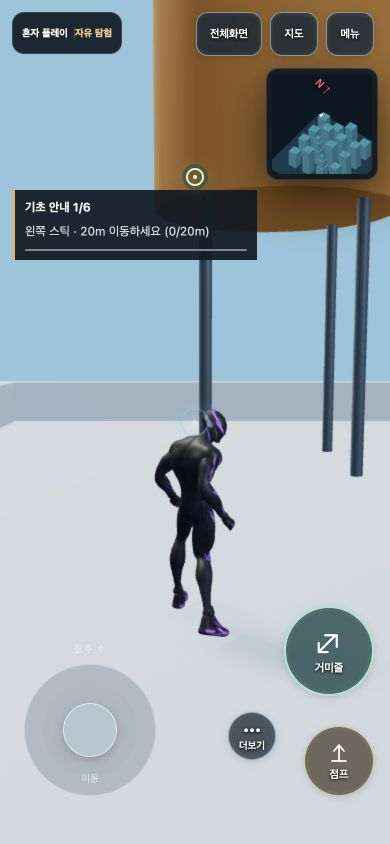
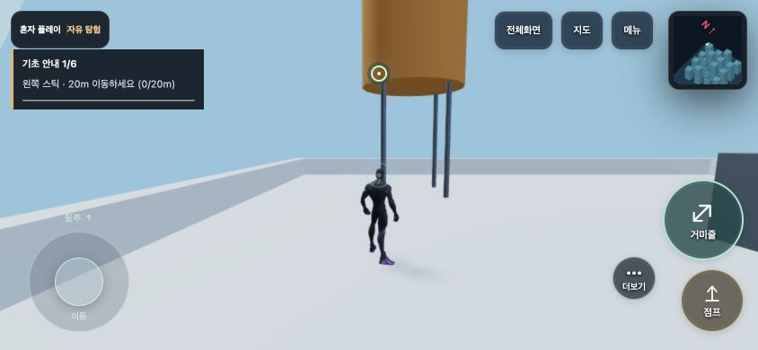
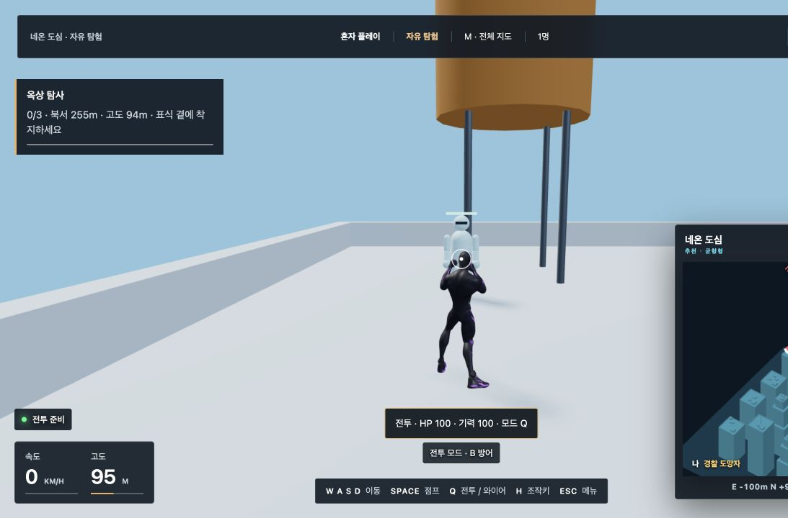
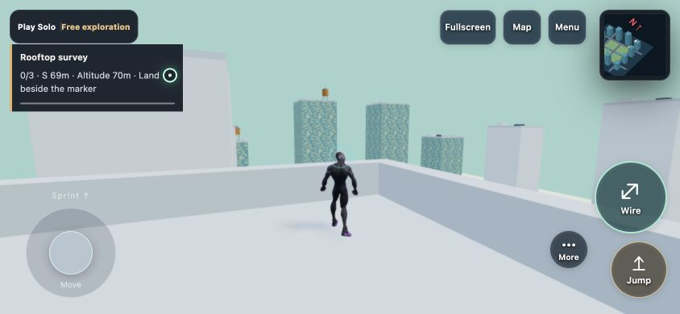
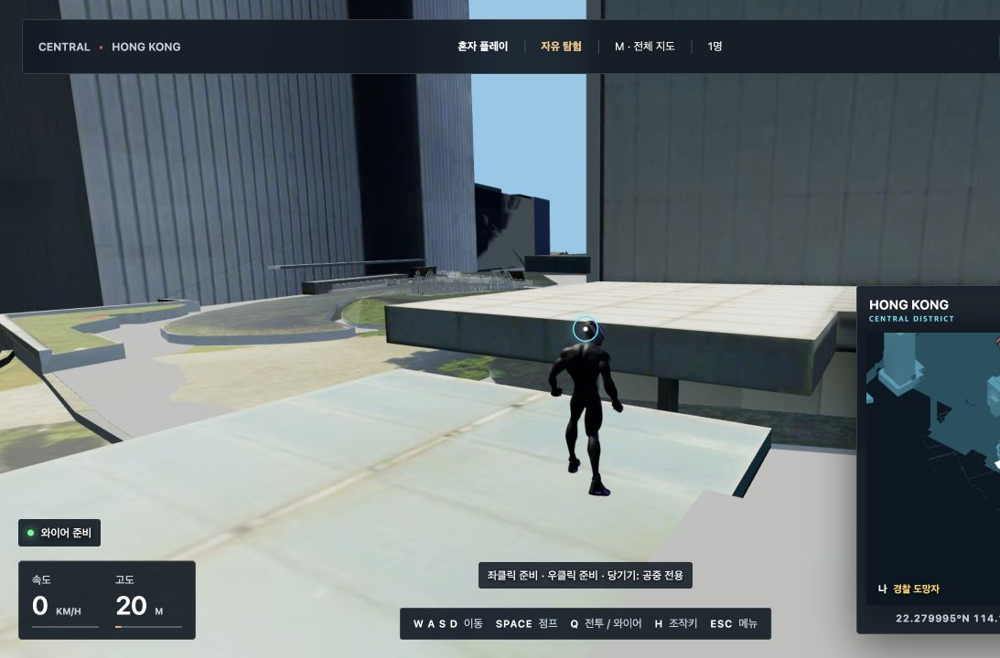

# 플레이 완성도 개선 · 2026-10-25

제안했던 여섯 영역 중 이 작업 환경에서 구현·검증 가능한 변경을 반영했다. 실제 휴대폰의 발열이나 공용 인터넷의 8인 플레이를 수행했다고 판정하지 않는다. 기존 작업 트리의 모션·물리·인터페이스 변경은 보존했다.

## 반영한 기능

| 영역 | 변경 |
| --- | --- |
| 처음 배우기 | 이동 20m → 점프 → 실제 와이어 스윙 2초 → 착지 → 벽 이동/턱 오르기 → 훈련 표적 명중의 6단계. 완료 단계 저장, 안내 닫기·다시 시작, 현재 키 설정과 터치·게임패드 안내 적용. |
| 혼자 플레이 목표 | 안전한 옥상 3곳 탐사, 처음 방문하는 구역 3곳 발견, 도시 500m 순찰. 완료 횟수 저장, 임무 교체·중단, 방향·거리·고도와 월드/미니맵 표식 제공. |
| 목표의 안전성 | 실제 지지면과 머리 공간을 검사한 옥상만 선택. 반경 3m·높이 오차 0.8m 이내에서 0.6초 동안 안전하게 서 있어야 도착. 다섯 로컬 지도에서 생성·도착 판정 검사. 스트리밍 지형이 부족하면 메뉴 안에 재시도 이유 표시. |
| 진행 상태 | 정지·도움말·숨겨진 탭·그래픽 연결 중단·온라인 전환 중 진행 방지. 복귀·회복 이동의 거리 제외. 저장 위치 복귀 시 진행 중 임무 종료. 전투 연습 중에는 임무 일시정지. 기존 와이어 색상은 그대로 사용 가능. |
| 훈련 상대 | 머리·몸통·상완·팔꿈치·다리·무릎·발을 가진 관절형 훈련 마네킹. 이동 보행, 공격 준비, 타격, 피격 자세와 방패 표현. 기존 공격 거리·피해·충돌 판정 유지. 화면 효과 줄이기 설정 반영. |
| 로딩 | 홍콩 타일/충돌 엔진을 해당 지도 진입 시 지연 로딩. 사전 컴파일 모션 로딩 실패 때만 FBX 파서 로딩. 빌드에 Brotli/gzip 산출물 생성 추가, Node 정적 서버가 요청의 인코딩 우선순위에 맞춰 전송. |
| 모바일/전력 | 로비·일시정지의 메인 3D 렌더를 최대 초당 10회로 제한하고 숨겨진 문서의 메인 렌더 생략. 플레이 입력·물리 프레임은 유지. 모바일 세로/가로 목표창 배치 및 계기판 겹침 수정. |
| 기기 진단 | 메뉴의 ‘기기 · 연결 진단’에서 JSON 다운로드. 실제 활성 플레이의 프레임, 느린 프레임 수, 렌더 자원 수, 해상도, 로딩·연결 정보 기록. 5초 표본 최대 360개, 최근 약 30분 유지. 이름·위치·계정·토큰을 수집하거나 외부 전송하지 않음. |
| 온라인 연결 | 지연 표본 최대 24개, P95와 변동 측정. 높은 지연/응답 중단 안내, 응답 없는 WebSocket 재연결 유도, 백그라운드 복귀 유예. 기존 재접속 토큰과 서버 권한은 유지. |
| 접근성·언어 | 한영 안내, 실제 저장된 키와 입력 장치별 조작 문구, 임무 상태의 접근성 정보. 같은 상태를 반복해서 읽지 않도록 live region 갱신을 캐시. |

훈련 상대는 가벼운 절차형 모델이다. 새 모션 캡처나 상용 게임 수준의 캐릭터 아트를 제작한 결과로 설명하지 않는다.

## 검증 결과

최종 결과는 **80/80 검사 묶음 통과(재검사 포함)**다. 최초 79개 묶음의 실패 3건과 실행 한도 초과 1건을 수정·재검사 결과로 해결했고, 정적 자산 전송 검사 1개를 추가했다. 새 기능 회귀 검사는 11/11, 관련 최종 재검사는 26/26 통과했다. 프로덕션 빌드와 실제 HTTP 압축 전송 검사도 성공했다. `npm test`를 최종 상태에서 단일 실행해 통과했다고 표현하는 대신 전체 결과와 재검사 근거를 함께 보존했다.

- `final-summary.json`: 최종 80개 묶음과 각 통과 근거.

## 검증 자료

- `suite.json`: 기본 테스트 명령의 검사 묶음을 실행한 최초 결과. 이 실행은 기존 모션 산출물을 재생성하지 않았다.
- `final-rechecks/results.json`: 최종 변경과 관련된 26개 묶음 재검사.
- `final-rechecks/player-journey.log`: 새 기능의 11개 회귀 검사. 실제 다섯 로컬 지형과 실제 Multiplayer.update의 침묵 감지도 포함.
- `final-rechecks/long-joints.json`: 최초 180초 실행 한도에 걸린 끝 관절 검사의 실행 한도를 늘린 재검사.
- `final-rechecks/source-hashes.json`: 최종 코드 해시.
- `network-conditions.json`: 실제 로컬 WebSocket 8개를 지연 프록시로 연결한 결과.
- `http-delivery.json`: 실제 정적 서버의 압축 전송·HEAD·406·404·숨김 파일 거부 검사.
- `build.log`: 프로덕션 빌드와 압축 산출물 집계.
- `browser-diagnostics.json`: 실제 화면의 다운로드 버튼으로 저장된 진단 파일.

첫 전체 실행에서 원격 모션·저장 위치 복귀·와이어 연속성 검사의 제한된 DOM 모형이 새 기능에 필요한 참조를 제공하지 않아 실패했다. 선택적 시스템 참조와 DOM 접근을 정리한 뒤 해당 검사들을 다시 통과시켰다. 전투 품질 검사의 생성자 모형에도 새 UI 생성에 필요한 최소 DOM 표면을 추가했다. 기존 판정 수치나 통과 조건을 완화하지 않았다.

## 정적 자산 전송 실측

로컬 지도용 시작 JS의 실제 HTTP 응답 크기다. 홍콩 지도는 별도 지형/충돌 엔진과 타일 자원이 추가된다. 전체 게임 다운로드 크기나 로딩 시간으로 해석하지 않는다. 대형 청크에 대한 Vite 경고도 남아 있다.

| 전송 인코딩 | 바이트 |
| --- | ---: |
| br | 320,526 |
| gzip | 355,718 |
| identity | 1,272,852 |

## 실제 브라우저 확인

로컬 네온 도심과 스카이 가든에서 첫 안내, 메뉴, 옥상 임무 시작, 목표 표시, 훈련 표적, 기기 진단 다운로드를 확인했다. 1280×720 데스크톱 DOM 배치, 390×844 세로와 844×390 가로의 터치 검수 모드, 한국어·영어 화면을 확인했다. 이 모드는 실제 휴대폰 하드웨어의 터치·발열 검증과 구분한다.

홍콩 지도에서는 지연 로딩된 엔진으로 실제 지형을 준비하고 솔로 진입한 화면을 확인했다. 외부 지형의 준비 시간은 일정하지 않았으며, 안전한 목표를 충분히 찾지 못한 경우에는 임무를 시작하지 않고 재시도 안내를 남긴다. 3D Tiles 1.1 지원 범위에 대한 기존 라이브러리 경고는 남는다.







## 아직 실측하지 않은 환경

| 항목 | 상태 | 구체적인 다음 확인 |
| --- | --- | --- |
| iPhone Safari·Android Chrome 실기기 | 미검증 | 각각 탐험 10분·훈련 10분 뒤 진단 파일 저장. 처음/마지막 구간 FPS·느린 프레임·자원 수·체감 발열 비교. 3개 동시 터치와 회전·백그라운드 복귀 확인. |
| 서로 다른 인터넷 회선의 실제 8인 경기 | 미검증 | 운영 주소에서 8명 입장·준비·전투·종료·재접속·방장 이탈 확인. 이동·명중 지연과 연결 기록 비교. |
| TCP 수준 패킷 손실·통신망 전환 | 미검증 | 이번 프록시는 애플리케이션 이동 업데이트 일부를 버린다. 실제 TCP 손실이나 Wi-Fi→모바일 데이터 전환과 같은 실험으로 표현하지 않는다. |
| 저대역폭 첫 방문 체감 | 미검증 | 압축 전송 바이트는 측정했으나 실제 단말의 첫 플레이 시간을 보장하지 않는다. 홍콩 외부 지형의 대역폭·서버 응답도 별도 변수다. |

## 재현 명령

```sh
npm run test:player-journey
npm run test:network-conditions
npm run test:release-quality
npm run build
npm run verify:asset-http
```

`test:release-quality`는 현재 체크아웃의 모션 산출물을 사용한다. `npm test`와 `npm run build`의 기존 모션 생성 단계는 일반 사용 시 그대로 실행된다. Node 정적 서버의 압축 전송은 빌드 후 `npm start`에서 적용된다. 외부 정적 호스팅의 압축 설정은 해당 서비스 설정에 따른다.
