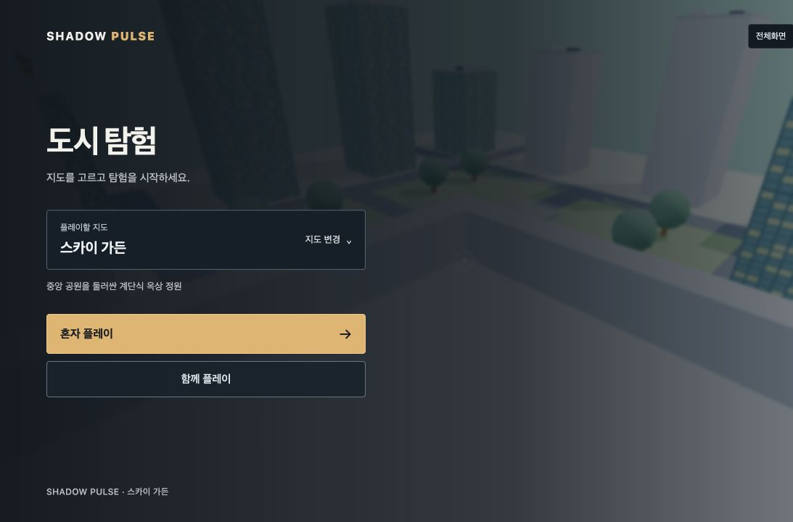
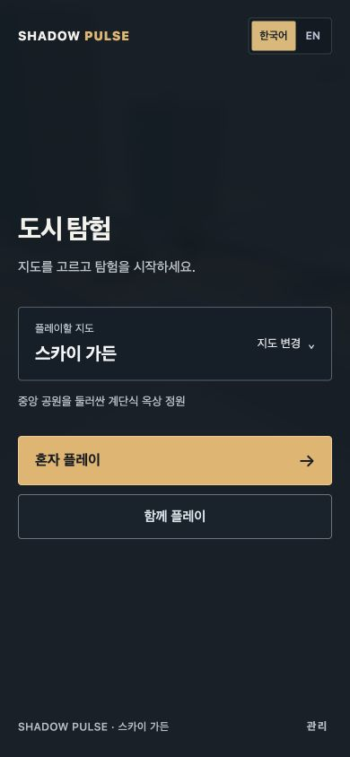

# 플레이어 관점 UI·시인성 검수 — 2026-10-25

## 판단 기준과 범위

33년 이상 게임을 플레이한 사용자가 기대하는 정보의 우선순위, 읽기 쉬운 글자, 일관된 조작 피드백을 기준으로 소스와 실제 브라우저 화면을 검토했다. ‘AI 느낌’은 객관적으로 판정할 수 있는 항목이 아니므로, 장식이 기능을 가리는 지점과 화면 간 불일치를 구체적인 수정 대상으로 삼았다.

로컬 네온 도심·스카이 가든에서 로비, 지도 변경, 실제 게임 진입, 인게임 HUD, 도움말, 일시정지, 설정, 로비 복귀를 확인했다. 멀티플레이는 방 목록과 생성 설정 화면을 확인했다. 1280×720 PC와 390×844 모바일 크기에서 확인했으며, 모바일 크기 테스트는 실제 휴대폰 실기기 테스트를 대신하지 않는다.

## 발견 사항과 반영

| 발견 사항 | 반영 |
| --- | --- |
| 로비는 WEB RUNNER, 메뉴와 문서에서는 SHADOW PULSE로 표기 | SHADOW PULSE로 통일, 기존 아이콘 색상도 화면에 맞춤 |
| 인사형 제목과 홍보 문장, 임의의 도시 막대 그림 | 목적이 명확한 ‘도시 탐험’, 간결한 설명, 실제 지도 특성으로 교체 |
| 선택 전에는 지도 특성이 숨겨짐 | 지도 목록에 설명 노출, 선택 후 설명과 이름 즉시 갱신 |
| 외부 폰트 요청과 서로 다른 서체, 작은 한국어 텍스트 | 기기 기본 한글 서체 중심으로 통일, 외부 폰트 요청 제거, 메뉴·설정·HUD 글자와 행간 조정 |
| 강한 분홍·보라·청록 장식, 유리 효과와 과도한 라운드 | 어두운 중성색과 황토색 강조로 정돈, 주요 버튼과 보조 버튼 구분 |
| FPS·ms·P95가 기본 게임 화면에 항상 노출 | 기본 숨김, 카메라·화면 설정의 ‘성능 정보 표시’로 선택 가능, 저장·복원 지원 |
| 이동할 때 속도·고도 표시가 흐려짐 | 배경 판과 대비 확보, 숫자 정렬과 단위 정리 |
| 상태에 SWINGING·PULSE READY 등 내부 명칭 노출 | 언어별 실제 행동 상태로 변경 |
| ‘집’이라는 모호한 와이어 상태 | ‘당기기’로 변경 |
| 전투 연습의 체력·기력이 CSS에 의해 숨겨짐 | 활성 전투 상태를 다시 노출, 모바일 배치 분리 |
| 일시정지 메뉴의 작은 긴 조작 설명 | 계속 플레이와 설정 우선, 플레이 중 단축키만 간결하게 안내 |
| 카메라·음량·HUD 크기 설정이 의미 없는 소수로 표시 | 시야각 °, 감도 ×, 나머지 % 단위 제공 |
| 조작 설명이 한꺼번에 길게 나열됨 | 이동·카메라, 와이어·공중 이동, 전투, 경기 규칙, 터치로 접기 제공 |
| 조작 도움말 상단과 알림이 겹침 | 도움말을 여는 동안 알림과 손 상태 표시 숨김, 온라인 경기 진행 여부 안내 유지 |
| 버튼인 모드 선택에 탭용 선택 속성 사용 | 그룹 안의 누름 버튼과 aria-pressed로 선택 상태 제공 |
| 로비 위로 게임 알림·미니맵이 비침 | 세션 UI를 플레이 중에만 표시 |
| 벽 때문에 카메라가 몸 가까이 들어오면 PC에서 캐릭터가 화면을 가림 | 모바일에만 있던 근접 시 모델 숨김을 PC에도 적용, 충분히 멀어지면 복원 |
| 모바일에서 배경 지형이 메뉴를 방해 | 좁은 화면의 로비 배경 대비 강화, 입력 필드와 버튼 크기 확보 |

## 확인 결과

다음 13개 검증 스크립트가 통과했다.

- `check-mode-selection.mjs`
- `check-session-flow.mjs`
- `check-input-lifecycle.mjs`
- `check-upgrade.mjs`
- `check-minimap.mjs`
- `check-touch-controls.mjs`
- `check-player-audit.mjs`
- `check-districts-and-language.mjs`
- `check-reticle-only.mjs`
- `check-display-mode.mjs`
- `check-mobile-traversal.mjs`
- `check-camera-motion-web.mjs`
- `check-third-person-only.mjs`

추가로 성능 표시의 기본 꺼짐·저장·복원·잘못된 저장값 처리와 설정 단위 표시를 Node assertion으로 확인했다. 브라우저에서 성능 표시 체크 후 실제 HUD가 나타나는 것도 확인한 뒤 꺼짐으로 복원했다.

실제 화면에서 지도 선택 후 URL과 게임 지도 변경, 도움말 열기·닫기, 일시정지와 복귀, 방 생성 옵션 펼치기를 확인했다. 한국어·영어 로비 표시를 확인했다. 모바일 로비·방 설정의 콘텐츠 너비는 390px로 뷰포트와 같아 가로 넘침이 없었다. 마지막 지도 진입에서 브라우저 오류·경고 로그는 없었다.

`npx vite build` 성공. 기존 대형 JavaScript 청크에 대한 Vite 경고는 남아 있다. 모션 파일을 다시 생성하는 prebuild를 피하고 현재 작업 트리로 빌드했다.

## 검수 이미지

## 남는 범위

이번 변경은 플레이어 인터페이스, 상태 전달, 접근성, 카메라 시야 가림을 다룬다. 캐릭터 모델과 도시의 아트 에셋, 애니메이션 전체, 사운드 믹싱을 새로 제작한 것은 아니다. 홍콩 실시간 지형의 모든 로딩 상태, 실제 모바일 기기, 8인 인터넷 경기의 전체 라운드는 이번 화면 검수 범위에 포함하지 않았다. 출시 수준의 ‘완벽함’이나 모든 분야의 검증 완료를 의미하지 않는다.

기존 작업 트리에서 진행 중이던 모션·물리 변경은 되돌리지 않았다. 스타일은 `src/player-ui.css`에 모아 기존 터치 조작 배치를 유지하며 적용했다.
