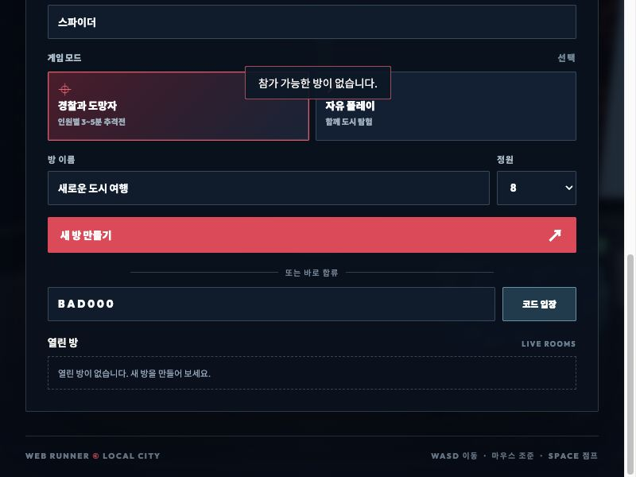

# 게임 출시 검증 보고서 — 2026-10-13

## 판정: 출시 보류

전체 기능을 무결함으로 판정하지 않는다. 자동 기능 검사와 로컬 플레이는 통과했지만, 경쟁전의 피해 판정과 운영 Supabase 이동 검증에 P1 문제가 남아 있다. 혼자 플레이·비경쟁 탐험에 대한 검증 결과와 경쟁전 출시 판정을 분리한다.

- 기준 Git HEAD: `e6d3282f68500f8155c8f1170c6b32d3955e4307`. 미커밋 변경을 포함한 검증이다.
- 최종 작업 트리 SHA-256: `f857ad0149712b57b600770a9a6fd175e9aab18d9f44296b2573f5ffc302370a`.
- 파일별 해시는 [소스 기록](evidence/final-source-manifest.json)에 있다. 기존 수정·미추적 파일을 보존했고, 커밋·푸시·배포·운영 DB 변경을 수행하지 않았다.
- 실제 대상은 루트 `spiderman-web-swing`이다. `spiderman-game/` 하위 샘플은 출시 대상에서 제외했다.
- Node 22.19.0, Apple M1, RAM 16GiB, macOS, Codex 내장 브라우저, 기본 측정 1280×720/DPR 1. 브라우저 정확한 버전은 기록하지 못했다.
- 모션 manifest는 39개/14,292,097 bytes를 확인했다.

## 실행한 검증

`npm test`의 26개 실행 단계(모션 생성 단계 포함), `npm run build`, 추가 회귀 검사 17개, 운영용 HTTP 서버 검사 10개, 의존성 audit를 실행했다. 단순 PASS 로그 개수를 테스트 케이스 수로 환산하지 않았다. 기존 검사는 실제 Three/Rapier 상태, 실물 리그·관절 수치, 모션 데이터, 타이머, 충돌·줄 제약, 소켓 통합 검사를 포함한다. 이 결과가 모든 모션의 주관적 자연스러움이나 모든 사용자 입력 조합을 보장하지는 않는다.

브라우저에서는 로비→혼자 플레이→점프→좌우 거미줄→착지, 도움말, 시작점 복귀, 레이스 시작·일시정지, 전투 연습과 공격 입력을 확인했다. 레이스는 22.86초에서 약 52.5초 동안 일시정지해도 기록이 변하지 않았다. 두 독립 세션으로 코드 입장·준비·역할 배정·시작 보호 시간 표시·원격 모션/거미줄·도망자 Q 제한·새로고침 복귀를 확인했다. 3분 경기의 도망자 승리와 방장 재경기 대기실·방 나가기까지 확인했다.

브라우저의 프로덕션 코드 검증은 `VITE_WS_URL=ws://127.0.0.1:5173/ws`로 빌드한 뒤 Node 서버로 실행했다. 기본 프로덕션 설정의 Supabase 쓰기 경로와 동일한 통합 시험으로 취급하지 않는다. 기본 설정 빌드는 별도로 검증한다. 운영 Supabase에서는 메타데이터·함수·권한·Advisor만 읽었다. 익명 계정 생성, 방 생성, 공격, 마이그레이션 적용을 수행하지 않았다.

작업 초반 외부에서 소스가 계속 변경되어 Vite 자동 새로고침이 발생했다. 이후 고정 빌드를 사용했다. 한 차례 서로 다른 번들/방 서버에 연결된 두 세션을 확인하고 동일 번들로 다시 검증했다. 초반 서버 전환 때 발생한 자산 다운로드 중단 경고를 최종 빌드의 결함으로 합산하지 않는다. 화면 증거의 파일명에 `before` 또는 이전 번들이 있으면 수정 전/중간 단계 증거다.

세부 범위와 미검증 항목은 [검증 매트릭스](MATRIX.md)에 있다.

## 수정한 결함

| ID | 심각도 | 재현된 문제 | 수정 및 재검증 |
|---|---|---|---|
| FIX-01 | P2 | 저장 설정이 null이면 정규화가 예외를 던져 다른 저장 설정까지 읽지 못함 | `PlayerSettings.cleanSettings`에서 잘못된 컨테이너를 기본값으로 정규화. 회귀 검사 PASS |
| FIX-02 | P1 | 잘못된 지형 시작점을 준비 완료로 받아들여 arena 없이 확장 경기를 시작할 수 있음 | `scripts/rooms.mjs`에서 시작점 검증·복사, 시작 시 유효 arena 재확인. 실제 소켓 검사 PASS |
| FIX-03 | P1 | 이미 방에 있는 소켓이 다른 방의 복귀 토큰을 사용하면 한 연결이 두 방에 남음 | 점유 중 복귀 거부. 기존 방 유지와 중복 멤버십 방지 검사 PASS |
| FIX-04 | P2 | 메시지를 모두 수신한 뒤에만 크기를 확인함 | WebSocket `maxPayload=4096`, 연결 오류 처리. 8KiB 메시지 연결 종료 및 다음 정상 요청 검사 PASS |
| FIX-05 | P2 | 방 목록 등의 반복 요청이 다른 연결에 제한 없이 전파됨 | 연결당 1초 120개 메시지/20개 제어 요청 한도. 과다 요청 연결 종료 검사 PASS. 대규모 DDoS 방어 전체를 검증한 것은 아님 |
| FIX-06 | P2 | 로비에서 시작한 전투 연습이 실제 플레이를 시작하지 않고 정지 상태에 남음 | 자산 준비·온라인 제한, 필요 시 혼자 플레이 진입, 캔버스 포커스. 자동 검사와 실제 연습 시작 PASS. 작업 중 연습 UI가 일시정지 메뉴로 옮겨진 변경도 현재 기준에 반영 |
| FIX-07 | P2 | 연습에서 쓰러져 적 목록이 초기화되면 빈 목록을 승리로 판정해 ‘연습 완료’ 표시 | 빈 적 목록에서 연습 중단, 적이 존재할 때만 완료 판정. 수정 전 실패/수정 후 PASS 기록 |
| FIX-08 | P1 | 매 이동 메시지마다 20m 오차를 새로 허용하여 약 110ms에 18m 순간이동 2회를 받아들임 | 로컬 WebSocket의 누적 이동 여유로 변경. 지속 허용 72m/s, 저장 가능한 여유 20m. 반복 순간이동 거부, 정상 48m/s·500ms 지연 업데이트 수용 검사 PASS. 운영 Supabase는 별도 미해결 |
| FIX-09 | P2 | 홍콩 카메라의 반복 삼각형 충돌 조회가 평균 약 34ms/프레임을 소비 | 준비된 지형은 Rapier 조회를 사용하고 새 LOD·재구축·커버리지 밖에는 시각 메시 검사를 유지. 관전 대상 위치도 별도로 고려. 실제 새 벽/기존 벽/원거리 관전 회귀 검사 PASS. 그림자 설정은 유지 |

| FIX-10 | P2 · 검증 도구 | 양손 시나리오가 버튼 유지 입력을 누락해 줄 0개로 잘못 보여줌 | 실제 입력 의미에 맞춰 유지·좌우 발사·교체를 구성. 자동 검사 및 0.8/2.5/4.5초 UI에서 줄 2개·SWINGING 확인 |
| FIX-11 | P2 | 잘못된 방 코드 오류 메시지가 로비 뒤에 가려져 실패 원인을 알 수 없음 | 알림 z-index 80으로 변경. 800×600 실제 화면에서 메시지가 로비 위에 보임을 확인 |

처음 추가한 7개 검사 중 5개가 실패했고 수정 후 통과했다. 이후 패배 표시와 순간이동을 각각 추가 재현했다. 현재 추가 회귀 검사는 총 17개이며 모두 통과한다. 키 재지정·활성 프레임 통계 등 검증 도구도 확인했다. 측정 패널은 기존 `?hongKongAudit`를 켰을 때만 표시되며, 외부로 데이터를 전송하지 않는다. 일시정지/숨김 구간은 활성 프레임 통계에서 제외하고 표본을 3,600개로 제한한다.

## 남은 출시 차단 문제

### SEC-01 — P1: 홍콩 경쟁전 피해를 피해자 클라이언트가 거부 가능

새 로컬 서버의 확장 홍콩 추격전에서 동일한 유효 주먹 공격에 대해 피해 확인을 무시하거나 `clear:false`를 보내면 HP 100이 유지됐다. `clear:true`를 보내면 HP 75가 됐다. 피해자 ID 확인과 재사용 방지는 있으나 지형 가림 여부에 대한 최종 판단이 피해자에게 있다. [실제 재현](evidence/hong-kong-defender-trust.json).

운영 `game_command`도 `hit-confirm` 및 클라이언트 `clear` 분기를 사용하는 것을 읽기 전용으로 확인했다. 운영에서 공격을 실행하지 않았으므로 실제 운영 공격 재현으로 표시하지 않는다. [운영 함수 검토](evidence/supabase-final-trust-review.json).

서버가 홍콩 지형의 충돌/시야와 피해를 독립적으로 검증해야 한다. 단순히 응답 시간 초과를 명중으로 바꾸면 벽을 통과한 공격이라는 다른 결함을 만든다. 구현·테스트용 지형 서비스 및 staging 검증이 필요하며, 이 보고서에서 수정 완료로 처리하지 않는다.

### SEC-02 — P1: 운영 Supabase에는 기존 반복 순간이동 허용이 남음

로컬 서버의 이동 여유는 수정했지만 운영 `game_command`의 `greatest(20, elapsed*0.15)` 조건은 현재도 남아 있다. 로컬 수정이 운영 DB에 자동 적용되는 구조가 아니다. [현재 운영 확인](evidence/supabase-final-trust-review.json). 동일 형태의 조건에 대한 실제 공격 재현은 로컬 수정 전 증거로 남았다.

운영 함수에는 RPC 상태를 이용한 누적 이동 예산, 정상 이동/집/복귀/지연의 회귀 검사와 트랜잭션 경쟁 조건 검증이 필요하다. 운영 변경은 하지 않았다. [누적 이동 예산 마이그레이션 초안](supabase-proposal/README.md)은 실제 migrations 밖에 작성해 자동 적용되지 않게 했다. 읽기 전용 SQL로 예산 산식의 정상 지연·반복 순간이동 분기를 확인했으나, 이는 함수 통합 검사가 아니다. Docker/psql 및 격리 staging이 없어 실제 적용·RPC·트랜잭션 경쟁 조건 검증은 BLOCKED다. 로컬 수정도 완전한 서버 물리 권위 구현은 아니며 클라이언트 위치를 제한·검증하는 수준이다.

### 추가 제한

- 모든 장비·장면에서 60FPS를 보장하지 않는다. 수정 전 홍콩 높은 설정은 약 22FPS였다. 카메라 수정 후의 실제 플레이 측정과 구분한다.
- 최종 번들은 약 5.6MB(압축 약 2MB)로 Vite 크기 경고가 남는다. 오류를 숨기거나 임계값을 늘려 경고를 없애지 않았다.
- 타일 라이브러리의 3D Tiles 1.1 제한 지원 경고를 기록했다. 이번 지형은 로딩·실제 충돌·RGB 텍스처를 확인했지만 모든 확장 지원을 검증한 것은 아니다.
- 실제 8인, Safari/Firefox, 여러 GPU/해상도, 물리 게임패드, 브라우저 네트워크 손실 주입, WebGL 컨텍스트 복구, 모든 모션의 영상 판정, 자산 배포 권한은 미검증이다.
- 최신 동시 작업의 모든 신규 기능을 독립적인 출시 사양으로 확정하지 못했다. 초기 README의 미구현 표기와 현재 위치 저장·게임패드·확장 추격전 구현을 구분했다. 문서나 구현을 일방적으로 정답으로 삼지 않았다.

## 안정성·성능·권한

30분 실시간 Node/Rapier + 8 WebSocket 클라이언트 시험은 1,800.128초, 30회 방 생성·시작, 29회 재접속, 193,005회 물리 갱신, 2,056,432회 이동 수신으로 PASS했다. 최종 퇴장 후 방 0개를 확인했다. 분 단위 힙은 14.82~27.76MiB, RSS는 52.41~78.48MiB였다. 단조 증가하는 누수 패턴은 관측하지 못했지만 메모리 누수가 없다는 증명으로 취급하지 않는다. [30분 증거](evidence/soak-summary.json).

이 장시간 시험은 FIX-08의 마지막 이동 예산 수정과 FIX-09 카메라 검사 변경 전 시작한 서버/물리 스냅샷이다. 최종 서버에는 별도로 60초/8연결 시험 및 전체 회귀 검사를 수행했다. 이 서버 시험과 아래 실제 브라우저 장시간 시험은 서로 다른 증거다. [최종 서버 짧은 시험](evidence/final-server-soak-60s.log).

홍콩 높은 설정의 97.07초 표본은 평균 21.91FPS, 프레임 p50 45.2ms / p95 49ms / p99 57.6ms였다. 카메라 수정 전 기본 설정도 평균 19.91FPS였고, 추가 측정에서는 카메라 평균 34.14ms/호출이 확인됐다. [병목 측정](evidence/hong-kong-profile-before.json). 수정 후 기본 품질/1280×720의 335.56초 측정은 59.95FPS, p95 18.4ms, 카메라 평균 0.047ms였다. [개선 측정](evidence/hong-kong-profile-after.json). 최종 장시간 표본의 카메라는 평균 0.049ms였다. CPU 구간 측정은 중첩되므로 값을 단순 합산하지 않는다. 타일/자산 초기 로딩, 장비, 캐시, 브라우저 도구 및 동시 세션 부하의 영향을 구분하며 순수 GPU 시간이라고 단정하지 않는다.

최적화된 카메라 빌드에서 실제 홍콩 브라우저 활성 실행 2,771.65초(46.19분), 156,935프레임을 기록했다. 마지막 3,600프레임 창은 51.45FPS, p95 27.2ms, p99 33.1ms, 전체 50ms 초과 프레임은 29개였다. 캡처된 위치·속도가 유한하고 마지막 ready/playing이 유지됨을 확인했다. 다른 모션·레이아웃 탭을 함께 실행했고, 긴 대기와 주기적 이동·점프·카메라 입력이 섞였다. 30분 연속 도시 순회·8인 부하·모든 LOD 전환의 증거로 확대하지 않는다. 이 장시간 탭은 마지막 모션 검증기/CSS 변경 전 번들이며 해당 두 변경은 따로 UI 재검증했다. [브라우저 장시간 증거](evidence/hong-kong-browser-soak.json). 리소스 250개 제한으로 네트워크 바이트는 전체 다운로드 합계가 아니다.

39개 모션의 45% 자세를 실제 화면으로 캡처해 [모션 갤러리](MOTION_SAMPLES.md)에 보존했다. 12개 연결 시나리오를 2개 시점에서 검사했고, 잘못된 양손 검증기를 발견해 수정 전 증거와 수정 후 3개 시점 증거를 구분했다. 정지 화면 표본은 전체 영상의 자연스러움을 보장하지 않는다. 800×600·1024×768에서 핵심 HUD와 조작을 확인했고 작은 로비의 세로 스크롤 및 오류 메시지 표시를 확인했다. [해상도 기록](evidence/responsive-checks.json).

Supabase 실제 권한을 읽어 두 게임 테이블의 RLS 활성, anon/authenticated 직접 SELECT·쓰기 금지, 내부 `game` 스키마 USAGE 금지를 확인했다. Realtime 읽기 정책은 방 참가 여부 함수로 제한된다. 공개 RPC의 SECURITY DEFINER 경고는 의도된 권한 상승 경계로 기록했고 각 함수의 인증/멤버십 검토와 구분했다. ‘RLS 정책 없음’ 알림을 해결하려고 테이블 접근을 새로 열지 않았다. 익명 로그인은 이 게임의 게스트 플레이 구조이며 별도로 인증된 익명 사용자와 anon 역할을 구분한다. 비밀번호 보호 경고는 현 게스트 흐름의 실제 피해 판정 결함과 같은 문제로 합산하지 않는다. [실제 권한](evidence/supabase-permissions.json), [Advisor](evidence/supabase-advisors.json), [공식 설명](https://supabase.com/docs/guides/database/postgres/row-level-security), [Advisor 해석](https://supabase.com/docs/guides/database/database-linter?lint=0029_authenticated_security_definer_function_executable).

`npm audit`의 보고된 취약점은 0개였다. 이것이 게임 권한 설계와 공격 판정의 안전성을 보장하지 않는다.

## 재현·재검증 명령

```sh
npm test
npm run build
node scripts/check-release-audit.mjs
node scripts/diagnose-release-security.mjs
node scripts/soak-release-audit.mjs 1800000
npm start
node scripts/check-server.mjs http://127.0.0.1:4173/
```

`diagnose-release-security.mjs`는 현재 SEC-01을 재현하여 의도적으로 종료 코드 1/FAIL을 출력한다. 전체 기능 테스트에서 제외한 이유는 미해결 진단을 정상 기능 PASS로 숨기지 않기 위해서다. 수정 후에는 이 진단의 실패 조건이 해소됐는지 별도 확인해야 한다.

로컬 프로덕션 브라우저 재현:

```sh
VITE_WS_URL=ws://127.0.0.1:5173/ws npm run build
PORT=5173 npm start
```

절차 도시: `http://127.0.0.1:5173/?city=procedural&hongKongAudit`.
홍콩: `http://127.0.0.1:5173/?city=hong-kong&hongKongAudit`.
두 새 탭에서 방 생성·6자리 코드 입장·모두 준비·방장 시작 후 역할과 원격 거미줄을 확인한다. 재접속은 시작 후 참가자 탭을 30초 내 새로고침한다.

출시 승인에 필요한 다음 증거는 SEC-01/02의 서버 권위 판정과 staging 통합 검증, 실제 8인 및 주요 브라우저/GPU 검증이다. 이번 보고서의 PASS 범위를 확대 해석하지 않는다.

## 실제 수정 화면


