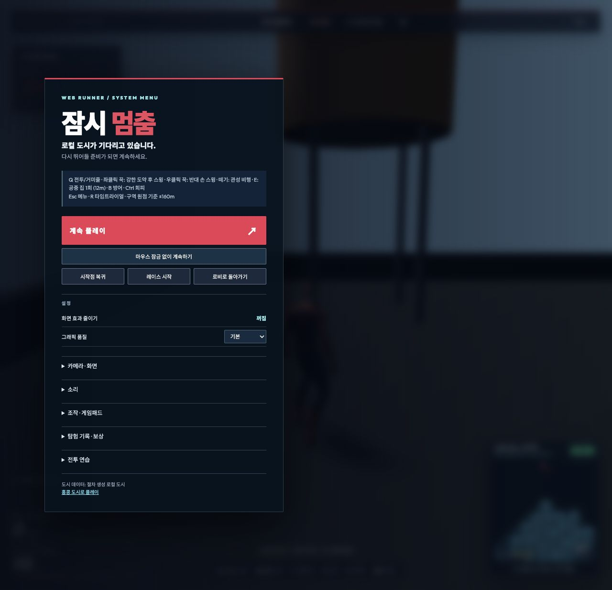
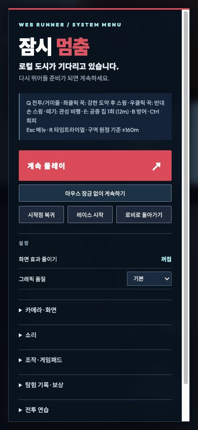

# 플레이 전환·도움말·메뉴 개선 검증 — 2026-10-14

루트의 실제 게임을 숙련 게임 개발·QA 관점으로 검토하고, 기존 개선 사항을 보존한 채 플레이 흐름의 추가 문제를 수정했다. 핵심은 도움말·일시정지·레이스·전투 연습이 서로 다른 상태를 남겨 다음 플레이를 방해하지 않도록 하는 것이다. 변경은 로컬 소스와 빌드에 반영했다.

## 이번 수정과 추가 기능

| 발견 사항 | 플레이 영향 | 반영 내용 |
|---|---|---|
| 로비·메뉴 뒤에서 열리는 도움말 | 로비에서 H를 누른 뒤 혼자 플레이를 시작하면 도움말이 남고 물리가 멈췄다. | 플레이 중에만 열도록 제한하고, 새 혼자/온라인 플레이 진입 시 이전 도움말을 정리한다. |
| 도움말을 읽다가 백그라운드로 전환한 뒤 재개 | 일시정지 메뉴를 닫아도 도움말 상태가 남아 혼자 플레이가 계속 정지할 수 있었다. | 일시정지·재개에서 도움말 표시와 상태를 함께 정리한다. |
| 마우스 잠금 중 도움말 닫기 버튼 | 화면에는 버튼이 있지만 커서가 잠겨 클릭할 수 없었다. | 도움말을 열 때 커서를 해제하고 닫기 버튼에 포커스를 준다. 잠금 해제 때문에 메뉴가 중첩되지 않게 처리한다. 닫을 때 게임 포커스를 복구하고 이전 잠금 복원을 시도한다. |
| 메뉴에 없는 레이스 조작 | 레이스는 게임 HUD·키보드로만 조작할 수 있었다. | 혼자 플레이의 Escape 메뉴에 시작/종료 버튼을 추가했다. 시작 성공 시 메뉴를 닫고 재개하며 정지 시간을 버린다. 종료는 메뉴를 유지한다. 온라인에서는 숨기고 그래픽 연결 중단 중에는 비활성화한다. |
| 전투 연습 중 레이스 시작 | 상대·투사체·공격이 남고 지상 클릭이 계속 주먹에 배정됐다. | 레이스 코스 준비가 성공하면 연습 상대·투사체와 공격을 정리하고 거미줄 모드로 시작한다. |
| 코스 준비 실패의 순간 이동 | 링을 놓을 수 없어도 먼저 시작점으로 이동했다. | 코스를 준비한 뒤 성공했을 때만 위치·활동을 초기화한다. 실패하면 현재 위치·메뉴·연습을 유지한다. |
| 패드 Start가 처리되는 같은 프레임의 입력 | 메뉴를 열며 입력을 지워도 이전 활성 상태에 따라 스틱 이동·카메라 회전이 다시 적용됐다. | 버튼 처리 이후 활성 상태를 재확인한다. 정지 프레임의 후속 버튼·스틱을 차단하고, 재개 프레임은 다음 프레임부터 스틱을 반영한다. |
| 메뉴 버튼 배치·모양 | 추가 버튼이 좁은 화면에서 넘치거나 기존 버튼과 다른 기본 스타일로 표시될 수 있었다. | 기존 버튼 스타일을 공유하고 줄바꿈 및 비활성 상태를 적용했다. 최종 화면을 다시 렌더·검수했다. |

변경 소스: `src/main.js`, `src/GamepadInput.js`, `src/Multiplayer.js`, `index.html`, `src/style.css`. 새 검사 `scripts/check-session-flow.mjs`를 전체 `npm test`와 `npm run test:session-flow`에 연결했다. README에도 현재 동작을 기록했다.

## 재현과 자동 검증

- 작업 시작 시 소스를 [별도 백업](source-before-review.tar.gz)했다. 최종 새 검사를 백업 소스에 실행해 **2개 통과·10개 실패**를 확인했다. 10개에는 기존 결함과 새 메뉴 기능의 부재가 포함되며, 2개는 이미 정상인 동작을 보존하는 검사다. [수정 전 로그](reproduced-before-fixes.log).
- 수정 후 새 검사 **12개 모두 통과**. 로비/메뉴 도움말, blur→정지→재개, 새 플레이 진입, 커서/포커스, 반복 Escape, 상대/투사체 정리, 실제 메뉴 클릭, 레이스 실패, 온라인 제한, 패드 정지/재개를 검사했다. [회귀 검사](regressions.log).
- 전체 `npm test` **40개 명령 단계 통과**, 종료 코드 0. 기존 물리·모션·전투·지도·온라인 회귀 검사와 새 12개 사례를 포함한다. [전체 로그](full-tests.log).
- 최종 `npm run build` **성공**, 종료 코드 0. [빌드 로그](build.log).
- `git diff --check` **성공**, 공백 오류 없음. 소스 해시와 명령 결과는 [execution.json](execution.json), 이번 작업만의 수정 비교는 [changes-this-review.patch](changes-this-review.patch)에 보존했다.

기존 전문가 검사의 도움말 사례는 렌더를 생략하려고 `contextLost:true`를 사용하면서 정상 온라인 도움말 열기를 기대했다. 실제 그래픽 중단을 차단하는 이번 동작과 충돌하므로 테스트의 그래픽 상태를 정상으로 설정했다. 기존의 혼자 플레이 물리/시간 정지·Escape 닫기·온라인 진행 단언은 모두 유지했다. [원래 검사](check-expert-audit-before.txt).

## 실제 Chrome 확인

로컬 개발 서버의 절차 도시를 현재 코드로 실행했다. [브라우저 기록](browser-evidence.json).

1. 수정 전 로비에서 H→혼자 플레이를 실행해 도움말과 정지 상태가 다음 플레이로 넘어오는 현상을 화면으로 확인했다. [수정 전 화면](help-carried-from-lobby-before.png).
2. 수정 후 같은 입력으로 혼자 플레이가 정상 진입하며 고도·양손 상태 HUD가 갱신되는 것을 확인했다.
3. Escape 메뉴의 새 레이스 버튼으로 시작했다. 메뉴가 닫히고 게임 화면이 포커스를 받으며 `링 1/8 · 0.14초`부터 진행됐다. 메뉴에서 종료하면 메뉴를 유지하고 버튼이 `레이스 시작`으로 돌아왔다.
4. 마우스 잠금 상태에서 H를 눌렀다. 커서 잠금은 해제되고 포커스는 닫기 버튼으로 이동했으며, 일시정지 메뉴가 중첩되지 않았다. 별도 검증 작업 후에도 레이스는 `6.94초`를 유지했고 닫기→Escape 전환 후 `6.95초`였다.
5. 메뉴에서 H를 눌러도 숨은 도움말이 열리지 않음을 확인했다.
6. 실제 훈련 표적 연습 시작 후 R로 레이스를 시작했다. `COMBAT READY`가 `WEB READY`, 양손 상태가 `지상 전투`에서 `좌클릭 준비 · 우클릭 준비`로 전환됐다. 상대·투사체 제거는 자동 검사에서 실제 Three.js 객체 제거까지 확인했다.
7. 최종 390×844 화면의 문서 폭은 390px, 메뉴 내용 폭/스크롤 폭은 각각 341px, 버튼 행 내용 폭/스크롤 폭은 각각 301px이었다. 세 버튼이 가로 넘침 없이 표시됐다. 검증 후 원래 화면 크기로 복원했다.
8. 해당 실행에서 수집한 브라우저 warn/error 표본은 빈 배열이었다.

## 검증 범위와 남은 사항

백그라운드 정지와 게임패드 입력은 실제 입력 핸들러 및 패드 처리 코드를 사용하는 자동 재현으로 검사했다. 실물 패드 검사는 수행하지 않았다. 이번 수동 브라우저 검증은 로컬 절차 도시이며 홍콩 전체 지형이나 운영 인터넷 환경의 검증으로 확대 해석하지 않는다. 운영 배포·DB 변경은 수행하지 않았다.

기존 대형 번들 경고는 남는다. 최종 메인 JS는 약 5.65MB, gzip 약 2.02MB이며 후속 개선 대상으로 초기 로딩 비용을 분리해 검토할 수 있다. 이번 수정은 플레이 상태 전환의 결함과 메뉴 사용성을 우선 해결했다.
