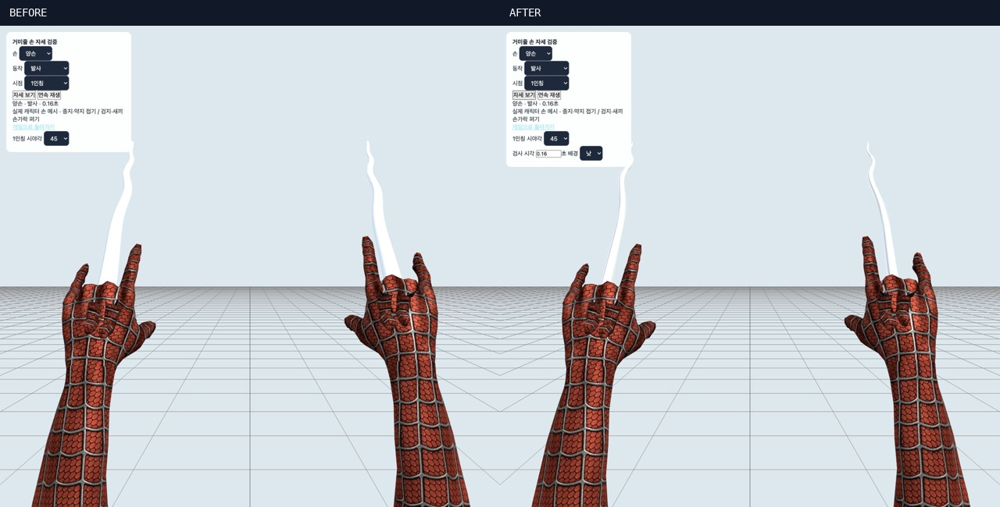

# 거미줄 표현·보행·전체 모션 검증 — 2026-10-15

거미줄을 가늘고 섬유가 드러나는 형태로 다듬고, 접지 해제 시 발목이 튀는 문제와 실제 부츠 밑창이 경사면에 묻히는 문제를 수정했습니다. 난간을 넘은 후의 마지막 발 IK가 발목 방향을 바꾸는 문제도 함께 수정했습니다.



[거미줄 움직임 미리보기](silk-motion-preview.gif)는 실제 브라우저에서 렌더링한 19개 시각 표본을 연결한 GIF입니다. 연속 녹화 영상은 아닙니다.

## 거미줄 수정

- 굵기가 일정한 코어를 손목·발사 끝에서 가늘어지는 실크 형태로 교체했습니다. 최대 코어 반경은 24mm에서 약 13mm로 줄였습니다.
- 본체 내부에 묻혔던 3가닥 섬유를 표면 바깥으로 드러내고, 곡선의 접선에 맞춰 표면 노멀을 계산합니다.
- 발사 파동은 도착하면서 줄고, 로컬 물리의 줄 길이에 따라 느슨한 줄과 팽팽한 줄의 처짐이 달라집니다. 이동 속도에 따른 미세한 흔들림을 반영합니다.
- 빗나간 발사는 마지막 0.16초 동안 사라집니다. 다음 발사에서 투명도가 복구되고 해제·충돌·만료 후 줄이 남지 않는지 검사했습니다.
- 앵커가 수직 방향을 지날 때 섬유 방향이 뒤집히지 않도록 프레임 방향을 연속적으로 전달합니다. 기존 튜브·섬유 버퍼와 손당 2개 렌더 객체를 재사용합니다.

## 발·발목 수정과 재현

| 확인한 문제 | 수정과 검증 |
|---|---|
| 접지 시작·해제 시 발목이 크게 꺾임 | IK 전 원본 발의 월드 회전을 보존하고 해제 회전을 이어받습니다. 접지 보정의 회전 속도를 시간 기준으로 제한합니다. 기존 재현에서 최대 약 6,871°/s였던 변화가 같은 검사에서 최대 약 720.1°/s로 줄었습니다. 이 값은 애니메이션 보정 한계이며 인체 관절의 의학적 기준은 아닙니다. |
| 경사면에서 접지 보간 중 발이 땅 아래에서 올라옴 | 수평 접지 보간과 지면 높이 제약을 분리해 지면 아래에서 보간하지 않도록 합니다. |
| 발목·발끝 관절은 지면 위인데 실제 밑창은 침범 | 부츠의 발 본·발가락 본 가중치가 우세한 실제 메시 정점 354개를 스키닝해 굽은 뒤꿈치·발끝·옆면을 반영합니다. 지면 탐색은 발목과 가장자리 4곳의 지지 평면을 사용하며 공중·구르기·벽 모션에 지상 제약을 강제하지 않습니다. |
| 계단의 앞쪽 발끝이 다음 단과 겹치는데 아래 단 접지가 유지됨 | 지지 평면의 불연속을 검출하면 아래 단의 접지를 해제하고 밑창을 들어 올립니다. |
| 난간 복귀의 마지막 발 IK가 다시 발목을 틀거나 밑창을 밀어 넣음 | 복귀 IK에서도 발목 월드 방향을 보존하고, 모든 지상 발 보정 뒤에 밑창 검사를 적용합니다. 4개 프레임률에서 별도 회귀 검사를 추가했습니다. |

새 검사 91건을 수정 전 소스 백업으로 복원한 독립 임시 환경에서 실행하면 **87 FAIL / 4 PASS**, 수정 후에는 **91 PASS / 0 FAIL**입니다. [수정 전 결과](results-before.json), [수정 후 결과](results.json), [복원 검사](verify-before.py), [원본 백업](source-before-review.tar.gz).

기존 검사 중 발목 중심을 항상 11cm에 고정하도록 요구하던 한 항목은 부츠의 실제 곡면을 허용하도록 수정했습니다. 대신 새 검사는 매 프레임 실제 부츠 정점 전체에 대해 지면 침범과 접지 중 부양을 독립적으로 검사합니다. 조깅 검사에서 실제로는 걷기가 선택되던 속도도 3.4m/s로 정정하고, 일반 달리기는 4.8m/s로 맞췄습니다. 이 검사 파일의 마지막 수정 후 63건을 다시 실행해 통과했습니다. [이전 검사 원문](check-pose-before.mjs).

## 수치 검증 범위

- 보행 4종 × 평지/오르막/내리막/횡경사/복합경사 5종 × 24/30/60/144fps = **80개 조건, 15,480프레임**.
- 부츠 정점 **5,479,920회** 검사: 수직 높이 기준 최소 지면 간격 약 **2.90mm**, 접지 시 최대 간격 약 **3.26mm**. 명시한 평면·경사면 조건에서 침범·과도한 부양이 없습니다. 무릎이 완전히 펴진 특이점과 사지 길이 변형도 검사합니다.
- 걷기→조깅→달리기→질주→정지→회전→점프→낙하→착지 시퀀스 4건, 난간 복귀 4건, 거미줄 형상·방향 연속성·실패 발사 정리 3건을 더해 **91건 통과**.
- 기존 실제 리그 검사: 경사·계단의 Rapier 캡슐 이동, 벽 접촉, 난간 넘기 등을 포함한 **63건 통과**. [로그](pose.log)
- 전체 클립 **42개**를 4개 프레임률로 전 구간 검사: **168개 타임라인 / 18,943프레임**, 모든 방향의 중단·복귀 전환 **7,056건**. 전체 모션 검사 **249개 그룹 통과**. [결과](all-motion-results.json), [프레임별 범위](all-motion-coverage.json)
- 원본 모션 검사: **32파일 / 44개 유효 take / 5,476프레임**. [목록](source-coverage.json)
- 기존 손·손목 메시와 발사 손가락 포즈는 유지했습니다. 손 정점 위치·노멀·UV·스킨 정보 동일, 손 관절 최대 위치 차이 0. [보존 결과](hand-preservation.json), [손 관련 41건](hand-results.json)

## 시각 확인

[전체 개별 목록](INVENTORY.md)에 누락을 확인할 수 있도록 242개 장면 링크를 남겼습니다.

- 전체 42클립 × 10/45/80% = 126장: [1](clip-sheet-1.jpg) · [2](clip-sheet-2.jpg) · [3](clip-sheet-3.jpg) · [4](clip-sheet-4.jpg) · [5](clip-sheet-5.jpg) · [6](clip-sheet-6.jpg) · [7](clip-sheet-7.jpg)
- 실제 물리 시나리오 19종 58장: [1](runtime-sheet-1.jpg) · [2](runtime-sheet-2.jpg) · [3](runtime-sheet-3.jpg) · [4](runtime-sheet-4.jpg)
- 발·발목 확대 14장: [모음](foot-sheet-1.jpg)
- 거미줄 44장: 왼손/오른손/양손, 발사·유지·실패·해제·전투, 낮/밤, 1인칭/3인칭과 64/95도 시야각. [1](web-sheet-1.jpg) · [2](web-sheet-2.jpg) · [3](web-sheet-3.jpg)

검수 도구에 발·발목 확대, 거미줄 시각 지정과 낮/밤 배경을 추가했습니다. 클립 단독 검사에서 이전 경사면이 남아 몸을 가리던 문제를 수정하고, 카메라는 골반을 따라 전신을 표시합니다.

최종 새 실행에서 두 검수 화면의 경고·오류는 0건입니다. 코드 수정 중 개발 서버 재연결 오류 1건은 별도 기록에 보존했습니다. [최종 로그](browser-logs.json), [개발 중 기록](browser-logs-before-reload.json).

## 재현 명령과 결과

```sh
npm test
npm run test:silk-gait
npm run test:all-motions
npm run build
python3 docs/qa/silk-gait-2026-10-15/verify-before.py
```

- `npm test`: 48단계 종료 코드 0. [로그](full-tests.log)
- 프로덕션 빌드 성공. 기존 대형 청크 경고는 남아 있습니다. [로그](build.log)
- [실행 집계와 소스 해시](execution.json), [화면 모음 재생성](generate-gallery.py)

전 구간 자동 검사와 대표 시각 표본을 결합한 로컬 검증입니다. 원격 리그는 기존 로컬 재현 검사에 포함되지만 이번 작업에서 운영 서버의 새 2인 세션이나 모든 GPU·실제 지형 조합을 확인한 것은 아닙니다. 원본 FBX/GLB 에셋은 변경하지 않았고 운영 배포는 수행하지 않았습니다. 명시한 최종 검사 범위에서 남은 실패는 없습니다.
