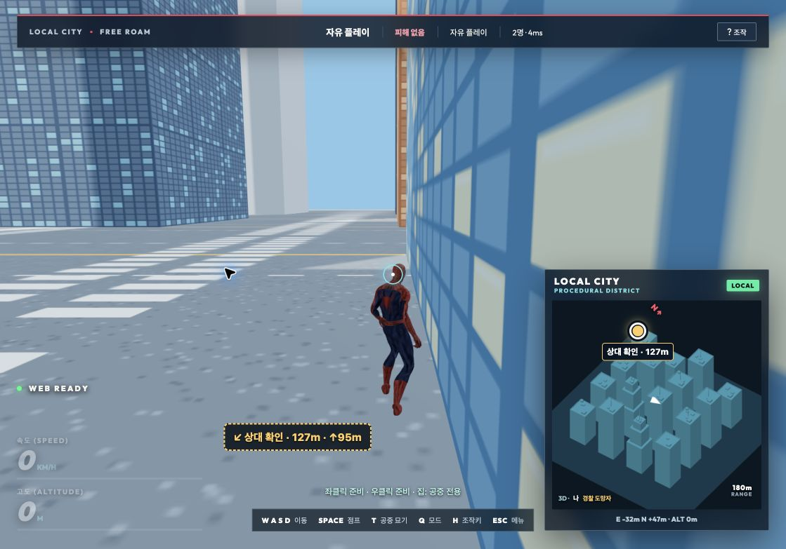

# 로컬 도시 밝기·상대 위치 개선 — 2026-10-14~15

요청한 로컬 도시 밝기와 상대 위치 가독성을 수정했다. 기존 지도 배치·충돌 좌표는 유지했다.

- 건물의 어두운 창문 텍스처를 밝은 낮 색상으로 변경하고, 유리·금속 외벽의 금속성을 낮췄다. 콘크리트·옥상·도로도 밝게 조정했다. 색상 텍스처는 sRGB로 처리한다.
- 로컬 도시에 밝은 하늘/지면 조명과 반대 방향 보조광을 추가했다. 기본 주소와 `?city=procedural` 모두 같은 지도 선택 함수를 사용해 로컬 조명을 적용한다.
- 미니맵 기본 폭을 236px에서 320px로 확대했다. 작은 화면의 지도 폭도 190~240px로 키웠다.
- 상대를 지도 위의 별도 DOM 레이어에 24px 아이콘과 이름·거리로 표시한다. 건물이나 높이 차이 때문에 가려지지 않는다. 2D 대체 지도에서도 표식을 확대했다.
- 경기 중 수신한 유한 좌표를 가진 모든 상대를 표시한다. 준비·탈락·상대 연결 중단·위치 공개 주기 때문에 숨기지 않는다. 상태에 따라 대기 위치·탈락·구조·마지막 위치를 구분한다. 서버에 유지되는 연결 중단 참가자의 좌표도 보존한다.
- 범위 밖 상대는 지도 가장자리에 방향표로 표시한다. 잘못된 아바타 보간 좌표는 유효한 서버 좌표로 대체한다. 이름과 상태는 `textContent`로 작성한다.
- 게임 화면의 상대 이름 표식도 11px에서 15px로 확대하고 테두리를 강화했다. 화면 가장자리 여백과 좁은 지도 라벨 폭도 조정했다.

## 검증

`scripts/check-visibility.mjs`를 추가하고 `npm run test:visibility` 및 전체 검사에 연결했다. 준비 전·탈락·상대 연결 중단·먼 거리·잘못된 보간, 3D/2D 투영과 지도 가장자리, 이름/거리/상태 라벨, 퇴장 정리, 밝은 재질의 sRGB 처리 및 서버와의 모든 충돌 좌표 일치를 검사했다. [새 검사 결과](regressions.log).

전체 `npm test`가 종료 코드 0으로 통과했다. 이후 기본 주소의 조명 선택·좁은 라벨 폭·게임 화면 가장자리 여백을 마지막으로 조정하고 관련 표시/미니맵/입력/메뉴 검사를 다시 통과시켰다. 최종 빌드와 `git diff --check`도 성공했다. [전체 검사](full-tests.log), [표식 검사](locators.log), [최종 빌드](build.log).

Chrome의 독립된 두 탭에서 실제 로컬 자유 플레이 방을 생성→입장→두 명 준비→시작했다. 상대 이름과 거리가 지도와 게임 화면에 표시됐고, 이동에 따라 14m·104m·127m 등으로 갱신됐다. DOM 측정에서 지도 폭은 320px, 아이콘 폭은 24px였다. 최종 화면의 건물·그늘·도로와 상대 표식도 직접 검수했다. [브라우저 기록](browser-evidence.json).

이번 실제 브라우저 검증은 로컬 절차 도시·2인 접속이다. 먼 거리·높이·탈락·연결 중단·좁은 지도 경계는 자동 검사로 확인했다. 유효한 좌표 자체가 없는 참가자의 실제 위치를 만들어 표시하지 않는다. 운영 사이트 배포는 수행하지 않았다.

작업 시작 시점의 [소스 백업](source-before-review.tar.gz), 이번 변경만의 [패치](changes-this-review.patch), 최종 [소스 해시·명령 결과](execution.json)를 보존했다.
