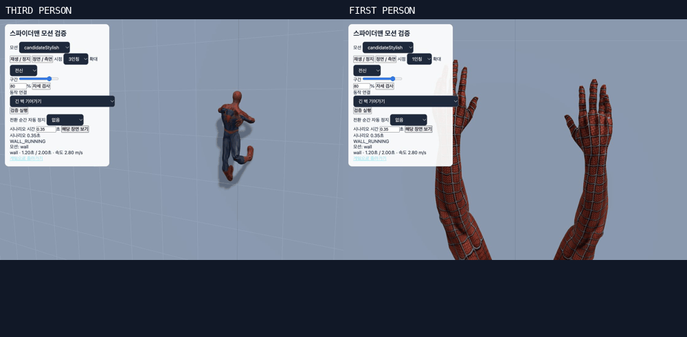

# 1·3인칭 벽 기어가기 및 전체 모션 검증

양 시점에 벽 기어가기와 거미줄 표현을 적용하고, 접촉 미끄러짐·손목 및 발목 꺾임·난간 전환을 수정했다. 최종 `npm test` 50단계와 `npm run build` 모두 성공했다.

## 수정 내용

- 3인칭: 원본 오르기 동작을 유지하면서 손·발이 벽을 짚는 동안 접촉점을 월드 좌표에 고정했다. 뻗기와 당기기 구간을 구분하고 도달할 수 없는 지점은 놓도록 했다.
- 주먹을 펴서 벽을 짚고, 손가락 방향을 팔의 도달 방향에 맞췄다. 손바닥과 밑창을 벽면에 정렬하고, 팔꿈치·무릎 방향도 접촉 위치와 관절 범위에 맞춰 보정했다.
- 일반 상승 속도 2.8m/s, 질주 4.2m/s로 구분했다. 원본 클립이 기본 이동에서 지나치게 빠르게 재생되던 문제를 줄였다.
- 1인칭: 실제 3인칭 손 높이와 벽 동작 주기를 사용한다. 벽을 짚어 당기기·다음 지점 뻗기·난간을 넘고 손을 내리기를 연결하고, 벽을 떠나면 정상 자세로 복귀한다.
- 기존 손·손목 메시와 수트 질감은 보존했다. 손 정점 속성 및 관절 위치 보존 검사도 양손 모두 통과했다.
- 거미줄의 가늘어지는 중심부·섬유·발사 파동·장력·해제 처리는 양 시점에서 같은 렌더러를 사용한다. 검수 화면에서도 카메라 확정 후 손목 시작점을 갱신하도록 맞췄다.
- 관절 제한을 적용할 때 정강이·팔뚝 축 회전과 무릎·팔꿈치 방향을 함께 조정했다. 발목만 강제로 잘라 경사면의 밑창 방향이 튀던 문제를 해결했다. 난간 끝에서 골반 보정이 다시 켜져 몸 전체가 튀던 현상도 수정했다.

## 최종 검증

| 검사 | 결과 |
|---|---|
| 전체 테스트 | 50단계 성공 — [로그](final-merged-tests.log) |
| 프로덕션 빌드 | 성공 — [로그](build.log). 기존 대형 번들 경고는 남아 있음 |
| 벽 접촉·양 시점·거미줄 | 101건, 실패 0 — [결과](results.json) |
| 벽 조합 | 4 FPS × 4 벽 방향 × 일반/질주/대각선 × 2 시점, 18,576프레임 |
| 최대 고정 접촉 오차 | 0.0024mm |
| 고정 손바닥/밑창 법선 내적 최솟값 | 1.000000 / 0.967464 |
| 경사·보행·밑창·거미줄 회귀 | 71건, 실패 0 — [결과](silk-gait-results.json) |
| 관절 범위·벽→난간→옥상 | 26건, 실패 0 — [결과](joint-results.json) |
| 전체 개별 모션 및 전환 | 189검사 그룹, 136타임라인, 17,386프레임 — [결과](all-motion-results.json) |
| 브라우저 화면 | 최종 개별 모션 102장, 행동 연결 76장, 벽 주기 24장, 거미줄 18장 |
| 브라우저 경고·오류 | 없음 — [기록](browser-logs.json) |

[모션 하나하나의 검사 목록과 화면](INVENTORY.md), [실행 기록·소스 해시](execution.json), [손 보존 결과](hand-preservation.json).

## 범위와 기록

검수 도중 기존 Git 통합의 모션 정리가 합쳐져 활성 목록이 39개에서 31개로 바뀌었다. 삭제된 cross·hit·회피 4종·femaleStop·jog는 복원하지 않았으며, 현재 활성 31개와 기본 1개·보관 후보 2개를 모두 다시 검사했다. 앞구르기 외 제거된 묘기의 테스트 참조도 현행 목록에 맞췄다. 이전 42개 검수 기록은 이 폴더의 기존 coverage 및 이전 보고서에 보존되어 있다.

개별 원본 클립은 10/45/80% 화면과 전체 타임라인으로 검사했다. 절차적 벽 접촉과 1인칭 손은 실제 행동 시나리오에서 별도로 검사했다. 1인칭의 기존 일반 이동 손 표현 전체를 새로 제작한 것은 아니다. 검증은 로컬 실제 리그·물리·브라우저 및 기존 원격 동작 테스트 기준이며, 모든 기기와 실운영 다중 접속의 무결함을 보증하는 의미는 아니다. 중간 실패 로그는 수정 원인 추적용이며 최종 판정은 `final-merged-tests.log`와 `execution.json`이다.
