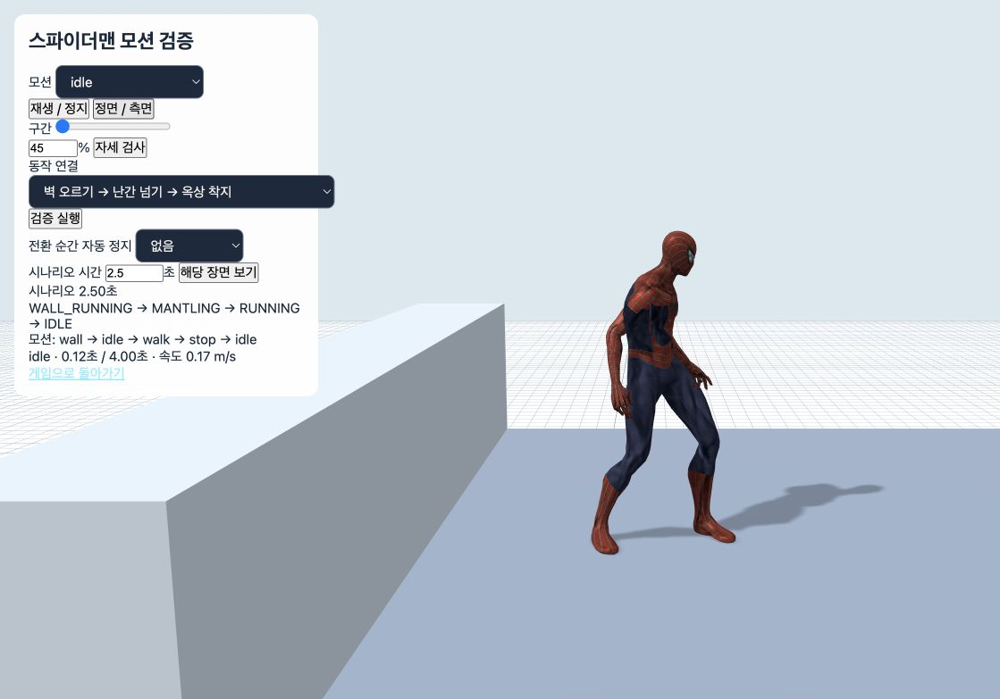

# 벽 끝 추락 및 옥상 진입 모션 검증

2026-10-15 · 로컬 소스 반영 완료

## 원인과 수정

벽 위쪽에서 가슴 높이의 접촉 검사가 먼저 끊기면 발 아래에 벽이 남아 있어도 추락했습니다. 또한 난간의 손잡이 높이를 착지 바닥 높이로 취급해 낮은 옥상으로 넘어가는 경로가 만들어지지 않았습니다.

- 가슴·하단 접촉을 함께 확인하고, 막힌 옥상에서는 벽을 잡은 채 옆으로 이동하도록 수정했습니다. 25초 경과만으로 벽에서 떨어지는 제한을 제거했습니다.
- 난간 위 높이와 실제 착지 바닥을 분리했습니다. 몸을 바깥에서 올리고 난간을 건넌 뒤 내려오며, 더 안쪽의 착지 후보를 순서대로 검사합니다. 캡슐 경로·천장·바닥 지지 검사를 유지합니다.
- 손이 벽에서 난간을 짚는 자세로 서서히 전환됩니다. 양발은 시간차를 두고 올라가며 무릎은 난간 바깥쪽으로 벌립니다. 손을 놓고 일어나는 팔 자세와 착지 직후 첫 걸음의 발 이동을 완화했습니다.
- 모션 검증 화면에 ‘벽 오르기 → 난간 넘기 → 옥상 착지’를 추가했습니다.

기본 조작: F+W 유지로 상승·옥상 진입, 막혔으면 A/D로 옆 이동, Space로 벽 점프 또는 진입 중단.

## 검증 결과

| 검사 | 결과 |
| --- | --- |
| 수정 전 소스에 신규 회귀 검사 적용 | 0/7 통과: 기존 추락·난간 경로 문제 재현 |
| 수정 후 벽·옥상 회귀 검사 | 7/7 통과 |
| 4방향 벽 × 30·60·144FPS | 1.2m 난간을 넘고 바닥에 지지된 착지 |
| 실제 로컬 도시 80개 건물 면 | 79개 안전 진입, 1개 장애물로 진입 불가 시 벽 유지 |
| 실제 Rapier 지형 | 30·60·144FPS 난간 통과·낮은 옥상 착지 통과 |
| 실제 Spider-Man GLB 리그 | 3개 FPS, 722프레임: 발·무릎·골반 난간 관통 및 팔다리 늘어남 없음 |
| 난간 손 고정 오차 | 30FPS 0.8mm / 60FPS 0.5mm / 144FPS 7.3mm |
| 전체 npm test | 종료 코드 0 |
| 기존 전체 모션 검사 | 39개 동작, 117개 FPS 사례, 16,183프레임 통과 |
| 기존 동작 간 전환 검사 | 4,563개 전환, 107,991프레임 통과 |
| 최종 자세 조정 후 재검사 | 벽 회귀·실제 리그·자세 검사 및 프로덕션 빌드 통과 |
| git diff --check | 통과 |

전체 테스트 후 마지막 무릎 자세·캐시 초기화 조정을 했으며, 관련 실제 리그 검사와 빌드를 다시 통과했습니다. 빌드는 성공했지만 기존 대형 번들 경고는 남아 있습니다.

## 브라우저 화면 확인

로컬 Chrome의 실제 캐릭터와 1.2m 난간 검증 장면을 확인했습니다. 2.50초에 `WALL_RUNNING → MANTLING → RUNNING → IDLE`, 3.20초에 옥상 대기 및 속도 0.00m/s를 확인했습니다. 최종 브라우저 경고·오류 로그는 비어 있습니다.

[난간 손 지지](grip.png) · [난간 통과](crossing.png) · [브라우저 기록](browser-evidence.json)

## 근거 파일 및 범위

[수정 전 재현](before.log), [벽 회귀](regressions.log), [실제 리그](rig.log), [리그 수치](rig-results.json), [전체 테스트](full-tests.log), [자세](pose.log), [빌드](build.log).

검사는 실제 로컬 도시 충돌체와 별도 난간 재현 장면을 포함합니다. 모든 지도·기기·온라인 지연 상황에서의 무결점을 보장하는 검사는 아닙니다. 이번 변경은 로컬 소스와 빌드에 반영했으며 운영 배포는 수행하지 않았습니다.

`source-diff.patch`는 작업 시작 시 보관한 소스와 현재 소스의 차이입니다. 같은 작업 공간의 다른 진행 중인 변경도 포함할 수 있어 이번 벽 수정만의 독립 패치로 취급하지 않습니다.
