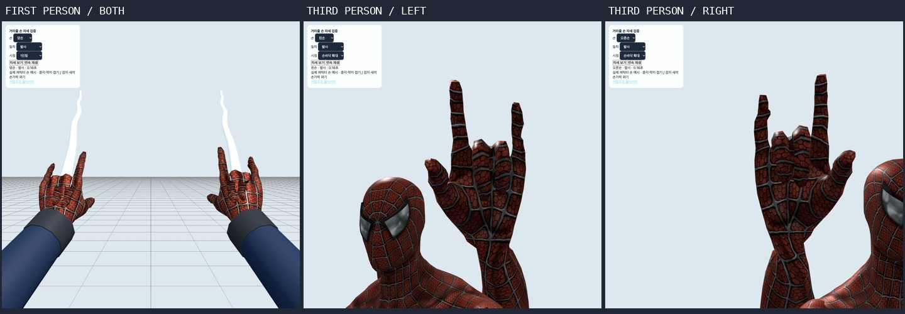

# 거미줄 전용 손 자세 구현·검증 — 2026-10-15

거미줄을 쏠 때 **중지·약지를 손바닥 쪽으로 접고 검지·새끼손가락을 펴며 엄지를 벌리는 자세**를 1인칭과 3인칭 모두 구현했습니다. 손목도 발사선 위로 젖혀 손가락과 줄의 방향을 구분했습니다. 확인한 검증 범위에서 실패는 없습니다.



## 구현

- 실제 캐릭터의 손가락 관절에 발사 자세를 덧씌웁니다. 발사 후 줄을 유지하면 다섯 손가락으로 잡는 자세로 연결하고, 해제·빗나감 만료 후 원래 애니메이션으로 복귀합니다.
- 좌우 손을 독립적으로 처리합니다. 양손 동시 발사, 한 손만 해제, 반대 손이 연결된 동안의 빗나간 발사를 지원합니다.
- 1인칭의 둥근 장갑을 제거하고 기존 수트의 **실제 손 메시·텍스처·다섯 손가락 리그**를 재사용합니다. 원본 자산 파일은 변경하지 않았습니다. 메시를 못 불러오는 경우에도 관절이 있는 대체 손을 제공합니다.
- 1인칭 팔 위치를 조정해 발사 자세가 미니맵과 덜 겹치도록 했습니다. 손을 그리기 직전에 깊이 버퍼를 프레임당 한 번 정리해 가까운 벽에 가려지지 않게 하면서, 접힌 손가락끼리의 깊이 판정은 유지합니다.
- 펀치·방어·피격과 벽·난간 동작에서는 거미줄 손가락 보정이 해당 애니메이션을 덮어쓰지 않습니다. 손 모델 교체·시점 전환 때 원본 수트 리소스를 보호합니다.
- 원격 자세에 발사 손·목표·남은 시간·빗나감 여부를 선택 필드로 전달하며, 양손의 발사 타이머를 함께 보냅니다. 오래된 자세는 만료하며, 새 원격 캐릭터가 로컬 캐릭터의 발사 손을 물려받지 않도록 초기화합니다.

주요 파일: `src/WebHandPose.js`, `src/FirstPersonArms.js`, `src/Character.js`, `src/RemoteMotion.js`. 검토 도구는 `?webHandReview`에서 열 수 있습니다. 손바닥·손등 확대 화면은 손가락을 가리지 않도록 줄만 숨기며, 1인칭·전신·실제 게임 화면은 줄까지 렌더링합니다.

## 자동 검증

| 범위 | 최종 결과 |
|---|---|
| 전용 손 자세 검사 | **41 PASS / 0 FAIL** |
| 프레임률 | 24 / 30 / 60 / 144fps |
| 실제 관절의 펴짐 비율 | 검지·새끼손가락 최소 0.9998; 중지·약지 최대 0.5555 |
| 전체 모션 재검사 | **249 PASS / 0 FAIL**, 42클립의 18,943프레임 |
| 전환 연속성 | **7,056건 PASS** |
| 원본 모션 | 32파일, 유효 take 44개, 5,476프레임 PASS. 빈 take 7개 별도 기록 |
| 전체 프로젝트 | `npm test` **47단계 종료 코드 0** |
| 프로덕션 빌드 | `npm run build` **종료 코드 0** |
| 브라우저 | 검토 화면 47장 + 실제 게임 좌·우클릭, 콘솔 경고·오류 0 |

펴짐 비율은 손가락 시작·끝 관절의 직선 거리를 관절 길이 합으로 나눈 값입니다. 1에 가까우면 펴진 손가락이고, 낮아지면 접힌 손가락입니다. 숫자 검사와 실제 메시의 시각 검사를 함께 수행했습니다.

같은 41개 검사를 수정 전 `Character.js`·`RemoteMotion.js`에 실행하면 **36개 실패 / 5개 통과**했습니다. [수정 전 결과](before-feature-results.json), [수정 후 결과](results.json). [재현 스크립트](reproduce-before.py)는 임시 복사본만 사용합니다. [수정 전 백업](source-before-review.tar.gz), [이번 변경 패치](changes-from-start.patch).

원본 FBX/GLB와 컴파일된 39개 모션·보관 후보·manifest는 이번 작업에서 변경하지 않았습니다. 앞선 검증 기록에 저장된 컴파일 파일 해시와 모두 일치합니다.

## 검사별 결과

| 검사 | 결과 |
|---|---|
| 24fps left: anatomical third-person shooting, held grip and clean release | PASS |
| 24fps left: actual first-person suit hand has the same five-digit gesture | PASS |
| 24fps left: a missed shot articulates, expires and never attaches | PASS |
| 24fps right: anatomical third-person shooting, held grip and clean release | PASS |
| 24fps right: actual first-person suit hand has the same five-digit gesture | PASS |
| 24fps right: a missed shot articulates, expires and never attaches | PASS |
| 30fps left: anatomical third-person shooting, held grip and clean release | PASS |
| 30fps left: actual first-person suit hand has the same five-digit gesture | PASS |
| 30fps left: a missed shot articulates, expires and never attaches | PASS |
| 30fps right: anatomical third-person shooting, held grip and clean release | PASS |
| 30fps right: actual first-person suit hand has the same five-digit gesture | PASS |
| 30fps right: a missed shot articulates, expires and never attaches | PASS |
| 60fps left: anatomical third-person shooting, held grip and clean release | PASS |
| 60fps left: actual first-person suit hand has the same five-digit gesture | PASS |
| 60fps left: a missed shot articulates, expires and never attaches | PASS |
| 60fps right: anatomical third-person shooting, held grip and clean release | PASS |
| 60fps right: actual first-person suit hand has the same five-digit gesture | PASS |
| 60fps right: a missed shot articulates, expires and never attaches | PASS |
| 144fps left: anatomical third-person shooting, held grip and clean release | PASS |
| 144fps left: actual first-person suit hand has the same five-digit gesture | PASS |
| 144fps left: a missed shot articulates, expires and never attaches | PASS |
| 144fps right: anatomical third-person shooting, held grip and clean release | PASS |
| 144fps right: actual first-person suit hand has the same five-digit gesture | PASS |
| 144fps right: a missed shot articulates, expires and never attaches | PASS |
| 24fps: both hands can shoot and release independently | PASS |
| 24fps: web fingers cannot overwrite combat or wall contact fingers | PASS |
| 24fps: remote hit/miss/dual hand gestures and stale cleanup use independent skin | PASS |
| 30fps: both hands can shoot and release independently | PASS |
| 30fps: web fingers cannot overwrite combat or wall contact fingers | PASS |
| 30fps: remote hit/miss/dual hand gestures and stale cleanup use independent skin | PASS |
| 60fps: both hands can shoot and release independently | PASS |
| 60fps: web fingers cannot overwrite combat or wall contact fingers | PASS |
| 60fps: remote hit/miss/dual hand gestures and stale cleanup use independent skin | PASS |
| 144fps: both hands can shoot and release independently | PASS |
| 144fps: web fingers cannot overwrite combat or wall contact fingers | PASS |
| 144fps: remote hit/miss/dual hand gestures and stale cleanup use independent skin | PASS |
| Remote shot capture validates handedness, expiry, target and payload size | PASS |
| First-person creation/replacement/disposal preserves shared suit resources | PASS |
| A new remote character never inherits the local firing fingers | PASS |
| Close walls cannot hide the hands, while folded fingers retain depth ordering | PASS |
| Missing downloaded skin keeps an articulated fallback that can shoot | PASS |

## 실제 화면·로그

- [1인칭 좌우·양손의 모든 상태](gallery/first-sheet.jpg)
- [3인칭 전신의 모든 상태](gallery/third-sheet.jpg)
- [손바닥 확대의 모든 상태](gallery/palm-sheet.jpg)
- [실제 게임: 좌클릭 연결·해제 직후](game-left-shot.png), [실제 게임: 우클릭 빗나간 발사](game-right-shot.png)
- [브라우저 화면별 상태 47개](browser-coverage.json), [콘솔](browser-logs.json)
- [전체 테스트 로그](full-tests.log), [빌드 로그](build.log), [전용 검사](results.json)
- [전체 모션 결과](all-motion-results.json), [타임라인](all-motion-coverage.json), [원본 결과](source-coverage.json), [실행·해시 기록](execution.json)

```sh
npm run test:web-hand-pose
npm run test:all-motions
npm test
npm run build
```

화면 기록은 실제 브라우저에서 저장했고, `generate-gallery.py`로 원본을 유지한 채 모음 이미지만 구성했습니다. 원격 동작은 실제 복제 리그의 로컬 재현 검사입니다. 이번 작업에서 새 운영 2인 접속이나 운영 배포는 수행하지 않았습니다. 빌드에는 기존 대형 청크 안내가 남아 있습니다.
