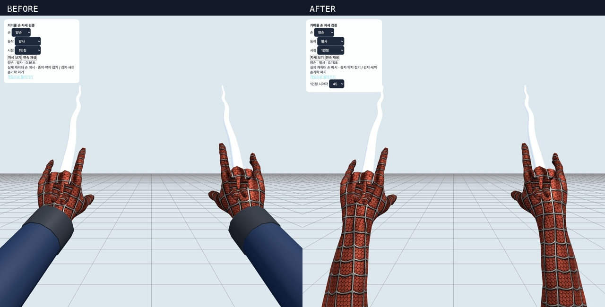

# 1인칭 손목·소매 디테일 수정 — 2026-10-15

손의 모양과 발사 포즈를 보존하면서, 손목의 두꺼운 회색 띠와 단순한 파란 원통 소매를 실제 수트 메시로 교체했습니다. 손등에서 손목·전완으로 같은 거미줄 무늬와 재질이 이어집니다.

## 수정 범위

- `src/FirstPersonArms.js`: 원본 수트의 손·전완·상완을 연속된 스킨 메시로 추출합니다. 원본 에셋 파일은 변경하지 않습니다.
- 넓은 시야각에서 펀치를 뻗을 때 드러나던 상완 절단면은 1인칭 전용 소매 상부를 연장해 화면 아래로 이어지게 했습니다. 바인드 좌표와 스킨 좌표 변환을 적용하고 늘어난 부분의 노멀도 보정합니다.
- 에셋이 없을 때의 대체 모델은 가늘게 테이퍼진 빨간 소매를 사용합니다.
- `src/WebHandReview.js`: 검수 화면에 45/55/64/95도 시야각 선택을 추가했습니다.
- `scripts/check-web-hand-pose.mjs`: 손 크기 검사는 확장된 팔 전체 대신 기존 손 본에 속한 정점을 대상으로 유지합니다.

## 손 보존 검증

수정 전 소스 백업과 현재 코드를 같은 원본 리그로 생성해 비교했습니다. 왼손 679개·오른손 702개 기존 손 정점의 위치, 노멀, UV, 스킨 인덱스, 스킨 가중치가 모두 동일합니다. 기존 손 삼각형이 모두 유지되고, 손 본의 최대 위치 차이는 0입니다. 손목·손가락 포즈 계산은 변경하지 않았습니다.

- [비교 결과](hand-preservation.json)
- [재현 스크립트](verify-preservation.mjs): 프로젝트 루트에서 `node docs/qa/wrist-detail-2026-10-15/verify-preservation.mjs`
- [수정 전 소스 백업](source-before-review.tar.gz)

## 검증 결과

- `npm test`: 전체 47단계 종료 코드 0. [로그](full-tests.log)
- 손 포즈·양손 발사·원격 포즈·자원 정리 검사: 24/30/60/144fps에서 41건 통과, 실패 0. [결과](hand-results.json)
- `npm run build`: 성공. 기존 대형 번들 경고는 남아 있습니다. [로그](build.log)
- Chrome에서 30개 화면을 직접 렌더링해 확인했습니다. 45도에서는 왼손·오른손·양손의 발사/실패/유지/해제/펀치, 55/64/95도에서는 양손의 같은 다섯 상태를 확인했습니다. [촬영 목록](browser-coverage.json)
- [기본 자세별 검수](contact-1.jpg), [시야각별 검수](contact-2.jpg)
- 실제 로컬 게임에서 1인칭을 확인하고, 검사 중 변경한 시야각은 기존 64도로 복구했습니다. [게임 화면](game-default.png), [설정 복구 기록](settings-restored.txt)
- 최종 브라우저 경고·오류 0건. [로그](browser-logs.json)

검수 화면은 실제 Character와 손 리그를 사용한 자세 재현입니다. 30개 화면은 모든 플레이 상황을 보증하는 전수 검사가 아니라 위 상태·시야각 조합의 시각 검수입니다.

[실행 기록과 소스 해시](execution.json)
